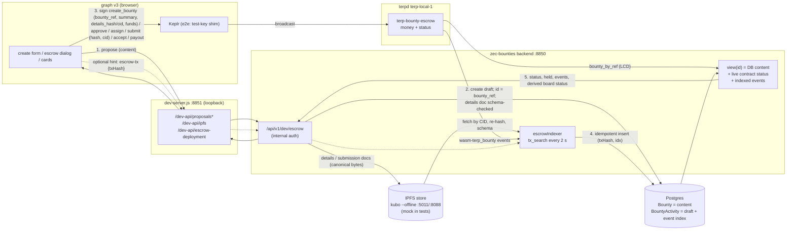

# terp-bounty-escrow: design notes

> DEV/TEST ONLY, not audited, not deployed. Ported from the standalone bounty-board dev workspace, where the
> TS client, backend indexer and UI live. Paths such as `client/`, `params/`, `graph/` and `localnet/` refer to
> that workspace, not to terp-rs. The off-chain JSON schemas are copied here under `offchain-schemas/`.

Prepared 2026-10-18 (Africa/Dakar, UTC+0) by the Bounties Coordinator bot. Nothing has been deployed, signed, pushed or posted. It has run only in cw-multi-test and `cosmwasm-check`. It is **not audited**. Every amount is in micro units (uterp/uthiol, 6 decimals, assumed) and is **proposed, pending vote**.

## 1. Messages (`src/msg.rs`, schema in `schema/`)
- **instantiate** `{owner, approver, gate{use_allowlist, min_stake?, cw4_group?}, denoms[{denom,min_amount,max_amount}], allow_partial_payouts, fee_bps, fee_collector?, min_duration_secs, max_duration_secs, params_version, params_placeholder, min_submit_stake, min_upload_stake, initial_allowlist[]}`. The `dev-chain-guard` feature (on by default) **refuses chain id `morocco-1`**.
- **execute**: `create_bounty{bounty_ref,title,summary,details_hash,details_cid?,reward,expires_at}` (payable; §5c), `approve`, `reject{reason?}`, `cancel`, `assign{assignee}`, `unassign`, `submit{submission_hash,cid}` (§5c, §5d), `request_changes{reason?}`, `accept`, `payout{amount?}`, `settle_remainder`, `expire`, `update_config{..}`, `update_allowlist{add,remove}`. Every message except create is non-payable.
- **query** (DAO DAO module queries in §9): `config`, `bounty{id}`, `bounty_by_ref{bounty_ref}`, `bounties{status?,proposer?,start_after?,limit?}` (indexed by status and by proposer), `submissions{id}`, `is_eligible{address}` → `{eligible, via, staked}`, `can_submit{address}` → `{eligible, staked, min_submit_stake, bond_denom}` (§5d), `can_upload{address}` → `{eligible, staked, min_upload_stake, bond_denom}` (§5e), `allowlist`.

## 2. Proposer whitelist (Terp stakers)
A sender may `create_bounty` if **any** enabled gate passes:
1. **min_stake**: the sum of `StakingQuery::AllDelegations(sender)` in the chain's `BondedDenom` must be ≥ `min_stake`. Zero is rejected.
2. **allowlist**: an admin-managed map, editable by `owner` only.
3. **cw4_group**: membership with weight > 0.

**Recommendation: min_stake as the primary gate, plus an owner-managed allowlist as an override.** min_stake matches "Terp stakers" with no curation, and anyone can check it with `is_eligible`. The allowlist covers the treasury, multisigs and partner DAOs, which don't stake. cw4 is the right swap if the DAO wants membership instead of stake. It aligns with the steward T1 rule ("cw4 parent weight > 0", platform-plan D3).
Known limits: stake is checked only at creation, so someone could delegate, create, then undelegate. The proposer's own deposit is still at risk, and listing still needs the approver. Unbonding stake doesn't count. Gas grows with the number of delegations. The gate only controls who may **fund and propose**. Nothing is listed without the approver.

## 3. Deposit rule
`create_bounty` checks the whitelist, the inputs, `denom ∈ denoms` and `min ≤ amount ≤ max`, and that `expires_at ∈ [now+min_duration, now+max_duration]`. Then it checks `info.funds == [reward]` **exactly**: one coin, same denom and amount, and no extra coins. Anything else fails with `FundsMismatch` and the whole tx reverts. Only after that is the bounty stored, as **Pending**. `bounty_ref` (the off-chain DB id) must be unique.

## 4. State machine
```
            approve (approver)          assign (proposer|approver)        submit (assignee, before expiry)
 Pending ───────────────────▶ Open ─────────────────────────▶ Assigned ──────────────────────────────▶ Submitted
   │ reject (approver)          │ ▲  unassign                    │ ▲       request_changes (proposer|approver) │
   ▼                            │ └──────────────────────────────┘ └────────────────────────────────────────────┤
 Refunded                       │                                                                              │ accept (approver)
 Cancelled ◀── cancel: proposer in Pending/Open; approver in Pending/Open/Assigned                              ▼
 Expired   ◀── expire: ANYONE once now ≥ expires_at, from Pending/Open/Assigned                 Accepted ──payout (approver)──▶ Paid
                                                                                                    │ partial payout (if enabled) stays Accepted
                                                                                                    └─ settle_remainder (approver): rest → proposer, ▶ Paid
```
- Refunds always go to the **proposer**, for whatever is still escrowed. Terminal states are Paid, Cancelled, Refunded and Expired.
- **Payout is never automatic.** `accept` and `payout` are separate approver-only calls, mirroring ZecHub's "Done ≠ Paid". In dev the approver is a human test key. In prod it is a cw3 multisig or a DAO-DAO core address, so a payout requires a passed proposal that executes `payout`. Model or pipeline verdicts never call the contract.
- **Timeouts:** after `expires_at` there are no approvals, assignments or submissions, and anyone may `expire` a Pending, Open or Assigned bounty for a refund. **Submitted and Accepted cannot be expired.** A hunter who delivered on time can't be rugged, and only the approver can resolve the bounty (request_changes, then cancel, or accept, then payout).
- **Partial payouts** (`allow_partial_payouts`, default off): `payout{amount}` ≤ remaining. The bounty becomes Paid when nothing remains, or the approver calls `settle_remainder` to refund the rest. Recipient is always the assignee.
- **Fee:** `fee_bps` (hard cap 1000) is deducted from each payout and sent to `fee_collector`. Default 0.
- **Submissions:** `Submission{seq, submitter, hash (sha256 hex), cid (IPFS CID, validated on chain, §5c), submitted_at, height}`, one record per (re)submit. The submitter must pass the submission stake gate (§5d).

## 5. Events and off-chain sync
Each state change emits one custom event **`wasm-terp_bounty`** with `action, bounty_id, bounty_ref, status, prev_status, actor` plus:
| action | extra attributes |
|---|---|
| create | proposer, denom, amount, expires_at, eligible_via, cap, params_version, params_placeholder, summary, details_hash, details_cid |
| approve / accept / unassign / request_changes | (accept: submission_seq; unassign: previous_assignee; request_changes: reason) |
| assign | assignee |
| submit | submission_seq, submission_hash, submission_cid |
| payout | recipient, denom, gross, fee, net, paid_total, remaining, partial |
| reject / cancel / expire / settle_remainder | refund_to, refund_amount (reject: reason) |
| instantiate / update_config / update_allowlist | owner, approver, params_version, params_placeholder, min_submit_stake, min_upload_stake / added, removed |

**Mapping onto the forked zec-bounties flow** (`flow.md`, `platform-plan.md` D4/D10):
| Chain | zec-bounties DB status | Who triggers |
|---|---|---|
| Pending | To Do, approval pending (`isApproved=false`) | proposer signs `create_bounty` after `POST /api/bounties` creates the draft. `bounty_ref` = DB `Bounty.id` |
| Open | To Do, approved | approver: decision-queue `bounty_publish` → `approve` |
| Assigned | In Progress | the board accepts an application (off-chain), then the proposer or approver signs `assign` |
| Submitted | In Review | hunter uploads a `terp-bounty-submission/v1` document (`POST /ipfs`: schema-checked, stored, returns `{cid, sha256}`), then signs `submit{submission_hash, cid}`. The indexer re-fetches the CID and validates it (§5c) |
| Accepted | Done | decision-queue `submission_review` → approver `accept` |
| Paid | Paid (txid = escrow payout tx) | decision-queue `payout_authorize` → approver/DAO proposal `payout` |
| Cancelled / Refunded / Expired | Cancelled (+ reason) | as in §4 |

- **Source of truth.** The **chain** owns money and status for escrow-backed bounties: amount, denom, status, assignee, submission hash and payouts. The **DB** owns content: description, acceptance criteria, comments, applications, submission body, privacy flags. It stores `escrowContract`, `escrowBountyId`, `escrowHeight` and `escrowTx`. For an escrow-backed bounty, the backend refuses DB-only status writes that conflict with the chain. `/api/transactions/authorize-payment` stops sending funds for Terp tenants and only creates a `payout_authorize` decision-queue item.
- **Indexer.** A backend worker follows `wasm-terp_bounty` events: tm websocket `tm.event='Tx' AND wasm-terp_bounty._contract_address=<addr>`, with `tx_search` backfill from the last height. It upserts the DB mirror idempotently on `(txhash, event index)`, then emits the existing HMAC webhooks (`bounty.status_changed`, `submission.created`, `payment.authorized`) to the steward BFF. It reconciles via the `bounty`/`bounties` queries on startup. Chain wins on mismatch, and the mismatch is logged.
- **Decision-queue items** (`decision-queue-item.schema.json`). `payload` = the exact `MsgExecuteContract` JSON (`client/src/msgs.ts` `toExecuteEncodeObject` / `toDaoWasmExecute`), and `payload_hash` = JCS sha256 of it, so the human approves the exact bytes. Kinds: `bounty_publish` → approve, `submission_review` → accept/request_changes, `payout_authorize` → payout/settle_remainder. Required scope is T2 `bounty:approve` / `bounty:authorize`. The user is the sole approver for now.

## 5a. One source of truth: contract + backend index (implemented on terp-local-1)
The contract and the backend are **one system with a split of ownership**, not two copies that are kept in sync:

| Owned by | Data | Written by |
|---|---|---|
| **DB** (`Bounty` row + `escrow.draft` activity) | content: title, summary, description, acceptance criteria, evidence required, capability tags, quote, proposer, and the full `terp-bounty-details/v1` document with its `details_hash` / `details_cid` | `POST /api/v1/dev/escrow/proposals`, **before** anything is signed |
| **IPFS store** (local offline kubo node; mock in tests) | the exact canonical bytes of every details and submission document, addressed by CID | `POST /ipfs` (schema-checked) and the draft route |
| **Contract** | money and **status**: deposit, reward, paid/refunded/held, status, assignee, submissions (hash + CID), params_version; plus the **commitments** to content: title, summary (≤ 280 bytes), details_hash, details_cid | signed `MsgExecuteContract`s only |
| **DB index** (`BountyActivity` `escrow.<action>`, `meta.source="indexer"`) | a copy of every `wasm-terp_bounty` event of the configured contract: txHash, height, action, status, prev_status, all attributes; for `create` `contentMatch` (on-chain details_hash = the draft's document); for `submit` the fetched document's `validation` | `services/escrowIndexer.js`, from the chain and the IPFS store only |

- **Link.** `bounty_ref` (contract) = `Bounty.id` (DB). The draft is created first, so the id exists before `create_bounty` is signed. The contract's `bounty_id` is recorded on every indexed event and in the view.
- **Status is derived, never stored.** `GET /proposals/:id` returns `status` = the contract's status, read live with the `bounty_by_ref` smart query (LCD), plus the indexed events, `indexedStatus` and `indexLag` (true while the index has not caught up). The zec-bounties vocabulary (`TO_DO`/`IN_PROGRESS`/`IN_REVIEW`/`DONE`/`CANCELLED`, `isApproved`, `isPaid`) is **computed on read** (`board`) with the §5 mapping. For escrow-backed rows the backend never writes `Bounty.status`, `isApproved`, `isPaid`, `paymentAuthorized`, `completedAt` or `paidAt`; a test enforces this (`bounty.update` throws in the fake DB).
- **Indexer.** `tx_search "wasm-terp_bounty._contract_address='<contract>' AND tx.height>=<last>"`, oldest first, every 2 s (`ESCROW_INDEX_INTERVAL_MS`), idempotent on `(txHash, event index)`. Failed txs are skipped. Events whose `bounty_ref` is not a DB id are kept as **orphans** (`GET /indexer`) and not written. It refuses any chain id but `terp-local-1`. On restart it re-scans from height 0; that is fine on a dev chain, but production needs a persisted cursor (see gaps).
- **`POST /proposals/:id/escrow-tx {txHash}`** is only an **"index now" hint**. The backend reads the tx from the node; it must have succeeded and carry an event of *this* contract for *this* `bounty_ref`. Then the indexer syncs. Nothing the client sends is stored. Transactions signed elsewhere (CLI, TS client, a DAO proposal) are indexed without any hint; the TS e2e checks this on the `approve` step.
- **The UI reads status from the backend.** v3 cards and the escrow dialog take status, held amount, assignee and the event list from `GET /dev-api/proposals?ids=…` / `/proposals/:id` (dev-server.js → backend, internal auth). The browser only signs.



## 5c. On-chain summary, off-chain details, IPFS CIDs and JSON schemas (v3.2)
**What goes on chain.** `create_bounty` carries `title` (≤ 140 chars), **`summary` (≤ 280 bytes of UTF-8)**, **`details_hash`** (required, sha256 hex of the canonical `terp-bounty-details/v1` document) and **`details_cid`** (optional IPFS CID of the same bytes). The full text never goes on chain: description, acceptance criteria, evidence required, tags and the reward quote are all in that document.

**Why 280 bytes** (`SUMMARY_MAX_BYTES` in `src/contract.rs`, a code constant rather than a governance param, because it bounds storage and gas):
- The `Bounty` record is loaded and re-saved on **every** state change (approve, assign, submit, accept, payout…) and returned by every `bounties` page. Its size is paid again and again, not once. At SDK gas rates (~30 gas/byte written, ~10/byte of tx, ~3/byte read), 280 bytes cost about 11k gas on create and about 1k on each later read+write.
- **Measured on terp-local-1** (simulate, `e2e/ts-client-e2e.results.json`): create_bounty used 175,403 gas with a 1-byte summary and 187,418 with 280 bytes, so **+12,015 gas (43 gas/byte)**, about 7% of the create. A `bounties{limit: 100}` page grows by at most 28 KB.
- Bytes, not characters. Storage and gas count bytes, and a character limit would let 4-byte emoji or CJK text cost 4× (141 × "é" is 141 chars but 282 bytes, and is refused). 280 is tweet-sized: enough for a listing line, too small to hold a spec, which pushes the spec into the hashed document.
- Also refused: empty or blank summaries and control characters (no newlines, so explorers and event attributes render cleanly). The same rule is in the contract, the TS client (`summaryProblem`), the schemas lib (`utf8Bytes`), the backend and the UI (a live "N / 280 bytes" counter). The contract is the only one that counts; the others fail early.

**CIDs, validated on chain** (`src/cid.rs`, ported 1:1 to `client/src/cid.ts` and `schemas/lib.mjs`, sharing the test vectors). `CID_MAX_LEN = 128`.
- **CIDv0**: `Qm…`, exactly 46 base58btc chars, decoding to a 34-byte sha2-256 multihash (`0x12 0x20` + 32 bytes).
- **CIDv1**: multibase `b` + lowercase base32 (`a–z2–7`, canonical padding bits) → varint version 1, codec ∈ {raw 0x55, dag-pb 0x70, dag-cbor 0x71, dag-json 0x0129, json 0x0200}, multihash ∈ {sha2-256 0x12, blake3 0x1e}, digest length 32, no trailing bytes.
- Refused: uppercase/base32upper, `z…` base58 v1, `ipfs://…` or URLs, wrong length, bad checksum bytes, unknown codecs. Only canonical encodings are accepted, so one document has one on-chain spelling.
- The contract cannot fetch IPFS, so it checks **form** only. Content is checked off chain (below).

**Content addressing.** `bytes = canonicalJson(doc)` (UTF-8, keys sorted, no whitespace); `hash = sha256(bytes)`; the CID we produce is **CIDv1 raw sha2-256** (`bafkrei…`) of those bytes. That is exactly what `ipfs add --cid-version 1 --raw-leaves` returns for a single-block (< 256 KiB) file. This was verified against the local kubo 0.32.1 node: empty file → `bafkreihdwdcefgh4dqkjv67uzcmw7ojee6xedzdetojuzjevtenxquvyku`, and the example submission gives the same CID from kubo and from `rawCidV1`. So **the CID's digest is the hash**, and anyone can check a document against the chain without an IPFS node.

**Schemas** (`escrow/schemas/`, JSON Schema 2020-12, `additionalProperties: false`, a `schema` const for versioning; a breaking change means a `/v2` file):
- `terp-bounty-details.v1.schema.json`: bounty_ref, title, summary, description, category (the 9 v3 categories), capabilities, tier, priority, acceptance_criteria[1..50], evidence_required[1..20], deadline, reward_quote{asset, denom, amount, work_units, params_version, label = "proposed, pending vote"}, proposer, links, created_at.
- `terp-bounty-submission.v1.schema.json`: bounty_ref, escrow{chain_id, contract, bounty_id}, submitter, payout_wallet, summary, notes, evidence[1..20]{kind, uri (https/ipfs), sha256?, cid?}, acceptance[{criterion, met, evidence indexes}], details_hash, submitted_at.
- `tools/build.mjs` compiles them with ajv into **standalone** validator code (no `eval`, CSP-safe) and bundles `lib.mjs` into `dist/terp-schemas.{mjs,cjs}`. The **same bundle** is vendored into the UI (`graph/app/v3/vendor/terp-schemas.js`, hash-pinned in `ESCROW-VENDOR.json`) and the backend (`services/vendor/terp-schemas.cjs`). `examples/` hold valid documents; `tools/test.mjs` has 8 tests, including a cross-check against `multiformats`.

**Validation pipeline** (the same checks run at four points):
| Where | When | Checks | On failure |
|---|---|---|---|
| UI (create form, submit dialogs) | as you type | summary bytes, schema, shows the template + `details_hash`/`details_cid` or `submission_hash`/CID | button disabled, reason shown |
| Backend `POST /proposals` | draft | builds the details doc field by field (no template defaults), schema-checks it **before** writing anything, stores the bytes, returns hash + CID; the UI re-hashes the returned doc | 400 `DETAILS_INVALID`, no row written |
| Backend `POST /ipfs` | before signing submit | schema, `bounty_ref` is a known DB id, stores the canonical bytes, returns `{cid, sha256}`; the UI refuses to sign if they differ from its own | 400 `SCHEMA_INVALID` / 404 |
| Contract | create / submit | summary limit, details_hash form, CID form, stake gate | tx fails |
| Indexer | on each `submit` event | fetches by CID (store → kubo → `ESCROW_IPFS_GATEWAY`), ≤ 256 KiB; `sha256(bytes) == submission_hash`; raw-CID digest == sha256; schema; `bounty_ref`, `escrow.contract`, `escrow.bounty_id`, `chain_id` and `submitter == tx signer` match the event | `meta.validation {ok:false, errors}` shown to the reviewer (the chain cannot be told; the approver decides) |
On `create`, the indexer also records `contentMatch` (on-chain `details_hash` == the draft's document hash).

**IPFS in dev.** `localnet/ipfs-start.sh` runs a **local kubo 0.32.1 node with `--offline`, no swarm addresses, no bootstrap peers, routing `none`**, API and gateway bound to loopback only, so nothing is announced or leaves the box. The backend uses it when `ESCROW_IPFS_API` is set. Otherwise, as in the unit tests, it uses an **in-memory/disk mock** that computes the same CIDs. The gateway is configurable (`ESCROW_IPFS_GATEWAY`). In production, pinning (a pinning service, or the DAO's own node) is a decision to make (gap table, "content").

## 5d. Submission stake gate (`min_submit_stake`)
- **Governance param**, required at instantiate (`Uint256` in this port, `0` = off; no implicit default), changed with `update_config{min_submit_stake}` plus a **new** `params_version`, and emitted on instantiate and update_config. PLACEHOLDER value **100 TERP** (`100000000` uterp): a tenth of the proposer gate. It adds sybil/spam friction for hunters, but it is not collateral: nothing is locked or slashed.
- **Checked on chain in `submit`** with the same staking query as the proposer gate (`AllDelegations(sender)` summed in the chain's bond denom, `bonded()` in `src/contract.rs`). Below the threshold the tx fails with `BelowSubmitStake`: "submitter terp1… has 0uterp bonded, below min_submit_stake 100000000uterp".
- **Query** `can_submit{address}` → `{eligible, staked, min_submit_stake, bond_denom}`. The UI shows the threshold and the user's stake from this query, and **blocks** the submit button with the reason when below. On terp-local-1 `deploy.mjs` bonds exactly 100 TERP for the test hunter and nothing for the guest, so the e2e shows both outcomes (`graph/screenshots/v3.2/`).
- Same caveats as the proposer gate: stake is checked at submit time only (delegate → submit → undelegate works), and only bonded stake counts. Gate it at assign time too if the DAO wants it to cover the work period.

## 5e. CID storage service and the upload stake gate (`min_upload_stake`, v3.3)
- **Governance param** `min_upload_stake` (`Uint256` in this port, required at instantiate, `0` = off), changed only with `update_config` plus a **new** `params_version`, emitted on instantiate and update_config. PLACEHOLDER value **10 TERP** (`10000000` uterp), a tenth of `min_submit_stake`, so anyone who may submit may also upload. The contract does not use it in any execute path; it answers `can_upload{address}` (bonded stake via the staking module, same as `can_submit`), and the off-chain **CID storage service** enforces it. That keeps storage-spam policy changeable by governance without a contract call per upload.
- **Service** (`zec-bounties-backend/services/cidStorage.js`, route `/api/v1/dev/cid-storage`, DEV ONLY): `POST /upload` takes `Content-Type: application/json` only (415 otherwise), `{kind: details|submission, doc: <JSON text>, auth: {message, signature}}`. Checks in order: canonical size ≤ 256 KiB (413), JSON object (400), schema with explicit versions (422, per-field `fields[]`), ADR-36 strict signature over a `terp-cid-storage/v1/upload` message (`schemas/lib.mjs uploadAuthMessage`, bound to chain id, escrow contract, signer, kind, sha256, cid, size, single-use nonce, expiry ≤ 10 min; 401), document ownership (`details.proposer` / `submission.submitter` = signer; 403), curation hook (allowlist / denylist / denied CIDs, env or a file re-read on change; 403), per-address rate limit (10/min default, counted only after the signature verifies; 429 + Retry-After), then `can_upload` (403 `BELOW_UPLOAD_STAKE`).
- **Storage is the user's minio-ipfs** (`terp-core/crates/minio-ipfs`): the service PUTs the canonical bytes with the MinIO SDK into a DEV bucket (`bounties-dev`, key `details|submissions/<cid>.json`, `Content-Type: application/json`); minio-ipfs' bucket notification makes its webhook collector add + pin the object in its Kubo node (`/api/v0/add?pin=true&cid-version=1&raw-leaves=true`, default chunker size-262144, sha2-256). The service then reads the pinned CID from the collector (`GET /pins`) and requires it to equal the CID it computed and the uploader signed, which is the `details_cid` / submission `cid` on chain. For one-block documents (≤ 256 KiB, enforced) that is `rawCidV1(bytes)` = `bafkrei…`, whose digest is the sha256 in `details_hash` / `submission_hash`. Endpoints are refused unless loopback and the bucket unless `*-dev` (never `s3.terp.network`).
- **Read path**: the indexer fetches details (on `create`) and submissions (on `submit`) back **by CID** from the minio-ipfs gateway (bucket object as fallback, content-type checked) and records sha256 = hash, CID digest, schema and cross-refs (`detailsFetch`, `validation` in the view).

## 5b. Governance parameters (per-bounty cap, min stake, deadline window, approver)
All of them are **instantiate/config params**, set by the owner (governance). Nothing is hardcoded in the contract, client, UI or tests.
- `InstantiateMsg` **requires** `params_version` (1–128 chars) and `params_placeholder` (bool), with no default. Both are stored in `Config`, copied onto every `Bounty`, and emitted on `create` along with the `cap` that applied.
- `UpdateConfig` (owner only) can change approver, gate (min_stake / allowlist / cw4), denoms (min/max per bounty), durations, fee, partial payouts and `min_submit_stake` (§5d). **Any** such change must come with a **new** `params_version`; reusing the current one is an error. That way every bounty records the parameter set it was created under.
- The values live in `params/escrow.params.json`, generated by `params/derive_params.py` (`--check` verifies the file). The script also writes `graph/data/escrow.params.json`, which build.py copies.
  - Cap per denom = round up to a whole token of max(the catalog's largest reward, the largest pricing-grid quote T1–T5 × P0–P3 at the catalog's budget scale). That gives uterp ≤ 95,242 TERP (catalog max 76,193.25, TB-SEC-002) and uthiol ≤ 202,545 THIOL (catalog max 162,035.97, TB-SEC-002). Minimum is 1 token.
  - min_stake 1,000 TERP bonded, **min_submit_stake 100 TERP bonded** (§5d), duration 1–90 days, fee 0, partial payouts off.
  - A `limits` block documents the code **constants** (not governance params): summary_max_bytes 280, title_max_chars 140, cid_max_len 128, the CID rules and the schema ids.
  - Roles: terp-local-1 owner = approver = the test approver key. For morocco-1 they are `null` (UNSET), and the client refuses to build an instantiate msg without roles.
  - **Every value is labelled PLACEHOLDER** (`params_placeholder: true`, version `escrow-params/2026-10-18.2-draft.r2+catalog-<hash>`).
- Tests read the same file (no literals). `params_caps_cover_every_catalog_reward` fails if the catalog gains a reward above the cap. `catalog_max_reward_accepted_and_cap_enforced` covers the max reward accepted, cap+1 refused, and the owner raising the cap with a new version. `governance_params_need_owner_and_a_new_version` covers the rest. The TS client has `instantiateMsgFromParams`, `capFor` and `rewardProblem`. The v3 UI loads the file (no fallback cap: if it is missing, nothing is signed or simulated).

## 6. Open governance decisions (all placeholders in tests)
1. **Proposer gate**: min_stake vs allowlist vs cw4 (recommended: min_stake + allowlist), the **min_stake value** in uterp, and whether stake must be held through payout.
2. **Owner** (config/allowlist admin) and **approver** (payout authority). Which DAO-DAO core or cw3 multisig, what threshold, and whether owner = approver. Ownership transfer is currently one-step; a two-step transfer is recommended before prod.
3. **Reward denoms**: uterp, uthiol or both. Per-denom **min/max caps per bounty**. Currently the derived PLACEHOLDERS in §5b: at least the catalog's max reward, 95,242 TERP / 202,545 THIOL. How this ties to the pricing params and budget cap (`catalog/pricing.params.json`, reward-model.md open questions 1–4: does Prop 61 apply, asset choice, which DAO pays, pricing height).
4. **Fees**: fee_bps (default 0, hard cap 10%) and the fee_collector (community pool, DAO treasury or none).
5. **Timeouts**: min/max bounty duration (placeholder 1–90 days, §5b), whether to add a review timeout for Submitted, and a "dead approver" backstop (today nothing moves Submitted/Accepted funds except the approver).
6. **Partial payouts**: on/off. Whether recipients other than the assignee are allowed (multi-contributor splits).
7. **Who may fund**: proposer-funded only (as implemented) or DAO top-ups; also cw20 support (not implemented).
8. **Limits**: max open bounties per proposer, a total escrow cap, and a deposit or spam fee. The **submission stake gate** value (placeholder 100 TERP, §5d), and whether it is also checked at assign time.
11. **Content hosting**: who pins details/submission documents in production (DAO node, pinning service), retention, and whether private submissions are encrypted before pinning (gap table).
9. **Admin powers**: whether the approver may cancel Assigned bounties (currently yes) and whether migrations are allowed (the admin is set at instantiate).
10. **Deployment**: code-upload permission on mainnet, the audit requirement, and when `dev-chain-guard` is turned off. All of these need explicit approval. Nothing goes to morocco-1 from this work.

## 8. Gap analysis: what belongs on chain, in the backend, or both
**Recommendation.** Keep the split from §5a: **the chain holds money, status and small commitments** (hashes, CIDs, a 280-byte summary, who did what). **The backend holds content, search, people and workflow**, and indexes the chain instead of mirroring it by hand. Combine the two only where a commitment on chain makes an off-chain fact *checkable*: content hashes, submission CIDs, stake gates and verdict hashes. Never put on chain anything that is private, large, frequently edited, or needs fast iteration. Every combined item below stays one-directional: the chain commits, the backend derives. That keeps a single source of truth for each fact.

| Area | Where it lives | Today (terp-local-1) | Combining helps | Combining hurts | Gap / next step |
|---|---|---|---|---|---|
| **Content** (title, summary, spec, criteria, submissions) | **Both**: chain = title + summary + `details_hash`/`details_cid`, submission `hash`/`cid`; backend/IPFS = full documents | §5c: schemas, canonical bytes, raw CIDv1, backend builds and validates, indexer re-fetches | Tamper-evidence: anyone can prove the spec a bounty was funded against and the exact work submitted. The CID survives a backend outage | **Cost**: every on-chain byte is re-paid on each state change (43 gas/byte measured). **Privacy**: anything pinned to public IPFS is public forever, and so is the CID's existence. **Upgradeability**: schemas can move to v2 freely, but on-chain limits need a migration | Production pinning and retention. Encrypt private submissions (e.g. to the reviewer key) before pinning. Allow details edits only as new versions (re-commit the hash via a new message, or forbid edits after Open) |
| **Status** | **Chain** (source); backend derives the board status on read | §5a: never written to `Bounty`; `indexLag` flag | One answer for "is it paid?". The board can never show Paid without a payout tx | **Latency**: a block (≈1–6 s) plus the index interval before the UI moves. **Upgradeability**: new statuses need a contract migration | Persist the indexer cursor (it re-scans from 0 on restart). Use websocket subscriptions instead of 2 s polling. Add reconciliation alerts when `indexLag` persists |
| **Money** (deposit, payout, refund, fee) | **Chain only** | §3, §4: exact-deposit, approver-only payout, anyone-can-expire | Custody without trusting the backend operator | **Cost**: gas per action. **Upgradeability**: payout logic changes need a migration (admin set at instantiate) | Reproducible optimizer build and an audit before any real upload. A two-step owner transfer. A "dead approver" backstop for Submitted/Accepted |
| **Identity / whitelist** (proposer gate, submit gate, allowlist, roles) | **Both**: chain enforces stake/allowlist/cw4; backend links wallets to accounts (ADR-36, key binding) and holds profiles | §2 proposer gate; §5d submit gate; dev Keplr shim | The rules cannot be bypassed via the API. `is_eligible`/`can_submit` let any UI show the same answer | **Privacy**: an address-to-person link must stay off chain. **Cost**: the staking query gas grows with the number of delegations. **Latency**: stake can change between check and payout | Decide whether stake must be held through payout (snapshot at assign). Move off-chain reputation into the backend only. Use cw4 for partner DAOs |
| **Review / validation pipeline** (prechecks, schema, model/human review, verdict) | **Backend**, with a **chain commitment** of the outcome | Schema + hash + CID + cross-ref checks in the indexer (`meta.validation`). The approver signs `accept`/`request_changes` | Hashing the verdict (and the pipeline version) into the accept memo or a future `accept{verdict_hash}` makes reviews auditable without exposing them | **Latency/cost**: putting checks on chain is impossible (no IPFS access) or expensive. **Upgradeability**: pipelines change weekly, contracts should not | Add `verdict_hash` to `accept`/`request_changes`. Expose `validation` in the decision-queue item. Keep models advisory: they never sign |
| **Retro comp** (retroactive rewards for past work) | **Both**: backend nominates and prices; chain pays from a DAO-funded escrow | Not implemented (catalog has `retroactive_eligible`) | One payout path and audit trail for prospective and retro work | **Cost**: a create + accept + payout for small retro grants. **Privacy**: nominee lists | Add a `create_retro{recipient, reward, evidence_cid}` that is born Accepted (approver/DAO only), or batch retro grants through a DAO proposal with many `payout`s |
| **Search** (full text, filters, capability tags, ranking) | **Backend only** (Postgres + the indexer's view) | v3 filters over catalog + backend view | none; the chain's `bounties{status, proposer}` indexes are enough for wallets/explorers | Putting search data on chain hurts all four: cost, privacy (draft text), latency, and no schema evolution | Full-text index on details documents. Facet on capabilities. Rank with chain status as a filter, not stored |
| **Notifications** (email, push, webhooks, Discord) | **Backend**, triggered by **indexed chain events** | Webhooks exist in the backend (`bounty.status_changed`…); not yet fired from the indexer | Events from the chain mean notifications cannot claim a status that did not happen | **Latency**: notifications wait for finality + index. **Privacy**: never put contact data on chain | Fire the existing HMAC webhooks from `syncOnce()` (once per eventKey). Add digest emails. Keep opt-outs in the DB |
| **Disputes** (hunter vs proposer/approver) | **Both**: backend holds the discussion and evidence; chain holds the funds in Submitted/Accepted and enforces who may move them | Submitted/Accepted cannot expire; only the approver resolves | Funds stay locked while a dispute is open. A DAO vote can be the final arbiter via `payout` / `cancel` proposals | **Latency**: DAO votes take days. **Cost**: proposal deposits. **Upgradeability**: a dispute module in the contract is hard to change | Add a `disputed` flag/status (or a review timeout that escalates to the DAO). Commit the evidence CID on chain. Keep the arbitration policy in governance docs, not code |

**Where combining hurts most:**
- *Privacy*: CIDs and summaries are public forever, so private bounties must keep their summary generic and encrypt the documents.
- *Upgradeability*: every on-chain field is a migration, which is why limits are constants and schemas are versioned off chain.

**Where it helps most:** content integrity (details_hash, submission CID), money, status, and the stake gates.

## 9. DAO DAO proposal module (`src/dao.rs`, 2026-10-19)
Location: `contracts/revenue/bounty-escrow` (moved from `contracts/bounties/terp-bounty-escrow`; the package name `terp-bounty-escrow` and the cw2 name `crates.io:terp-bounty-escrow` are unchanged). The escrow is now also a DAO DAO proposal module: **each bounty is a proposal**, and its id is the proposal id. Message shapes follow `dao-proposal-single`. The types come from the vendored dao-dao packages in `../dao-contracts` (`dao-interface`, `dao-voting`, `dao-hooks`, `cw-hooks`, `cw-reply-helper`) as workspace path deps. They are reused, not copied.

**Implemented**
| Spec item | Shape | Notes |
|---|---|---|
| `info {}` | `dao_interface::voting::InfoResponse { info: ContractVersion }` | cw2 name and version |
| `dao {}` | `Addr` | `InstantiateMsg.dao`, which defaults to the instantiator. A DAO core instantiates its proposal modules, so `info.sender` is the core, the same as in dao-proposal-single. `migrate` back-fills `dao = owner` for older instances |
| `proposal { proposal_id }` | `{ id, proposal: Bounty }` | same envelope as `ProposalResponse` |
| `list_proposals { start_after?, limit? }` / `reverse_proposals { start_before?, limit? }` | `{ proposals: [{ id, proposal }] }` | `limit` is u64, default 30, max 100 |
| `proposal_count {}` / `next_proposal_id {}` | `u64` | from `bounty_seq` |
| `proposal_creation_policy {}` | dao-voting `ProposalCreationPolicy` | `Anyone {}` or `Module { addr }` |
| `pre_propose_info` (instantiate) and `update_pre_propose_info { info }` (DAO only) | dao-voting `PreProposeInfo` | `ModuleMayPropose` instantiates the module with admin = dao. It gets exclusive creation rights in the reply (fails open to Anyone until then), as upstream |
| `create_bounty.proposer?` | | must be set **iff** the sender is the installed pre-propose module (dao-proposal-single rule). Refunds go to that proposer. The reward is still attached as funds by whoever calls |
| Proposal hooks: `add_proposal_hook` / `remove_proposal_hook` (DAO only), `proposal_hooks {}` | dao-hooks `ProposalHookMsg::{NewProposal, ProposalStatusChanged}` | fired on create and on every status change (handled centrally in `execute`). A receiver that errors is removed via the reply (upstream semantics) |
| Pre-propose completion hook | dao-pre-propose-base `ProposalCompletedHook { proposal_id, new_status }` | sent to the pre-propose module on a terminal status: Paid→`executed`, Refunded→`rejected`, Cancelled/Expired→`closed`. If the module errors, it is uninstalled (fails open), as upstream |

**Not implemented / by design**
- **Votes and vote hooks.** Bounties are not voted on. The human approver (a cw3 or the DAO core in prod) approves, accepts and pays, so there is no `vote`, `vote_hooks` or `VoteHook`. Adding a vote hook surface without votes would mislead indexers.
- **Core `ExecuteProposalHook` on payout.** The escrow custodies the reward itself, so payout is a direct `BankMsg` and needs no DAO treasury messages. In prod the DAO controls payout by being (or controlling) the `approver`: a passed DAO proposal executes `payout`. If treasury-funded top-ups are wanted later, add optional per-bounty `completion_msgs` executed through the core's `ExecuteProposalHook { msgs }` on Paid.
- **`close`/`execute` messages and threshold/voting config.** These don't apply. The escrow state machine (§4) replaces them.
- An off-the-shelf `dao-pre-propose-single` **cannot** drive this module. It sends `Propose { msg: SingleChoiceProposeMsg }` with no funds, and the escrow needs `create_bounty` with the reward attached. A pre-propose module for bounties must forward `create_bounty` with the deposit (see the mock in `tests/dao_module.rs`).

### 9a. Creation gating: decision
`Config.creation_gate` (`CreationGate`) applies while the creation policy is `Anyone {}`:
- `ProposerGate {}` (default, legacy): allowlist, `min_stake` or cw4. Any one passes.
- **(a) `Anyone {}`**: any funded sender may deposit and create. The ProposerGate may then be fully disabled. Listing still needs the approver.
- **(b) `MinStake { amount }`**: the sender's bonded stake in the bond denom must be ≥ `amount`. This reuses the same `bonded()` staking query as `ProposerGate.min_stake` and the submit/upload gates. The amount must be > 0.
- **(c) `CounterpartyEscrowProof { chain }`**: TODO stub. Instantiate and `update_config` reject it with `not implemented`, and the create path would error the same way (§9b).
Changing `creation_gate` is a governance parameter, so it needs the owner and a new `params_version`.

**Why config in the module rather than a new pre-propose contract.** (a) and (b) are stateless checks on the sender that the escrow already performs (the stake gate code exists). A separate contract would add a second code upload, a second audit surface and a forwarding hop for the deposit. And dao-pre-propose-base cannot carry the escrow deposit anyway (above). Spec alignment is kept because the dao-voting `PreProposeInfo` / `ProposalCreationPolicy` mechanism is fully supported. A DAO that wants richer gating (deposits held by the module, approval flows, a denylist) installs a bounty-aware pre-propose module with `ModuleMayPropose`, and that module becomes the only gate (`creation_gate` is ignored while it is installed).

### 9b. TODO (c): private proof of a counterparty-chain escrow deposit
Goal: let a proposer fund a bounty on another chain (e.g. a Zcash shielded escrow) and prove on Terp that the deposit exists and is locked for this bounty, without revealing the amount, the sender or the note.
Design sketch (not built):
1. **Statement.** "There is a note commitment `cm` in the counterparty's commitment tree at anchor `rt`. It pays value ≥ `min` to the escrow's spend policy, it carries a memo binding `bounty_ref`/`details_hash`, and it is unspent." The public inputs are `rt`, the bounty binding, `min` and an escrow-policy id. Everything else is a witness.
2. **Anchor soundness.** `rt` must be a finalized counterparty root known on Terp, from a light client (e.g. the crosslink / zap1 ics08 clients in `contracts/light-clients`) or a governance-attested root oracle. Without a light client this is only as sound as the attester.
3. **Proof system.** Halo2 (Orchard-compatible circuits) verified with the zk host functions of the cosmwasm 4.0.0-zk fork (`cosmwasm-std/zk`), or via a verifier contract (`contracts/zk`).
4. **Lock and release.** The deposit must stay spendable only under the escrow policy (a FROST threshold or a time-locked script), so a payout or refund on Terp is mirrored by a counterparty spend. That is a bridge-grade problem, and it is the real reason this is a TODO.
5. **Replay.** Store the bounty binding and a deposit-specific tag (not the nullifier) so one deposit cannot fund two bounties.
Until all five are specified and audited, `CounterpartyEscrowProof` stays an erroring stub.
