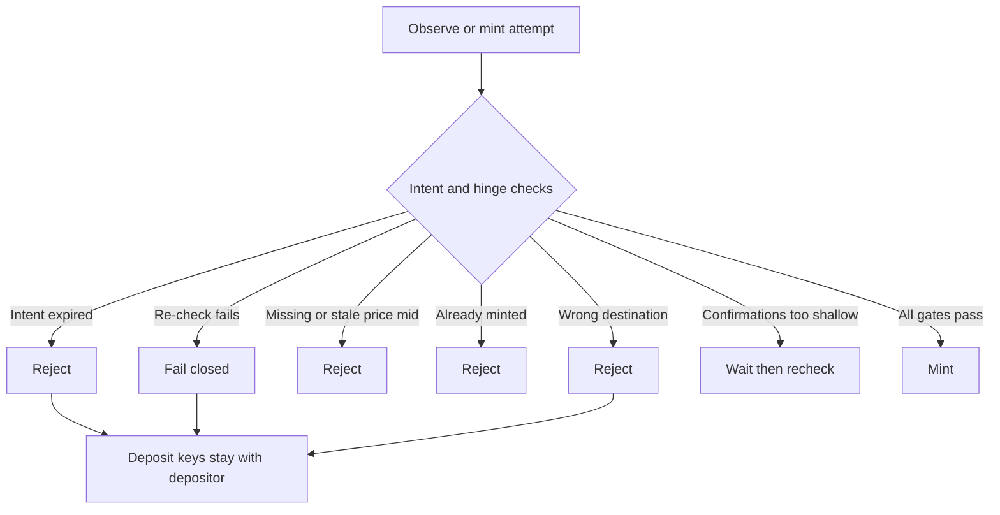

# Private Bridge honesty

Private Bridge is research documentation. Workflow shape can match a production-shaped path. The **deploy label** still decides whether money is synthetic, local test, or mainnet.

## Product rules (positive)

- **Destination before send.** Zcash payout address and rate policy are sealed before the Bitcoin QR is funded.
- **Mint needs tip + burn membership.** The light-client hinge admits a Bitcoin tip and proves the bridge burn sits under that tip’s burn set. Mint does not proceed on coordination gossip alone.
- **Egress is Terp burn, then Zcash pay** to the sealed address only (when a deploy enables egress).
- **Oracle mids are bounds only.** They never create balance.
- **Fail closed.** Failed re-check, expired intent, wrong destination, or replay stops as failure; deposit keys stay with the depositor.

## How to read labels

| Profile | Honest reading |
|---------|----------------|
| Lab simulated | Mock verify and synthetic observe are in bounds. Success is not mainnet settlement. |
| Local funded / testnet | Live local mint and test Bitcoin prove fidelity on test money. |
| Production-shaped | Fail closed on re-check and proof policy. Operator must say whether rails are mainnet. |

Hard rule: local or testnet success is workflow fidelity, not a mainnet receipt.

## Fail closed

## Not this product

| Not this | In one clause |
|----------|----------------|
| Cash App private API | Funding is an ordinary Bitcoin send to the QR. |
| Always-on recovery vault | Optional pre-declared recovery binding per deploy only. |
| Transparent token-pair DEX as bridge actor | Bridge mints notes; it does not run a cleartext AMM. |
| Public mainnet settlement listing | Not published as live on this site. |

## Missing product facts

- Public mainnet Private Bridge settlement is not claimed live here.
- Full browser zero-knowledge mint proofs may still stage behind mock verify depending on deploy policy.
- Production Zcash light-client egress is deploy work beyond the labeled lab burn-then-pay path.
