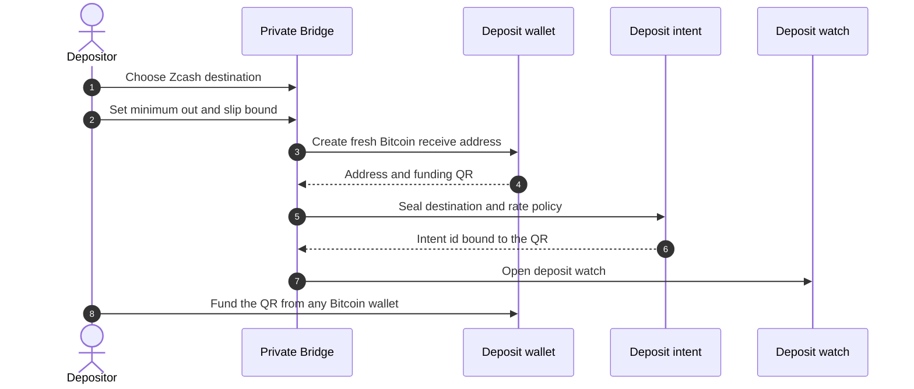
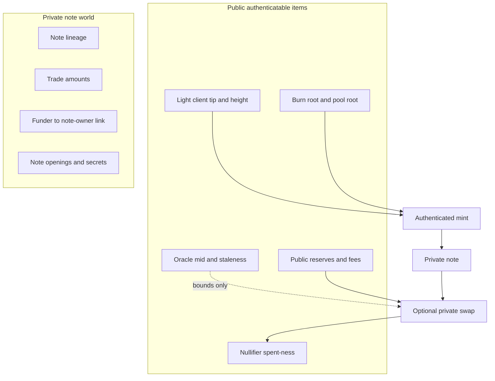

# How Private Bridge works

Private Bridge authorizes payout **before** Bitcoin leaves the depositor’s wallet, then admits value onto Terp only through authenticated finality. See the [Overview](/research/private-bridge) for what Terp and private notes mean.

## 1. Seal destination and rate policy

The depositor chooses a **Zcash destination** and rate floor. A Zcash destination is a unified address or transparent receive address bound into an opaque **owner binding**. An owner binding is a fixed handle the mint and later open steps must match.

Rate policy stores minimum out and optional max slippage against an oracle mid. An **oracle mid** is a public price hint used as a bound only. It never creates balance.

## 2. Fresh deposit wallet and QR

The UI creates a **deposit wallet**: a new browser HD wallet and **P2WPKH** receive address. P2WPKH is a standard Bitcoin SegWit address type (starts with `bc1` on mainnet). The address is not the depositor’s everyday Cash App identity. The sealed intent binds to that address. The product shows a Bitcoin URI QR for funding.

Before any Bitcoin moves, the depositor locks a Zcash destination and rate policy, then funds a fresh QR address under that sealed intent.

## 3. Observation

**Observation** means a watcher or reporter notices the deposit on Bitcoin and emits a coordination event. Coordination alone is not authority. Production-shaped clients **re-verify** the deposit against a Bitcoin index. Lab mode may use a synthetic observation that still carries the lab label.

## 4. Light-client hinge and mint gate

The light-client hinge requires a height-bound tip and **burn membership** under that tip. Burn membership proves the foreign burn (or deposit-backed burn record) sits in the bridge-burn set the tip attests. Ordinary spent-set membership alone does not authorize mint.

When the gate passes, the **headstash** contract runs **bridge mint** and emits a private note in the shared note shape used by other private mint paths and the private DEX. Headstash is a CosmWasm contract surface — CosmWasm is the WebAssembly smart-contract runtime on Cosmos chains — that mints and burns private notes for airdrop-style claims and bridge ingress.

## 5. What the depositor holds on Terp

After mint, the depositor holds a Terp private note bound to the sealed owner binding. Note lineage, trade amounts, and the funder-to-owner link stay private. Public authenticatable items include tip height, burn and pool roots used at mint, public reserves and fees after any swap, oracle mid freshness when bounds apply, and nullifier spent-ness.

A **nullifier** is a one-shot spent marker. Replaying the same burn or intent for a second mint rejects.

Finality roots, reserves, and oracle bounds stay public while note lineage, amounts, and owner links stay private.

## 6. Optional private swap and Zcash egress

An optional **private swap** spends the Bitcoin-denominated note into public virtual reserves and mints a Zcash-denominated private note. Details live under [Private DEX](/research/private-dex).

**Zcash egress** burns that Terp note and pays only the pre-sealed destination. Lab deployments may settle the Zcash leg from labeled inventory after the Terp burn statement. Mainnet Zcash broadcast is not assumed for this research product.

## Reject path

Wrong destination, expired intent, missing or stale oracle mid, replayed mint, or failed re-verify stop the path. Funds are not redirected to a new destination without a new intent and a new deposit address. Until observation and mint consume the UTXO, deposit keys remain with the depositor.
