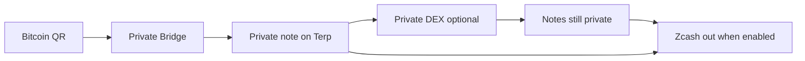

# Private bridge

**You lock where Zcash should arrive, then you pay a fresh Bitcoin QR.** Terp mints a **private note** only after that Bitcoin deposit is checked. Terp is the Cosmos-SDK chain that hosts these private notes. A private note is a shielded balance commitment the chain can spend later without publishing who funded it or how much moved between notes.

An optional [Private DEX](/research/private-dex) swap can trade notes that already sit in that set. Approximate trade size becomes public after a swap; note amounts stay private. Leaving Terp for Zcash, when a deploy enables it, pays only the destination sealed up front.

## Who it is for

- People who fund a one-time Bitcoin QR from a phone wallet (Cash App is the example) or any wallet that can send to a `bc1` address, and want Zcash payout locked before they send.
- Engineers who need mint gates and note shape without reading internal interface dumps.

## Lab versus public network

| Surface | Status |
|---------|--------|
| Intent → QR → observe → re-verify → private mint | Runs in lab and local multi-net demos |
| Synthetic deposit observation | Explicit lab mode only |
| Optional private swap under public reserves | Lab research — see [Private DEX](/research/private-dex) |
| Mainnet Bitcoin → Terp → mainnet Zcash settlement | **Not** claimed as a live public network on this site |

Local or testnet success proves workflow fidelity. It is not a receipt for mainnet money.

## Why two products

**Private Bridge** admits value into notes. **Private DEX** trades notes already in the set. After a swap, pool reserve changes make approximate size public; amounts inside notes do not.

## Read next

- [How it works](/research/private-bridge/how-it-works) — destination first, then QR, check, mint
- [For users](/research/private-bridge/for-users) — steps, receipts, banners
- [For engineers](/research/private-bridge/for-engineers) — seams and code homes
- [Honesty](/research/private-bridge/honesty) — what this product does and refuses
- [Glossary](/research/private-bridge/glossary) — product nouns
