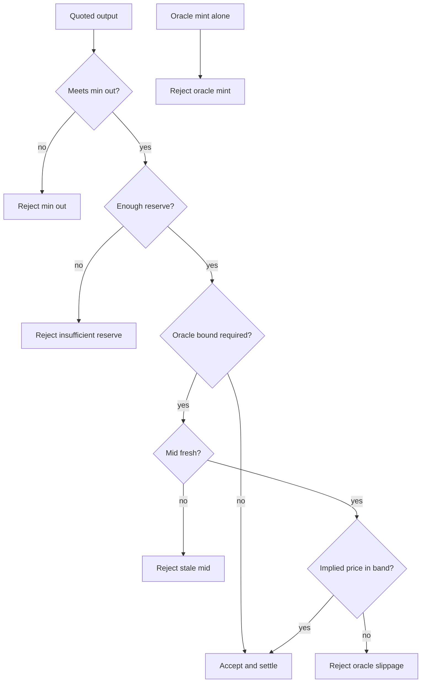

# For engineers

Math and reject codes live in pure Rust. CosmWasm settle reuses that posture on chain. CosmWasm is the WebAssembly smart-contract runtime on Cosmos chains.

## Where the code lives

| Piece | Role |
|---|---|
| `crates/terp-seams` `dex` module | `quote_exact_in`, `apply_reserves`, `apply_swap`, oracle bound checks, hard reject of oracle mint |
| `contracts/revenue/private-dex` (`cw-private-dex`) | CosmWasm settle of a public swap statement plus proof bytes |
| Transparent `crates/dex` pair | Separate cleartext token-pair reference for message shape — not the private note venue |

## Quote (exact in)

A pool is a public pair record with reserves `R_in` and `R_out` plus fee factor `gamma / gamma_den`. Exact-in quote:

```
delta_out = floor( (R_out * gamma * delta_in) / (R_in * gamma_den + gamma * delta_in) )
```

On accept: `R_in += delta_in`, `R_out -= delta_out`, and `R_out` stays greater than zero. The pool does not custody note openings.

## Settle pipeline

| Transparent pair habit | Private settle |
|---|---|
| `ExecuteMsg::Swap` + bank/CW20 in | `SettleSwap { statement, proof }` with proven note spend |
| `compute_swap` | Seam `quote_exact_in` with `gamma / gamma_den` |
| `assert_max_spread` | `min_out` plus optional oracle mid band |
| Ask asset transfer out | Emit output commitment attributes (`cm_out_*`) |
| `QueryMsg::Simulation` | `QueryMsg::QuoteExactIn` |

Host recompute loads the pool, checks Active, optionally checks oracle bounds, recomputes `delta_out`, enforces `min_out`, verifies the proof path in use, inserts nullifiers, appends commitments, and updates reserves.

## Dual-path verify

| Mode | When | Behavior |
|---|---|---|
| **mock_verify** | `Config.mock_verify = true` or unit tests | Accept non-empty proof after host seam checks (lab) |
| **proof_instance_verify** | `mock_verify = false`, `zk-api` feature, host import present | Real verifying-key check against registered `zkid` (circuit id for the verifying key) |
| **Fail closed** | Production-style config without zk host support | Reject settle; no silent pass |

A **zk host import** is the chain-host API that verifies proof bytes against a registered verifying key. Default CosmWasm guest builds omit that import so the wasm module runs on stock wasmd without requiring a zk-enabled host.

## Normative reject codes

| Code | Condition |
|---|---|
| `ErrMinOut` | `delta_out < min_out` |
| `ErrInsufficientReserve` | Output would empty the out leg |
| `ErrOracleStale` / `ErrOracleMissing` | Required mid absent or too old |
| `ErrOracleSlippage` | Implied price outside mid band |
| `ErrOracleDisabledMint` | Any attempt to credit balance from mid alone |
| `ErrNullifierExists` | Reused spent marker |
| `ErrWrongAsset` | Note asset ≠ pool input leg |
| `ErrPoolPaused` | Pool not Active |



## Topology

v1 seams target **hub edges** only (Hub–B, Hub–C). A full pair matrix and atomic multi-hop are not in v1. Hub denomination is demo config (for example a lab hub token, or a wrapped-Bitcoin-style **cBTC-class unit** in fixtures — a demo denomination, not a frozen mainnet symbol).

Bridge mint, light-client deposit gates, and Zcash egress are [Private Bridge](/research/private-bridge) concerns. Swap conservation does not treat oracle mids or bridge authorities as AMM balance creators.

## Tests

Pure math: `cargo test -p terp-seams --lib`. Contract unit path: `cargo test -p cw-private-dex`.
