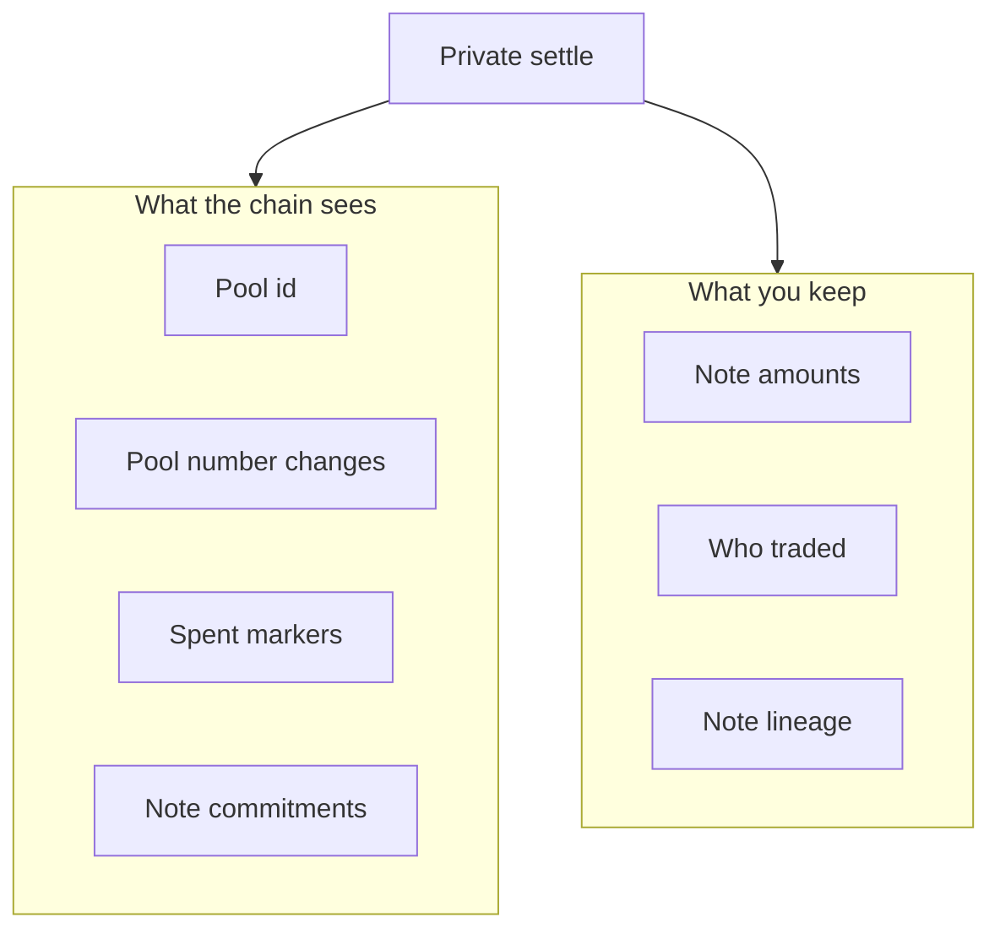

# For users

Trade without publishing note amounts or which notes link together. Pool sizes and the fact that a settle happened stay visible.

## What you keep private

- How much each note holds.
- Which notes link across bridge mint, claim, swap, and later exit.
- Who authorized the spend, beyond unlinkable public markers.

## What the chain shows

- Which **pool** traded.
- How public **pool numbers** changed (approximate trade size).
- Spent markers and new note commitments (not cleartext balances).

## Slippage

Before settle, set **minimum out**: the least output you accept. If the quote on current pool numbers falls short, the swap rejects and your notes stay unspent.

If the deployment requires a public price mid, a stale mid or a price outside the band also rejects. The mid is a guardrail, not a mint.

## Venue status

This path runs in the **local lab**. It is not a public mainnet AMM. Notes may arrive from the [Private Bridge](/research/private-bridge). Swapping those notes is this product; depositing Bitcoin or exiting to Zcash is not.

## Demo routing

Lab liquidity is hub-and-spoke: two demo tokens each trade against one hub token. Demo token B → demo token C is two swaps. There is no single atomic cross-edge route in v1.
