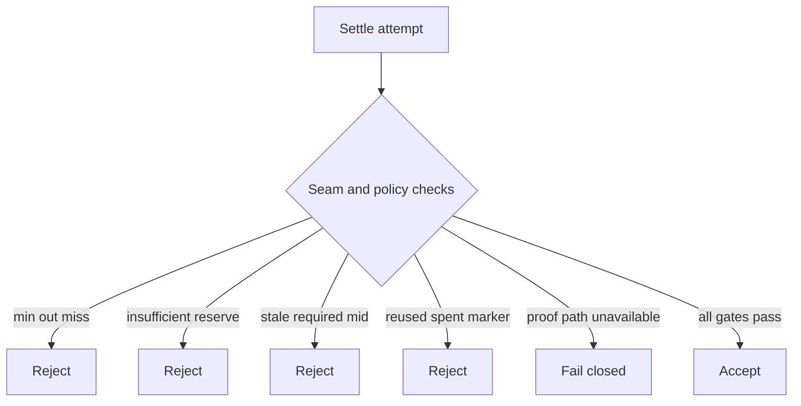

# Honesty

Private DEX docs describe a **research settle path**. They are not a live public trading venue listing.

## Product rules (positive)

- **Shielded settle:** private notes in → public reserve deltas → private notes out.
- **This AMM spends notes**, not bank balances in a transparent pair.
- **Oracle mids are bounds only** when configured; a mid never creates notes or bumps reserves alone.
- **Fail closed** when proof verification cannot run, seam checks fail, `min_out` misses, reserves are insufficient, the pool is paused, or a spent marker is reused.

## Privacy honesty

| Public | Private |
|---|---|
| Pool id, reserve deltas, fee params | Per-note amounts |
| Spent markers, new commitments | Spender identity and note lineage |
| Optional price mid + freshness | Note openings and secrets |
| Pool mid after settle | Who traded which prior mint |

Reserve deltas reveal **approximate trade size**. Per-note amounts stay private.

## Relation to Private Bridge

The [Private Bridge](/research/private-bridge) seals deposits and mints private notes. The Private DEX does not authorize foreign ingress. Shared note vocabulary means notes can compose; it does not mean bridge and DEX are one module.

## Fail closed

## Not this product

| Not this | In one clause |
|----------|----------------|
| Public mainnet private AMM with open pools | Lab research; no shipped public pool network here. |
| Drop-in cleartext token-pair swap | Those spend bank balances; this spends notes. |
| Oracle-funded balances | Mid alone cannot mint or bump reserves. |
| Encrypted-reserve / sealed-batch auction venue | Not in v1. |
| Atomic multi-hop router | v1 is sequential hub edges only. |
