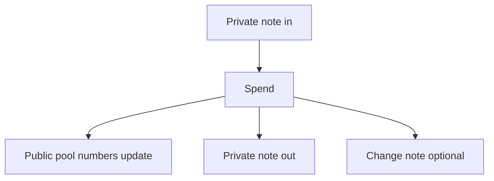
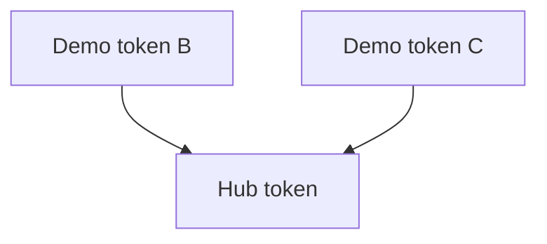

# How it works

A **shielded swap** is one settle on the Private DEX.

## In plain language

1. **Spend a private note** (or more than one) of the asset you are selling. Each spend publishes a spent marker so the same note cannot spend twice.
2. **Pool numbers on chain change.** The pool keeps public counters for each side. Your trade moves those counters.
3. **A new private note comes out** for what you bought. If you spent more than the trade needed, an optional **change note** returns the rest.
4. **`min_out` is your slippage.** It is the least output you accept. If the quote is worse, settle rejects and nothing moves.

## What stays private vs public

| Private | Public |
|---------|--------|
| Amounts inside notes | How much the pool counters moved (approximate trade size) |
| Which notes link to which | Pool id, spent markers, new commitments |

## Price guardrails

If the deploy requires a public **price mid**, it must be fresh and the implied trade price must sit in an allowed band. The mid is a guardrail. It never mints notes by itself.

## Demo pools (v1)

Lab liquidity is a **star**: two **demo tokens** each trade against one **hub token**. Going from demo token B to demo token C is **two swaps** (B→hub, then hub→C). There is no single atomic multi-hop button in v1.

## Separate from the bridge

[Private Bridge](/research/private-bridge) can mint notes into the shared set. Only a private swap updates pool counters. Deposit authorization and Zcash exit belong to the bridge, not this settle path.

Formulas, reject-code tables, and verify modes live on [For engineers](/research/private-dex/for-engineers).
