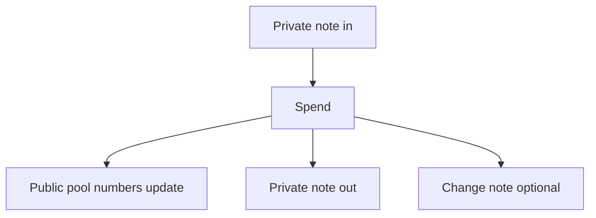

# Private DEX

The **Private DEX** is a research product for **shielded swaps** on Terp: you spend one or more **private notes**, the **public pool numbers** on chain change, and you receive a new private note (and optional change). A private note is a committed balance — amount and owner stay private; the chain sees commitments and spent markers.

This is not the [Private Bridge](/research/private-bridge). The bridge admits value into notes. The Private DEX trades notes that already exist.

## Why two products

Bridge **mints** notes from a checked Bitcoin deposit. DEX **trades** notes already in the set. After a swap, reserve deltas make **approximate trade size** public; **amounts inside notes** stay private.

## Who it is for

### [For users](/research/private-dex/for-users)

Trade without publishing note amounts or which notes link together. Pool sizes stay visible.

### [For engineers](/research/private-dex/for-engineers)

Settle math, reject codes, and verify modes.

## Lab versus public venue

| State | Fact |
|---|---|
| **Lab** | Swap math and CosmWasm settle run in research / local deploys. CosmWasm is the smart-contract runtime on Cosmos chains. |
| **Not a public venue** | No shipped public mainnet pool network for this product. |
| **Fail closed** | Production-style config without proof verification rejects settle. It does not silently accept. |

## Shielded swap at a glance

You spend a note → pool counters on chain change → a new note comes out. Your **minimum out** is slippage protection: if the quote is worse, the swap rejects and nothing moves.

## Read next

- [How it works](/research/private-dex/how-it-works) — spend, pool move, note out, slippage
- [For users](/research/private-dex/for-users) — what you see vs what the chain shows
- [For engineers](/research/private-dex/for-engineers) — formulas, reject codes, verify modes
- [Honesty](/research/private-dex/honesty) — what this is and is not
- [Glossary](/research/private-dex/glossary) — product nouns
