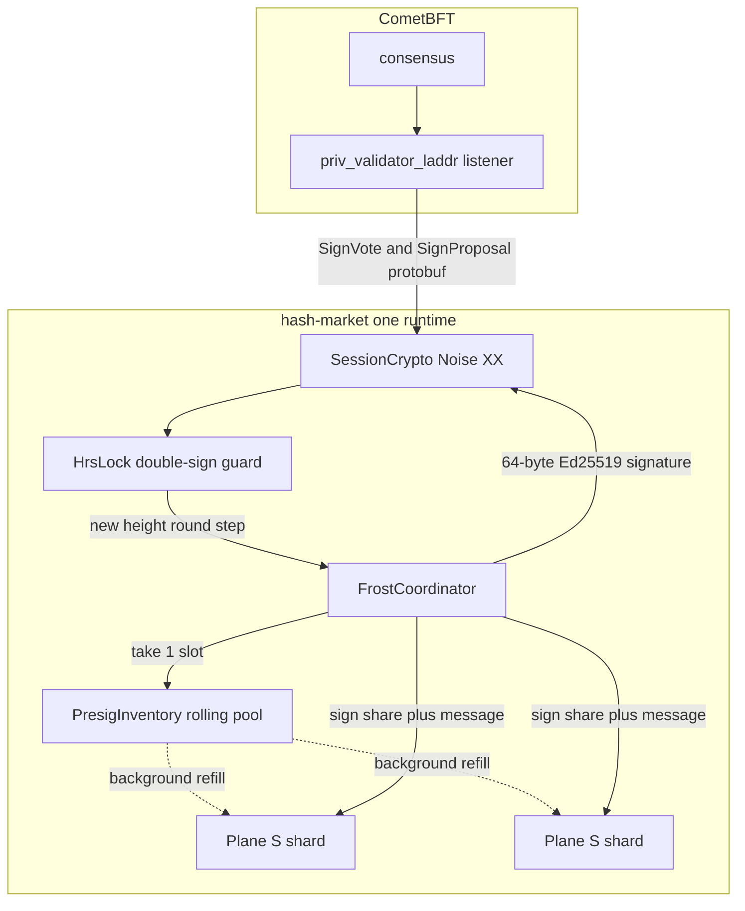
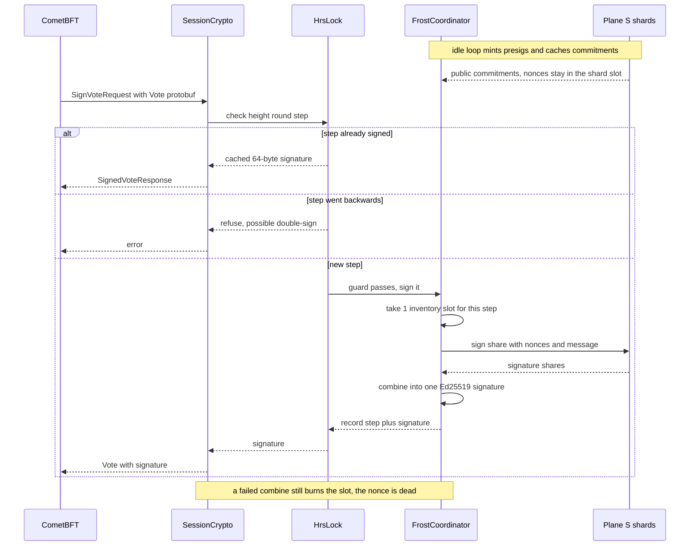

# FROST privval sidecar

The hash-market sidecar signs CometBFT votes and proposals with a **threshold key**: `t`-of-`n` FROST-Ed25519 shares cooperate inside one runtime, so no single host ever holds a usable consensus key. There is no `priv_validator_key.json` to steal, and no second `kms` binary to operate — consensus signing lives in the same process as the merchant/VE host.

Use this guide to deploy the sidecar, cut a validator over to it, and keep it healthy.

## How it works

Three keys, three jobs — never mixed:

| Key | Curve | Job |
|---|---|---|
| Consensus key | Ed25519 | Votes and proposals, held as FROST shares |
| Operator key | secp256k1 | Vote extensions, DAO messages, onboarding |
| Session key | X25519 | Encrypts the sidecar ↔ node link (Noise XX) |

The DAO never holds the consensus scalar, and the shares are never reconstructed into a full key — not at signing time, not ever.



### The sign path

When CometBFT needs a vote signed, the sidecar checks its double-sign guard, spends one pre-minted nonce slot, gathers threshold shares, and returns the signature:



Two things worth knowing about this pipeline:

- **Presigs are message-independent.** A presignature is just a nonce pair minted ahead of time. It only becomes a vote signature when the coordinator feeds in the actual vote bytes — which is why the sidecar never precomputes votes (the `block_id` doesn't exist until proposal time). Prevote vs precommit labels are inventory bookkeeping so one step can't starve the other, not different cryptographic objects.
- **The double-sign guard commits after signing.** The guard checks the height/round/step, the coordinator signs, then the guard records the step. A crash between signing and recording leaves the guard behind while the spent nonce is already dead — so any retry at the same step needs investigation, not a blind re-submit.

### Capacity planning

The presig pool is rolling, not tagged by height: one slot is consumed per successful sign and a background loop tops the pool back up (plus one fill at startup). Size it with `need ≈ R_buf · (2 + p_propose) + margin` — buffering `R_buf` rounds of prevote plus precommit, plus proposals if this validator proposes, plus margin. The defaults (`R_buf = 3`, propose on, margin 2) cover normal operation; raise the buffer if you routinely see the pool run dry in logs.

## Deploy

### 1. Build

```bash
cd crates/terp-rs/tools/hash-market # own workspace
cargo build -p hash-market --features full-sidecar
```

### 2. Generate the threshold key

Run the DKG on an offline machine and distribute one share per host:

```bash
cargo run -p kms-shard --bin kms-dkg -- init --n 3 --t 2 --out DIR
```

Destroy any unsharded key material afterwards. For lab setups only, the coordinator can self-generate without touching disk (`FrostCoordinator::from_dkg`).

### 3. Configure the node

The sidecar **dials** the node, so the node listens. In the CometBFT `config.toml`, bind the private-validator listener to the private network only:

```toml
priv_validator_laddr = "tcp://<private-ip>:26659"
```

### 4. Configure the sidecar

```toml
[privval]
enabled = true
addr = "127.0.0.1:26659"   # dial the node address above
crypto = "noise"           # cleartext is lab only
codec = "cmt"              # production Vote protobuf, json is lab loopback
frost_t = 2
frost_n = 3
group = "group.bin"
shares = ["share-1.bin", "share-2.bin"]
state_file = "data/privval-hrs.json"
```

| Field | Meaning |
|---|---|
| `addr` | Node's `priv_validator_laddr` — the sidecar connects out |
| `crypto` | `noise` (default) or `cleartext` (lab loopback only) |
| `codec` | `cmt` for CometBFT 0.40 production, `json` for the lab loopback |
| `frost_t` / `frost_n` | Threshold and total shares from the DKG |
| `group` / `shares` | Group public package plus this host's share files (`shares[0]` is participant 1, and so on) |
| `state_file` | Double-sign guard persistence — back it up, never share it between signers |

### 5. Cut over without double-signing

1. Sync the validator host as a full node with **no consensus key**.
2. Stop the old signer and confirm its last signed height on-chain.
3. Copy the `priv_validator_state.json` watermark into the sidecar's `state_file` so it refuses anything already signed.
4. Start the sidecar, then the node. Confirm the next height signs exactly once.
5. Only then retire the old process — and never start it again with the old key file.

## Operate

**Watch the presig stock.** The `frost presig refill` log line and the pool snapshot tell you whether the background loop is keeping up. Sustained depletion means raising the buffer, not hand-minting on the sign path.

**One signer per consensus key.** Never run the sidecar and Go `kms` (or a leftover `priv_validator_key.json`) against the same consensus pubkey at the same height. Two active signers is how validators get tombstoned during migrations.

**Guard file hygiene.** `state_file` is per-signer double-sign insurance. Copying it between hosts that sign concurrently defeats it.

## Troubleshoot

| Symptom | Likely cause | Action |
|---|---|---|
| `refuse double-sign` / step regression errors | Retry at an old step, or two signers active | Investigate before re-submitting; confirm no second signer holds the key |
| Sign errors with burned slots | Combine failure or fewer than `t` reachable shares | Restore share availability; the pool refills on its own |
| Missed votes after signer-set change | Leftover slots correctly dropped | Expected — the pool rebuilds; check DKG outputs match the new set |
| Node can't establish session | `crypto`/`codec` mismatch, or sidecar dialing the wrong address | Match `noise`+`cmt` in production; verify `priv_validator_laddr` is bound and reachable on the private net |
| Peer expects Go `noise://` framing | Lab Noise (snow XX, 4-byte frames) is not Go libp2p-noise (2-byte length plus identity protobuf) | They interoperate at the protocol level only if the peer speaks this sidecar's framing — do not assume byte compatibility |

## Verify the build

```bash
cd crates/terp-rs/tools/hash-market
./scripts/e2e-frost-privval.sh
```

Sound cases must pass and unsound cases must fail closed. Internals live in `src/custody/{frost,presig,hrs,shard_peer}.rs` and `src/transport/{privval,cmt_privval,session,noise}.rs`.
