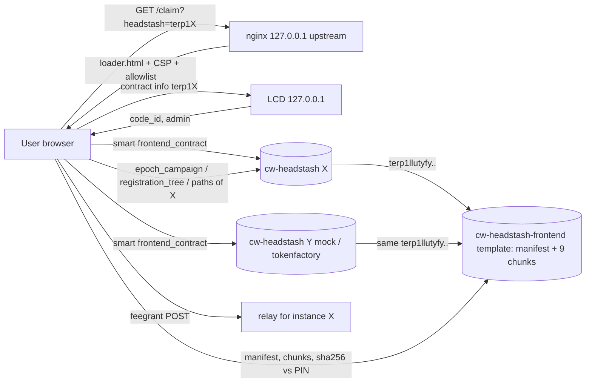

# Headstash frontend: one on-chain template, many instances

Status: spec only (2026-11-02). It changes no code and no part of the c53d68c v0.0.1 render.

## 1. Audit: where today's page is bound to one instance

| Piece | Location | Instance binding |
|---|---|---|
| `cw-headstash-frontend` state | `contracts/headstash/cw-headstash-frontend/src/lib.rs:15-19` (`MAX_CHUNK`, `CURRENT`, `NEXT_VERSION`, `MANIFESTS`, `PROGRESS`, plus chunks), `msg.rs:11-95` | **None.** No headstash address, chain-id, denom or root. It is a generic content-addressed file host (owner = gov). |
| Manifest + chunks (v1) | `deploy/rendered-mainnet/phase-a/page-manifest.json`, `19-fe-chunks/*` | **None in the page bytes.** The only address in the chunk tx JSONs is the tx envelope `contract` (the frontend address), not the payload. |
| `app.html` | `frontend/app.html` | None, apart from the generic title "Terp Headstash claim" (line 10). |
| `app.js` | `frontend/app.js` | None baked in. Everything comes from `cfg`: `cfg.headstash` (lines 27, 47, 83, 112, 138, 143), `cfg.chain_id` (32, 47), `cfg.denom` (fee denom, 31; Penumbra preview, 176), `cfg.hrp`, `cfg.rest`, `cfg.relay`. The tree root and paths are queried live (`registration_tree`, `registration_path`, 138-143). |
| `crypto.js`, `zk_headstash.js`, `zk_headstash_bg.wasm` | prover (vk_id 3 circuit, -Oz) | None. The circuit is generic, and ctx is a runtime input. |
| Eligibility rows | a user-supplied file (`app.html:16`) | Per campaign, but off-chain and never in chunks. |
| **`loader.html`** | `frontend/loader.html:2,6,7` | **The ONLY binding.** `CFG.headstash="__HEADSTASH__"`, `chain_id`, `denom`, gas, `rest`/`relay` (also in the CSP), and the optional `PIN` manifest sha are filled by nginx. It is not in the manifest and not on chain (OPERATOR-CHECKLIST.md:18, V0.0.1-DEPLOY-PACKET.md:57). |
| `cw-headstash` `frontend_contract` | `cw-headstash/src/bridge.rs:52,641-660`; `msg.rs:37` (instantiate), `msg.rs:113` (`SetFrontendContract`, owner only), query `msg.rs:289` | Pointer from instance to template, many-to-one capable. Each instance stores one `Option<Addr>`. |
| Note derivation | `app.js:47` `directCtx = sha256(tag‖chain_id‖headstash)`, matching `cw-headstash/src/direct.rs` `direct_ctx` | Runtime per instance. Notes and proofs for instance A can't be replayed on B. |
| Relay | `headstash-register-relay`: `HEADSTASH_CONTRACT` is a single env value (headstash-registration-spec.md:36) | Off-chain and one instance per relay process. |

## 2. Answers

**(a)** The on-chain bytes are already a reusable template. Nothing in the manifest or chunks names an instance. The page is tied to one instance only through the loader's hard-coded `CFG.headstash`, which nginx fills. Today the loader does not read the URL or query string. It goes headstash → `frontend_contract` → manifest/chunks, so the binding direction is already instance → template.

**(b) Bytes (manifest v1, page-manifest.json):**

| File | raw B | stored gzip B | chunks | class |
|---|---|---|---|---|
| zk_headstash_bg.wasm (prover) | 1,801,693 | 642,593 | 5 | shared |
| app.js | 14,638 | 5,347 | 1 | shared |
| zk_headstash.js | 12,777 | 3,005 | 1 | shared |
| crypto.js | 10,640 | 4,316 | 1 | shared |
| app.html | 5,023 | 2,238 | 1 | shared |
| **on-chain total** | 1,844,771 | **657,499** | 9 | **100% shared** |
| loader.html (off-chain, nginx) | 3,015 | – | – | per instance (5 fields) |
| frontend wasm e72eee9b | 357,081 | – | – | shared code, stored once |
| cw-headstash `frontend_contract` item | ~70 | – | – | per instance |

Per-instance on-chain cost: one ~70 B `Option<Addr>` in each headstash. Per-instance off-chain cost: about 5 config values. Proving params are not shipped. The vk is in the chain sidecar registry (vk_id 3), and the prover wasm carries the circuit only. A second instance that reuses the same frontend address duplicates **0** chunk bytes. The only cost is avoidable: deploying a second frontend contract per campaign (the current salt is `sha256("headstash-frontend:"+label)`, per label) and re-uploading 657 KB.

**(c) Smallest design: loader-only, no contract change, works with the current wasm e72eee9b.**
1. Deploy one template frontend (v0.0.1's terp1llutyfy…0e5n9 can be it). Every later instance is instantiated with `frontend_contract` set to that same address, or gets it via `SetFrontendContract`. There is no new upload, no new frontend contract, and no per-instance record type, because the existing pointer already is the per-instance record.
2. The loader takes the instance from `?headstash=<addr>`, falling back to the nginx-filled default. It derives the rest from chain instead of from placeholders:
   - Run bech32 validation with hrp `terp`.
   - `GET /cosmwasm/wasm/v1/contract/<addr>` → `code_id` must be in an allowlist baked into the loader (the gov-stored cw-headstash code ids, or checksum 40197344…e980 via `/code/<id>`). Admin/owner should be GOV.
   - `frontend_contract` must equal an allowlisted template address, and the manifest must match `PIN`.
   - `chain_id` comes from `/cosmos/base/tendermint/v1beta1/node_info`. The fee denom stays a server config value, because fees are chain-wide, not per instance.
   - The instance banner (claim denom, cutoff, amounts) comes from `epoch_campaign`, `direct_claim` and `pause_status`. Note that `EpochCampaignParams.denom` is the blake3 proof (`epoch.rs:63`), not the raw denom. For display, the raw denom needs a token-strategy/config query or a raw-state read. If cw-headstash exposes no such query, show the proof plus the bank metadata of the candidate denom and let the user compare.
3. Optional later: manifest v2 (gov `PublishManifest` + `SetCurrent` on the same contract) adds an instance banner to app.js/app.html that shows denom, contract, code id and cutoff.

**Impact on the locked v0.0.1 set (c53d68c):**
- Steps 1-2 change only `loader.html`, which is not in the manifest and not on chain. Chunk hashes, manifest sha 6a90d092…, A14 (deploy proposal, which publishes the manifest), A18 (uploader feegrant 3,374,003 uthiol), A19 chunks, A20, sign docs, wasm hashes and the predicted addresses terp1llutyfy…/terp14dq8… are **all unchanged**.
- Step 3, if folded into v0.0.1, would change app.js/app.html chunks f0/f1, the manifest sha, A14, the A18 gas/allowance and all of the A19 docs. The recommendation is not to fold it in: ship v0.0.1 as rendered and publish v2 later on the same contract.
- One caveat for future instances: the render's per-label salt (`headstash-frontend:`+label) deploys a new frontend each time. Future renders should skip 13b/A18-A20 and pass the existing template address. That is a render.py change, deferred.

## 3. Data flow

## 4. Security notes
- **Who can aim the template at a hostile instance.** Anyone who can craft a URL. The page asks for an **EVM private key**, so a link like `?headstash=<attacker>` loaded inside the genuine, hash-verified page is the main phishing vector. The bytes are genuine, so "verified chunks" proves nothing about the instance.
- **Mitigations, all in the loader:**
  - Allowlist of instance code ids/checksums. cw-headstash store has `instantiate_permission` `AnyOfAddresses [gov]` (phase-a/13), so instances of the official code can only come from gov.
  - Admin/owner == GOV check.
  - Template address allowlist plus `PIN`.
  - Refuse anything else, with no "continue anyway" option.
  - Show the instance address, code id and owner prominently before key entry.
  - Optionally, nginx serves only a fixed instance allowlist and rejects unknown `?headstash=` values at the edge.
- **Remaining risks:**
  - The attacker hosts their own loader. This can't be prevented. Users must verify the loader sha published in the gov proposal and the domain.
  - A gov-approved mock or test instance on mainnet is still "official", so test instances belong on local or testnet only, and the allowlist should list addresses, not just code ids.
- **The private key never leaves the page.** CSP `connect-src` is restricted to REST and relay, so a hostile instance can't exfiltrate the key. It could still collect registration signatures for its own ctx. Those are bound to `chain_id‖that contract` (`direct_ctx`), so they are useless against the real instance, but they do link the user's EVM identity to the attacker.
- **How users verify the denom and contract:** the banner shows the raw denom, the `factory/<instance>/` creator (which must equal the instance for NewFungible), the bank denom metadata, the instance address, code id + checksum, and the frontend address and manifest sha. Users compare these with the gov proposal text.
- **Relay:** the fee-grant relay is single-instance (`HEADSTASH_CONTRACT`). Use either one relay route per instance (`/relay/<addr>/…`, still the one nginx) or make the relay accept an allowlist. A grant for an unknown instance must be refused.
