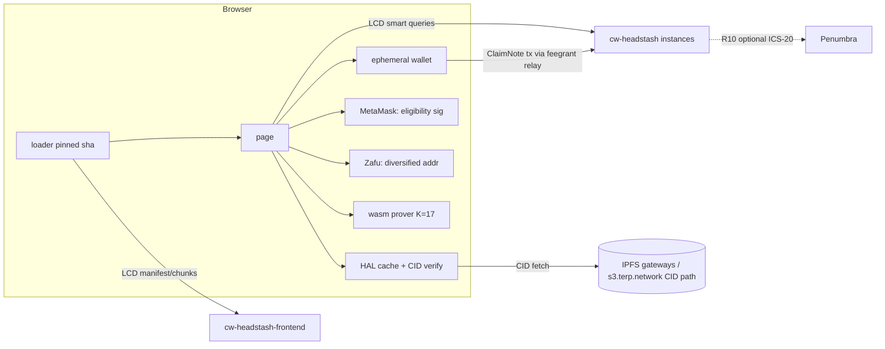
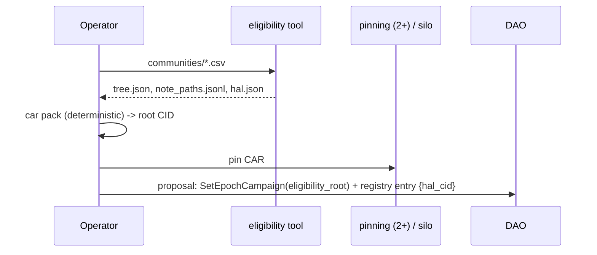
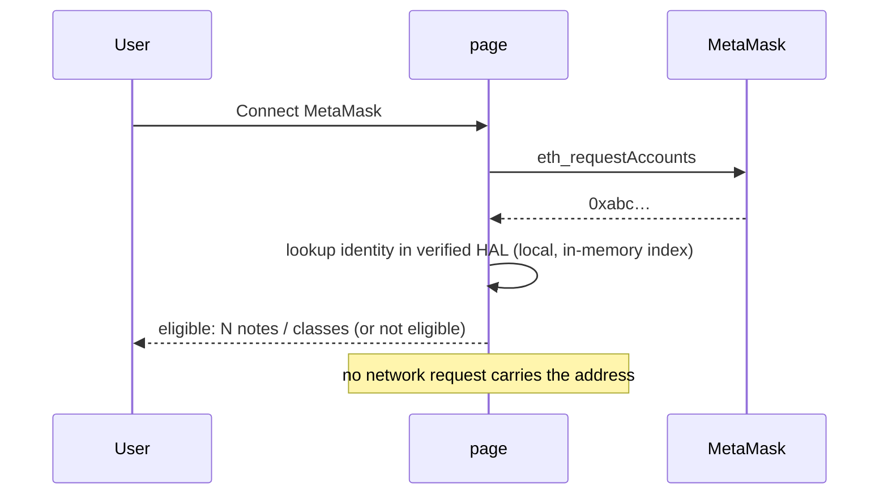
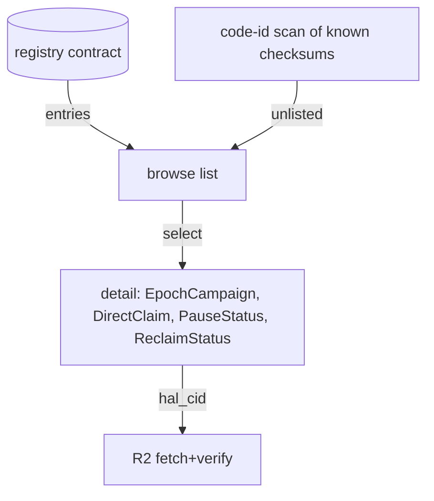
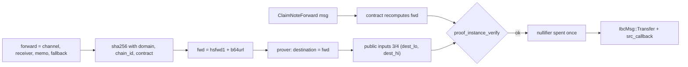
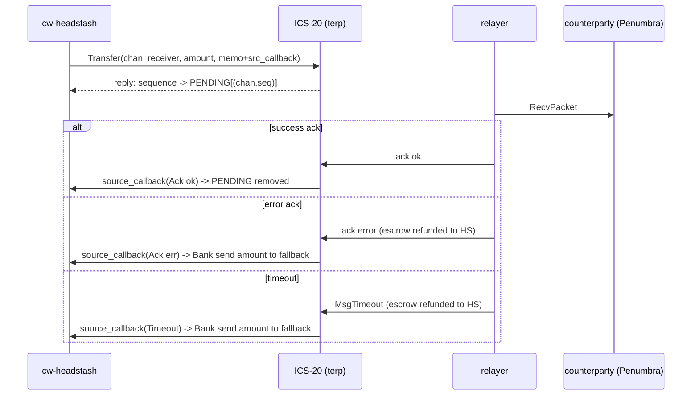

# Headstash v2 — claim page + frontend pruning spec

Status: draft for review. Branch `wip/headstash-v2` (off `e3b1e87`). The contract work for R11 is implemented here.
R1–R9 (UI) are spec only. R10 (IBC forward) is implemented in cw-headstash (`src/forward.rs`, see §F). The R11 keep-last policy is implemented in cw-headstash-frontend (commit 9b9646e). Address-reuse prevention is **frontend-only** (§F.5): the contract keeps only the one-spend-per-note nullifier.

Keywords: MUST / SHOULD / CAN as in the owner brief (pt168u). Requirement IDs R1–R11 follow the brief's order.

## 0. Actors and artifacts

| Name | What it is |
|---|---|
| **HAL** | Headstash Allocation List: the public note set (initial allocation). It is `notes/tree.json` + `notes/note_paths.jsonl` from the eligibility tool, plus a small `hal.json` index. |
| **cw-headstash** | The claim contract (one instance per headstash). It verifies `vk_id 3` proofs with `proof_instance_verify`. |
| **cw-headstash-frontend** | The on-chain page store (manifest + chunks). It is versioned and, after R11, prunable. |
| **loader** | The tiny pinned HTML that fetches the manifest and chunks from LCD, hash-checks them and boots the page (served now at `terp.network/headstash/`). |
| **page** | The claim app (JS + the membership prover wasm), stored in the frontend contract. |
| **ephemeral wallet** | A secp256k1 key generated in the browser (WebCrypto CSPRNG). It lives in memory or IndexedDB (non-extractable wrapping key) and is used for registration rewards and claims. |
| **Zafu** | The Penumbra browser wallet. It exposes diversified addresses (`addressByIndex`, one-time addresses). |



---

## R1 — The HAL file MUST be CID-accessible

**Design.**
- At campaign build time the eligibility tool output is packed as a deterministic CAR (UnixFS, CIDv1, raw leaves, sha2-256, chunker `size-1048576`, files sorted). The root CID is recorded in three places:
  1. the campaign metadata (`hal_cid`) in the headstash registry entry (R8/R9);
  2. the frontend manifest `note` field / page config;
  3. the DAO proposal text that created the campaign.
- Pin it on at least two independent pinning services, plus the existing MinIO `silo` bucket under `static/terp.network/headstash/hal/<cid>/` (served by the same nginx, so no new proxy).
- **Binding to chain.** `hal.json` contains `eligibility_root` (hex) and `depth`. The page MUST check that the tree root in the HAL equals `EpochCampaign.registration.eligibility_root` read from the contract. So the CID gives integrity of the bytes, and the on-chain root gives authenticity of the list.



## R2 — Users MUST NOT set the public note set by hand; web retrieval of the HAL

**Design.**
- The page resolves `hal_cid` from the selected headstash (R8/R9). It fetches it, in order: (a) the local cache (IndexedDB keyed by CID); (b) `https://terp.network/headstash/hal/<cid>/…` (same origin, CSP-friendly); (c) public gateways in a fixed list via `https://<gw>/ipfs/<cid>?format=car`.
- **Verification in the browser (MUST).** Fetch the CAR (trustless gateway format), verify every block hash against its CID and walk the DAG from the root CID. Use `@ipld/car` + `multiformats` (sha256 via WebCrypto). Bundle these into the page; no remote script. Never trust a gateway's `200` for plain `/ipfs/<cid>/file` responses.
- Then check the root against the chain (R1). If either check fails, the user sees a red state and claim/registration are disabled.
- An "advanced" disclosure lets users load a local HAL file. It goes through the same two checks; it never replaces the CID.

## R3 — Registration reward address SHOULD be an ephemeral in-browser wallet (CAN default to Keplr)

**Design.** The page shows a radio choice:
- `Ephemeral (recommended)`, the default. A new key per headstash per session, shown as a QR + bech32 + "export"/"sweep to…" action.
- `Keplr`. Uses `experimentalSuggestChain` + `getOfflineSignerAuto`. Where the user's Keplr supports it, a fresh derived account is used; otherwise the user is warned that the address links registration to their Keplr identity.

`reward_addr` (msg.rs:220 `RegisterNotes { reward_addr: Option<String> }`) is filled with the chosen address. The ephemeral key is generated with `crypto.getRandomValues`. It is kept in memory, and optionally persisted in IndexedDB encrypted under a non-extractable AES-GCM `CryptoKey`. The user is prompted to sweep before closing (a `beforeunload` guard while the balance is above 0).

## R4 — Eligibility check with MetaMask against the downloaded set; no server query



- Lookup is purely local: an index `identity -> [note_index…]` built from `note_paths.jsonl` after verification.
- **Privacy.**
  - The page MUST NOT send the address to the relay, LCD or any analytics. The CSP `connect-src` of the page stays limited to LCD/RPC/relay/gateways, and no request is made between connect and result.
  - Signing for registration (eth `personal_sign` of the registration challenge) happens only after an explicit "Register" click.
  - The page documents the leak that remains: registering later reveals the key on chain (by design of v1 registration). Checking eligibility does not.

## R5 — Every form step MUST have an info modal

Steps: (1) choose headstash, (2) HAL load + verify, (3) connect eligibility wallet, (4) reward address, (5) register, (6) wait for anchor / anonymity set, (7) claim destination (ephemeral / Zafu / Keplr), (8) prove, (9) submit, (10) sweep/forward.

Each step has an `(i)` button that opens an accessible `<dialog>` with three parts: *what happens*, *what is revealed on chain*, and *what can go wrong*. Modal copy lives in one `steps.json` inside the page bundle, so it is reviewable and translatable. Acceptance: a test enumerates the form steps and fails if a step has no modal entry.

## R6 — Claims MUST default to ephemeral wallet accounts

- The claim destination defaults to a **new** ephemeral key per note (not per session). This keeps notes unlinkable at the destination.
- Claims are sent from that key (`ClaimNote` pays `info.sender`, direct.rs:240/249), with fees covered by the existing feegrant relay (`CheckNoteClaim` dry-run before the grant).
- Funds are then swept by the user (to Keplr, or Zafu via R7/R10). The UI warns that sweeping several notes to one address re-links them.

## R7 — Zafu diversified addresses; a diversified address MUST NEVER be used for two claims

- Zafu (Penumbra) addresses are only reachable via IBC. So Zafu is a **sweep/forward target**, not the `info.sender` of `ClaimNote`. Under R10 (forward) the Penumbra address is bound into the proof destination.
- **Local guard.** The page asks Zafu for `addressByIndex(account, randomizer)` with a fresh randomizer per claim (or ephemeral/one-time address mode). It keeps a persistent `used_penumbra_addrs` set (IndexedDB), and also a hash of the address per headstash. It refuses reuse.
- **No on-chain guard (decision, t170u).** The contract MUST NOT record or reject reused receivers, fallbacks or claim addresses. Reuse prevention is a page rule only (§F.5). The modal MUST say that the guard is local to this browser and cannot see other devices.

## R8 — Reusable for any existing headstash

- The page takes `?hs=<contract>` (or a registry selection). Everything is read from that contract: `EpochCampaign {}`, `DirectClaim {}`, `RegistrationTree {}`, `PauseStatus {}`, `FrontendContract {}`, `DistroConfig {}`. Denom display comes from bank metadata. The ctx is checked against `DirectClaim.expected_ctx`.
- There are no hard-coded addresses except the chain registry (chain-id, LCD/RPC list, relay URL per headstash in the registry entry).
- The HAL CID per headstash comes from the registry (R9). If there is no registry entry, the user may paste a CID (still verified against the on-chain root, R1/R2).

## R9 — Browse available headstashes and parameters

**Registry source of truth — options.**

| Option | How | Pros | Cons |
|---|---|---|---|
| A. code-id scan | LCD `/cosmwasm/wasm/v1/code/{id}/contracts` for each known cw-headstash checksum | permissionless, no new contract | finds spam/forks too; no HAL CID/relay metadata; the checksum list itself needs distribution |
| B. registry contract | small `cw-headstash-registry`: DAO-owned `Map<addr, Entry{hal_cid, relay, label, frontend, added_at}>` | curated, carries metadata, one query | a governance step per headstash; trust in the DAO |
| **C. (recommended)** | B for curated listing **plus** A shown as "unlisted (unverified)" under a toggle | best of both | two code paths |

The page displays for each headstash: label, denom + metadata, cutoff height (and an ETA), denomination table and caps (`amounts`), paid counts, `min_anonymity_set`, anchor interval, pause status, reclaim status, frontend contract, code id + checksum, admin/owner.



## R10 — IBC transfer of claimed assets to a destination after a valid claim

### Verdict

**The recipient is already a public input. A forward destination can be bound safely with NO circuit change, using a contract-only change.**

Evidence:

1. **The circuit exposes the destination as two public instance cells.**
   - `tools/headstash/circuits/halo2/src/note_membership.rs:16` documents the public inputs as "ctx, root, nullifier, dest_lo, dest_hi, amount".
   - `:167-168` load `dest_lo`/`dest_hi` as advice from `destination_lo/hi`.
   - `:190-192` constrain `[ctx, node, nullifier, dest_lo, dest_hi, amount]` to instance offsets 0..5 via `constrain_instance`.
   - The same applies in `no_ecdsa.rs:120-121, 148-150`.
   - The dest cells are not otherwise constrained (no byte/range gate). The circuit binds *whatever two canonical Pallas elements* the prover chose, and the proof is invalid for any other values.
2. **The packing is a 62-byte string.** `no_ecdsa.rs:277-291` (`pack_destination`) puts up to 62 bytes into lo (31) / hi (31). The contract mirror is `direct.rs:64` (`pack_destination`, same 62-byte limit).
3. **The contract rebuilds the instances itself.** `direct.rs:85` (`instances(ctx, root, nf, dest, amount)`) and `direct.rs:224` (`let inst = instances(...)` → `verify`). The dest is taken from **`info.sender`**: `direct.rs:240` (`check_claim(..., info.sender.as_str(), ...)`), and payout goes to the same address at `direct.rs:249` (`push_credit(res, env, strategy, info.sender.as_str(), amount)`).
4. `ctx` (`direct.rs:48-60`, `direct_ctx`) binds chain-id and contract. `nullifier` is root-independent (one spend per note).

**Answers to the brief's questions.**
- *Is the recipient a public input?* Yes: `dest_lo`, `dest_hi` (instance offsets 3–4).
- *Can H(recipient, channel, penumbra addr, memo) be bound into an existing public input?* Yes. Define the **forward destination string**
  `fwd = "hsfwd1" || base64url_nopad(sha256(DOMAIN || chain_id || contract || channel_id || receiver || memo || fallback))`
  where `DOMAIN = "terp-hs-ibc-fwd-v1\0"`, each field is length-prefixed (u16 BE), and `fallback` is a terp address for refunds. That is 6 + 43 = 49 bytes, which is ≤ 62, so it fits `pack_destination` unchanged.
  - The prover proves for `destination = fwd` (the browser prover already takes an arbitrary destination string: `browser_prove.rs:54`, `note_membership.rs:325`).
  - The contract gets a new message `ClaimNoteForward { root, nullifier, amount, proof, forward: { channel_id, receiver, memo, fallback } }`. It recomputes `fwd` from the message fields and calls the **same** `check_claim(..., &fwd, ...)`, which rebuilds the instances with `fwd`.
  - It then pays with `IbcMsg::Transfer { channel_id, to_address: receiver, amount, timeout, memo }` instead of a bank send.
  - Alternatively the hash can fill the two limbs as raw field elements. Keeping it an ASCII string keeps `pack_destination` and every existing client unchanged, so the string form is recommended.
- *Front-running / redirection?*
  - **Redirection is impossible.** Changing any of channel / receiver / memo / fallback changes `fwd`, so `dest_lo/hi` differ and `proof_instance_verify` fails. The sha256 output space makes finding a second preimage infeasible.
  - **Front-running is harmless.** Anyone who copies the tx from the mempool can only execute *the same* forward to the same receiver. The nullifier is consumed exactly once (`verify_nullifier_stateful`). The submitter is deliberately *not* in the hash, so a relayer/feegrant account can submit.
  - **Collision with a normal claim.** `ClaimNote` uses the sender's bech32 string. A bech32 address cannot equal an `hsfwd1…` string unless sha256 is broken, and `ClaimNote` verifies `dest == info.sender`, so a forward proof cannot be replayed as a plain claim either.

### Required contract-side safeguards (no circuit change)

- **Channel allowlist** (`FORWARD_CHANNELS: Map<channel_id, {counterparty_chain, enabled}>`, owner/DAO-set). A bound but dead channel would otherwise lock funds into timeouts.
- **Timeout + refund handling.** The contract is the ICS-20 sender, so on ack-error/timeout the tokens return to the contract. Implement `ibc_source_callback` (or the ICS-20 callbacks middleware, if enabled on terpd) to credit `fallback` (bound in the hash). Without callbacks, keep a `PENDING_FORWARD` record keyed by sequence and let anyone trigger `RefundForward{seq}` after timeout plus a proof of no-ack, or simplest: route refunds to `fallback` via a pull-based claim. **Open question: are IBC callbacks available on terpd?**
- **Address reuse:** NOT enforced on chain (t170u). The page enforces it (§F.5). Only the note nullifier is one-use on chain.
- **Denom.** The tokenfactory denom must be transferable over ICS-20 (it is, as a native denom). The Penumbra side will see `transfer/<chan>/factory/...`. Memo length cap (e.g. 256 bytes).
- **Caps and pauses** are the same as `ClaimNote` (`check_claim` is shared, so class caps, the cutoff, the pause check and the public-path reservation all apply unchanged).
- Prefer **one IBC transfer per claim** (no batching) to avoid amount-linking. Penumbra's shielded pool provides privacy after arrival.

```mermaid
sequenceDiagram
  participant B as Browser
  participant Z as Zafu
  participant HS as cw-headstash
  participant T as ICS-20
  participant PN as Penumbra
  B->>Z: fresh diversified address A_i
  B->>B: fwd = "hsfwd1"+b64u(sha256(dom,chain,contract,chan,A_i,memo,fallback))
  B->>B: prove(destination = fwd)   (existing circuit, unchanged)
  B->>HS: ClaimNoteForward{root,nf,amount,proof,forward}
  HS->>HS: recompute fwd; check_claim(fwd) -> proof_instance_verify
  HS->>HS: nf spent; PENDING[(chan,seq)] = {fallback, amount, timeout}
  HS->>T: IbcMsg::Transfer(chan, A_i, amount, timeout, memo)
  T->>PN: packet -> shielded A_i
  T-->>HS: ack / timeout -> refund to fallback
```

---

## R11 — cw-headstash-frontend version pruning (IMPLEMENTED)

### Behaviour
- `instantiate` writes cw2 (`crates.io:cw-headstash-frontend`, `CARGO_PKG_VERSION` = 0.0.2).
- `migrate(MigrateMsg {})` (entry point with `MigrateInfo`):
  - with cw2 present: the contract name must match and the stored semver must be ≤ the new one (no downgrade);
  - with **no cw2** (the v1 / code-106 state): accepted only if `max_chunk`, `next_version` and `current` exist, i.e. the state looks like this contract. Any other state is refused;
  - then it writes cw2. Attributes: `from` (`v1-no-cw2` or the old version), `to`.
- `ExecuteMsg::PruneVersion { version, limit: Option<u32> }`:
  - owner only (cw-ownable);
  - refuses: the current version, an unknown version, an already pruned version, and a **pending activation target** (an `activate=true`, incomplete version greater than current). The last one can still become current by auto-activation; it becomes prunable once a newer version is made current;
  - `limit` is the number of chunk slots visited per call: default 50, clamped to [1, 250]. Gas is bounded per call (each visited slot is one read plus at most one delete);
  - first call: it marks `pruning[version] = (file, index, removed)`. Every call resumes from that cursor in manifest order;
  - when every slot has been visited: it removes `manifests[v]`, `progress[v]` and `pruning[v]`, and writes the tombstone `pruned[v] = removed`. Version numbers are never reused, because `next_version` is monotonic, so `PublishManifest` for a pruned number is refused;
  - while a version is pruning, `UploadChunk` and `SetCurrent` refuse it (no resurrection mid-prune).
- `QueryMsg::PruneStatus { version }` → `{ version, state: live|pruning|pruned|unknown, next_file, next_index, removed, remaining }`.
- **Fix**: auto-activation on the last chunk now only moves `current` forward (`version > current`). In v1, an older activate=true version that finished late would replace a newer current.
- Keep-last-N: deferred (open question). Owner tooling can loop `Versions` and prune all but N.

```mermaid
stateDiagram-v2
  [*] --> live: PublishManifest
  live --> live: UploadChunk / SetCurrent
  live --> pruning: PruneVersion (first call; not current, not pending target)
  pruning --> pruning: PruneVersion (limit slots, cursor saved)
  pruning --> pruned: last slot visited -> manifest+progress+cursor removed, tombstone
  pruned --> [*]
```



### Files
- `contracts/headstash/cw-headstash-frontend/src/lib.rs`: `PRUNING`, `PRUNED`, `CONTRACT_NAME/VERSION`, `prune`, `prune_status`, `migrate`, guards, auto-activation fix.
- `src/msg.rs`: `PruneVersion`, `MigrateMsg`, `PruneStatus`, `PruneStatusResponse`, `DEFAULT_PRUNE_LIMIT`/`MAX_PRUNE_LIMIT`.
- `src/interface.rs`: cw-orch migrate type `MigrateMsg`, `ContractWrapper::with_migrate`.
- `Cargo.toml`: `cw2`.
- Tests: `src/tests.rs` (+6 unit tests), `tests/orch_prune.rs` (cw-orch Mock / multi-test).
- e2e: `tools/headstash/e2e/run_dao.py` `fe_v2_prune` (enabled by `FE_V2_WASM`).
- Wasm: `artifacts/v2/cw_headstash_frontend.wasm` + `checksums.txt`.

---

## Security considerations (R1–R10)

- **HAL CID verification.**
  - Use trustless CAR verification only.
  - Re-check the root on chain.
  - Cap the CAR size (e.g. 64 MB) and the block count, to resist gateway DoS.
  - Cache by CID; a cached entry is never "updated".
  - The gateway list is in the page bundle (pinned by the loader manifest sha), so a compromised DNS cannot add a gateway.
- **Zafu reuse prevention.** Frontend-only (§F.5). The local record cannot detect reuse across devices or after the browser storage is cleared; the page says so. The UI never offers Zafu's default (index 0) address.
- **Ephemeral keys.**
  - Generated by the CSPRNG and never sent anywhere.
  - Optional at-rest encryption with a non-extractable key; an export/sweep prompt.
  - The page runs under a strict CSP (the loader already sets `script-src` blob-only from verified chunks).
  - Losing the tab loses funds, so the sweep UX is mandatory before "done".
- **MetaMask eligibility privacy.** The lookup is local. No `eth_sign` until register. No third-party RPC calls with the address (MetaMask's own RPC still sees `eth_requestAccounts`, but not the eligibility).
- **Registry source of truth.** The curated registry is DAO-owned. The page shows both the registry entry and the on-chain facts (code checksum, admin) and flags mismatches. Unlisted code-id scan results are marked unverified.
- **IBC auto-forward.** See R10: hash-bound destination, channel allowlist, refunds to the bound fallback, memo cap; receiver/fallback freshness is a page rule (§F.5). Timeouts must be finite (e.g. 10 minutes of block time) so that funds are never stuck in flight.

---

## C. Security review — R11 implementation

Reviewed `lib.rs` (prune/migrate/guards) and the tests.

1. **Authorization.**
   - `PruneVersion` calls `cw_ownable::assert_owner` before any state read beyond ownership.
   - `migrate` is gated by the chain (contract admin only); in the e2e that is the DAO, and the non-admin migrate is shown to fail.
   - If ownership is renounced, pruning becomes impossible (same as SetCurrent), which is acceptable: a frozen page stays frozen.
2. **Never prune current.** `prune` checks `CURRENT == Some(version)` on every call, not just the first. While a version is pruning, `SetCurrent` refuses it and auto-activation cannot target it (uploads are refused). So current can never point to a pruning or pruned version. This is covered by the tests `never_prunes_current`, `prune_in_batches…` and the e2e `fe_v2_prune_current_refused`.
3. **Bounded work.**
   - Each call visits ≤ 250 slots (clamp, tested by `prune_limit_is_clamped`).
   - The trailing "skip empty files" loop is bounded by `files.len()`, and the manifest validation caps files (`MAX_FILES`). Zero-chunk files cost no deletes.
   - Total gas per call ≈ limit × (read + delete) + manifest load. The manifest is loaded each call; it is bounded by the existing manifest size limits.
4. **Completeness ("keys actually gone").**
   - The prune visits every `(file, index)` the manifest declares. Chunks can only exist at manifest-declared slots (`UploadChunk` checks bounds), so after completion no chunk key for the version can remain.
   - The unit test scans the raw keys plus the total storage count (−9 keys +1 tombstone). The e2e reads raw keys over LCD.
5. **Resume integrity.**
   - The cursor is stored only in contract state. Concurrent prune calls in one block are serialized by the chain.
   - The cursor never moves backwards. `removed` counts only keys that existed, so for partially uploaded versions it is less than the total (tested).
6. **Pending activation target.**
   - Refusing an incomplete `activate=true` version > current prevents racing an in-flight upload. The fix "auto-activate only forward" ensures a superseded target can never activate later, so allowing its prune afterwards is safe.
   - Residual: an owner who publishes v_{n+1} with activate=true and abandons it must make some newer version current before pruning it. This is documented.
7. **Migrate safety.**
   - The legacy path requires the three v1 items, which stops migrating an arbitrary contract's state into this code by mistake.
   - Downgrades and foreign cw2 names are refused.
   - Equal version re-migrate is allowed (idempotent), which helps redeploys.
   - The semver parse is strict `x.y.z` numeric; pre-release tags are refused (fail closed).
   - Migration does not touch existing state; v1 chunks and the manifest stay byte-identical (e2e `fe_v2_v1_state_kept_after_migrate`).
8. **Tombstones** cost one small key per pruned version, and they prevent version-number reuse, so cached loaders pinned to an old manifest sha can never be served different bytes under the same version.
9. **Loader impact.** A pinned loader that points at a pruned version gets "manifest not found" and fails closed. Operators must re-pin before pruning the version that any published loader pins (operational note in the runbook).
10. **No panics.** Arithmetic: `remaining = total - before`, where `before ≤ total` by cursor construction. Counters are u32, bounded by the manifest chunk limits.

Findings: none blocking. Recommendation: before pruning on mainnet, check every published loader pin (terp.network/headstash, s3 copies) against `Config.current`.

---

## Open questions

1. ~~Are IBC callbacks enabled on terpd?~~ Answered by the owner (t169u): yes. The implementation uses `ibc_source_callback` (§F.3).
2. Registry: should a curated DAO registry contract be deployed (option C), or is code-id scanning enough?
3. ~~Keep-last-N in the contract?~~ Answered (t169u): in the contract (9b9646e, §F.8).
4. HAL pinning providers, and is s3.terp.network/static the canonical mirror?
5. ~~Scope of on-chain `FORWARD_USED`?~~ Dropped (t170u): no on-chain reuse records.
6. Should the mainnet migration of the frontend (code 106 → v2) be a DAO proposal rendered via cw-orch-kms like the frontend proposal (e3b1e87)?
7. Still pending from the earlier phase: DAO vote/execute CLI commands for the frontend proposal (they need the proposal id).

## R11 verification results (groot-wan, 2026-11-03)

- `HSFE_ASSET_DIR=<prover dir> nice cargo test -p cw-headstash-frontend --features interface`: lib 10 passed / 0 failed; orch_prune 1/0; orch_upload 1/0.
- Optimizer (`optimizer-arm64:0.17.0-rust1.91`, wasm-opt -Os, one-caller-inline 2000): `artifacts/v2/cw_headstash_frontend.wasm`, sha256 `88ac2bbe5af595650002bfc676e8bd90194049bb26ef660417033398f69ade77`, 381014 B, cosmwasm-check pass.
- Local e2e (`run-local.sh` HARNESS=dao FE_PROP=1 STOP_AFTER_FE=1 REST_CORS=1 + `FE_V2_WASM=artifacts/v2/cw_headstash_frontend.wasm`): **65 passed / 0 failed** (the earlier 50 plus 15 new `fe_v2_*` steps). Flow: v1 code 106 bytes (no cw2) → store v2 → non-admin migrate refused → DAO migrate (cw2 written, v1 state unchanged) → publish + upload v2 (not auto-activated) → prune of the current version refused (proposal execution_failed) → set current v2 → prune v1 limit 4 (pruning, 4/10) → upload to the pruning version refused → 2 more batches → pruned, 0/10 raw chunk keys, no manifest/progress/cursor keys, tombstone present → versions == [2] → v2 10/10 chunks hash-verified. The report is `/tmp/headstash-mvk-chain/run-1793757321/report.json` (copy in the git-ignored `tools/headstash/e2e/out/v2/`).

---

## F. R10 implementation (cw-headstash, branch `wip/headstash-v2`)

Code: `contracts/headstash/cw-headstash/src/forward.rs` (+ wiring in `lib.rs`, `msg.rs`, `direct.rs`, `interface.rs`). No circuit change, no new verifying key.

### F.1 ClaimNoteForward and the bound destination

```
fwd = "hsfwd1" || base64url_nopad( sha256( lp(DOMAIN) || lp(chain_id) || lp(contract)
                                        || lp(channel_id) || lp(receiver) || lp(memo or "") || lp(fallback) ) )
DOMAIN = "terp-headstash-forward-v1"      lp(x) = u32_be(len(x)) || x        len(fwd) = 6 + 43 = 49 ≤ 62
```

`fwd` is the proof destination, so it lands in public inputs 3/4 (`dest_lo`, `dest_hi`) through the unchanged `pack_destination`. The contract recomputes `fwd` from the message and rebuilds the instances itself, so any change to channel, receiver, memo or fallback fails `proof_instance_verify`. The query `forward_destination{forward}` returns `fwd` so the page can prove for it, and `check_note_forward{…}` dry-runs the claim.



Execute: `claim_note_forward{root, nullifier, amount, proof, forward:{channel_id, receiver, memo, fallback}}`. It shares `check_claim` with `ClaimNote`, so caps, cutoff, pause, the public-path reservation and the nullifier apply unchanged. The submitter is not in the hash, so a feegrant/relayer account can submit.

### F.2 Channel allowlist and field limits

- `set_forward_channel{channel_id, timeout_seconds, enabled}` is owner-only. At most 16 channels; `timeout_seconds` in 60 s … 7 days. `forward_channels{}` lists them. A claim on a channel that is not present and enabled fails with "forward channel not allowed".
- `receiver`: printable ASCII, ≤ 256 bytes (it is a Penumbra address, so it is not bech32-validated on terp).
- `memo`: ≤ 256 bytes, empty or a JSON object, and it MUST NOT contain callback keys (`src_callback` and `dest_callback` are refused with "memo may not set callbacks"). The contract merges its own `{"src_callback":{"address": <contract>}}` into the memo.
- `fallback`: a valid terp address (bech32 checked by the API).

### F.3 Callbacks and refunds to the fallback

The contract is the ICS-20 sender. A reply (id 7301, on success) reads the packet sequence from `MsgTransferResponse` and stores `PENDING[(channel, sequence)] = {fallback, denom, amount, timeout}`. ibc-go's callbacks middleware then calls `ibc_source_callback`:



Refunds go only to the `fallback` bound in the proof, never to the submitter. An unknown packet or a non-`transfer` port is ignored (attribute only), so a callback can never pay twice: the PENDING entry is removed on the first resolution. Query: `pending_forward{channel_id, sequence}`, `pending_forwards{start_after, limit}`.

### F.4 Why the claim is safe if the callback never fires

- The nullifier is spent in the claim tx. The proof cannot be replayed, with or without a callback.
- If the transfer succeeded but the ack callback is lost, the tokens are already at the receiver; PENDING is just a stale record.
- If the packet timed out or errored and the callback is lost, ibc-go has already returned the escrow to the contract, so the funds sit in the contract; nobody else can take them.
- Recovery: `resolve_forward{channel_id, sequence}` is owner-only, only after `timeout + 24 h` grace, and can only pay the PENDING record's bound fallback. Before voting, the DAO MUST confirm on the counterparty that the packet was not received (no receipt for that sequence) and on terp that the packet commitment is gone, or the receiver could be paid twice. The worst case of a lost callback is a delay, not a loss or a redirection.

### F.5 Address reuse — frontend-only MUST rules (t170u)

The contract does not record receivers, fallbacks or claim addresses. The page MUST:

1. Generate a **fresh fallback** (refund) terp address per claim: a new ephemeral key, never a reused Keplr address by default.
2. Ask Zafu for a **fresh diversified receiver** per claim (`addressByIndex` with a new randomizer / one-time address) and never offer index 0.
3. Use a **fresh claim address** (ephemeral key) per note for `ClaimNote`.
4. Keep a **local browser record** (IndexedDB, per origin) of `sha256(address)` for every receiver, fallback and claim address it has used, and refuse to build a claim that reuses one. A user override MUST show a linkability warning.
5. State in the modal that the record is local: it does not see other devices or cleared storage, and the chain will accept a reused address.

The e2e and unit tests show the contract accepts reuse (`address_reuse_is_not_enforced_on_chain_only_note_spend_is`, e2e `fwd_address_reuse_accepted`). The one-spend-per-note nullifier is kept.

### F.6 Enumerating instances by code id (LCD)

`GET /cosmwasm/wasm/v1/code/{code_id}/contracts?pagination.key=…` for every known cw-headstash code id (e.g. 105 on mainnet, plus migrated code ids), then per instance `GET /cosmwasm/wasm/v1/contract/{addr}` (admin, code id) and smart queries (`hal_source{}`, `direct_claim{}`, `pause_status{}`, `forward_channels{}`). Results are "unverified" unless also in a curated registry (R9 option C). Every headstash created from the code id is scanned, so a new instance shows up without a registry change.

### F.7 HAL URI

`set_hal_source{source:{uri, sha256?, cid?}}` (owner; `None` clears) and `hal_source{}`. The `uri` is a location **without a forced scheme**: a bare `host/path` (e.g. `s3.terp.network/static/hs/<id>/hal.json`) is the normal form; `ipfs://`, `ipns://`, `ar://` and `https://` are tolerated. ≤ 512 bytes, printable, no quote/angle/backslash/brace characters, and `javascript:`/`data:`/`vbscript:`/`file:`/`blob:` are refused. At least one of `sha256` or `cid` is required, and the page MUST verify the fetched bytes against it and the tree root against the chain (R1/R2) before use. The URI is only a hint; integrity comes from the hash and the on-chain root, so the location can move without trusting it.

### F.8 Keep-last justification (frontend contract)

`set_keep_last{keep_last}` (owner) and permissionless, resumable `prune_old{limit}` keep the current version plus the newest older versions and prune the oldest beyond that, never the current or a staged version. Storage is bounded without a DAO proposal per prune, cached loaders pinned to a recent version keep working, and rollback to a recent version stays possible. Anyone can pay the gas, but they can only remove what the owner's policy already marks obsolete.

### F.9 Migration and the existing instances

`migrate` is state-preserving. With cw2 it checks the contract name and refuses downgrades; without cw2 (v0.0.1 instances) it requires the headstash config item, otherwise "not a cw-headstash instance", and records `from_version=none`. The unit test compares a full storage snapshot before and after (except `contract_info`).

Finding (read-only LCD): terpy `terp16ww6y3e7y63v98d9jzg0cft2u0ztx5kda0zvr0e90kwawh4hxweqhtvv7q` and thioly `terp1yc4qtcwzv6g55vqrj95xq8anruwyy2ly4narcqs4a2hzgnu6rlrsa4s9r7` are on code 105 (created at height 24291979). For both, admin = creator = owner = pauser = Foundation DAO `terp14w2qva6dx6wcsmq5fvplh7cr7nvptejznyvpe5hp5mtyqhxxjamsz3kw2w`. No cw2, nothing claimed, not paused. They can be migrated to the v2 code by a DAO proposal through the no-cw2 branch.

## E. Security review — R10 implementation

1. **Binding.** All forward fields plus chain id and contract are inside the hash; length prefixes stop field-boundary shifts. The tampered receiver/fallback/memo cases fail a real proof (unit `tampered_forward_destination_fails_real_proof`, e2e negatives).
2. **No plain/forward confusion.** `ClaimNote` binds `info.sender` (bech32); an `hsfwd1…` string is not a valid sender, so neither proof works on the other path.
3. **Refund target.** Only the bound fallback, from the PENDING record written at claim time. Callbacks are idempotent (removed on first use). The owner path has the same target and a 24 h post-timeout grace.
4. **Memo.** Capped at 256 bytes, JSON object only, callback keys refused, so a user cannot redirect the callback to another contract or trigger a wasm hook on the counterparty.
5. **Channel risk.** Allowlist only, bounded timeout. A misconfigured channel at worst sends funds back to the fallback.
6. **Owner powers.** The owner (DAO) can set channels, the HAL source, and resolve stale forwards. It cannot redirect a forward or a refund.
7. **Reuse.** Not enforced on chain by design (§F.5). Linkability from reuse is the page's job; a malicious or old page can reuse addresses, and the chain will accept that.
8. **Nullifier kept.** One spend per note is still enforced on chain. If the intent of t170u was to remove that too, it was not removed: removing it would allow double claims.
9. **Residual.** A lost callback needs DAO action with a counterparty check (§F.4). The receiver is not validated as a Penumbra address on terp; a bad receiver gives an error ack and a refund.

## R10 verification results (groot-wan, 2026-11-04)

- `nice cargo test -p cw-headstash --features zk-api,interface --no-fail-fast`: lib **142 passed / 1 failed**. The failure is the existing `epoch_orch::tests::mock_chain_pays_once_and_keeps_the_paths_apart` ("disabled in this build (v0.0.1)", sudo gate from b9a91aa); this change did not cause it. Integration: mod 34/0, factory 6/0, headstash 10/0, insanity 12/0, integration 6/0, retired_vk 1/0. The 10 new `notes::tests::forward_v2::*` tests pass, including `tampered_forward_destination_fails_real_proof` (real K=17 proof, pinned circuit artifacts, no mocks).
- `cargo test -p cw-headstash-frontend --features interface`: lib 12/0, orch_prune 2/0 (keep-last). `orch_upload` needs `HSFE_ASSET_DIR` (prover assets) and was not rerun here; it passed in the R11 run.
- No cw-multi-test custom IBC module was written, because multi-test has no ICS-20 + callbacks stack. Unit tests drive the reply and `ibc_source_callback` entry points directly; the two-chain e2e covers the real stack.
- Optimizer (`optimizer-arm64:0.17.0-rust1.91`, `/tmp/hs-outsider/build-cw-headstash.sh`, `--features zk-api`, wasm-opt -Os, one-caller-inline **1000**): `cw_headstash.wasm` sha256 `baf5d4f277f1fb707233d86a943910ea848c56674e627143c32a451550a2b631`, 1000040 B. It was stored and run on the local chain. Note: a build with one-caller-inline 2000 (sha `17c69a5e…`) is **rejected by the arm64 singlepass compiler** (`ImpossibleRelocation`), both in cosmwasm-check and on store. Keep 1000.
- Frontend: `cw_headstash_frontend.wasm` sha256 `19035ef86eda28cad8de2b8baf0f1f3f6c9f09065cae7d0b3130704771835b12`, 389977 B, cosmwasm-check pass (replaces the stale `88ac2bbe…`).
- Two-chain e2e (`tools/headstash/e2e/run_forward.py`, which wraps `run_direct.py` through `FWD_HOOK`): **64 passed / 0 failed**.
  - Chains: A `headstash-mvk-e2e` and B `hs-fwd-b`, both terpd (b2339a9c build, ibc-go v11 callbacks). **Chain B is a second terpd standing in for Penumbra** (ICS-20 receiver only, no shielded pool). Relayer: hermes 1.13.2.
  - Steps:
    - a stranger's set-channel is refused; the owner allowlists the channel
    - a tampered receiver, fallback or memo is rejected under a real proof; an unallowed channel is refused
    - happy path: received on B (`ibc/942CC0E3…`), PENDING cleared, no refund; nullifier replay refused
    - error ack (bad receiver): refunded to the fallback
    - timeout (60 s, relayer stopped): `resolve_forward` before the grace period is refused; the timeout refund goes to the fallback
    - the same receiver + fallback reused for a new note is accepted
  - Report: `/tmp/headstash-mvk-chain/run-1793767578/report.json` (copy in the git-ignored `tools/headstash/e2e/out/v2b/`).

## G. Zafu wiring (t172u) — real extension, exact AddressIndex, no hand-rolled formats

All references are to Zafu source `rotkonetworks/zafu` @ `e200751929e1382125fda98e0708a993d0b3a0b6` and to the
pinned npm packages bundled into `frontend/zafu-client.js` (see `frontend/zafu/package.json`). The extension tested is the
release asset `zafu-prod-v29.5.3.zip`, sha256 `2ad54a7a68a298b71e05d9ac55ac381043f87b98969ba280cef4063cf641b271`
(matches the GitHub release digest).

### G.1 Discovery and transport (documented path only)
* Provider record: `globalThis[Symbol.for('penumbra')]`, keyed by extension origin —
  `apps/extension/src/content-scripts/injected-penumbra-global.ts:6`, consumer example `packages/zid/src/provider.ts:52`.
  The page accepts only keys matching `^chrome-extension://[a-p]{32}$` with a `connect` function (`zafu/entry.js providers()`).
  The production manifest has no `key`, so the id differs between Web Store and unpacked installs; the page therefore
  discovers by origin pattern, never by a hard-coded id.
* `provider.connect()` → `MessagePort`, or rejects with `cause: PenumbraRequestFailure` (`@penumbra-zone/client/dist/client.d.ts:91`,
  `dist/error.d.ts:1,15`). Denied/NeedsLogin are returned at `apps/extension/src/message/listen/content-script-connect.ts:59,66,87,94`.
  The page maps these with `V.zafuErrorText` (unit-tested).
* Transport: `createChannelTransport({ getPort, jsonOptions:{typeRegistry}, defaultTimeoutMs })` from
  `@penumbra-zone/transport-dom/create` (`dist/create.d.ts:22,24`) — the same constructor Zafu itself uses
  (`apps/extension/src/clients.ts:10,64`, `direct-client.ts:91`). Client: `createClient(ViewService, transport)` with the
  generated `ViewService` from `@penumbra-zone/protobuf/penumbra/view/v1/view_connect` (`view_connect.d.ts:125 addressByIndex`,
  `:158 indexByAddress`).

### G.2 Fresh diversified addresses
* `AddressIndex = { account: u32, randomizer: bytes }` (`core/keys/v1/keys_pb.d.ts:210-212`); Penumbra derives the diversifier
  from the full 16 bytes `account_le ‖ randomizer[12]`, and an all-zero randomizer is the account's default address.
* The page calls `ViewService.AddressByIndex({addressIndex:{account, randomizer}})` with a FRESH 12-byte non-zero randomizer
  per claim (`V.IndexBook.allocate`). Zafu's own callers pass only `{account}` (`state/penumbra-send.ts:132`,
  `routes/popup/approval/transaction/fixture.ts:16`); `ephemeralAddress` (`state/ibc-withdraw.ts:150`) is NOT used because it
  ignores the caller's randomizer and so cannot be recorded/proved.
* Proof of ownership/shape (`zafu/entry.js addressAtIndex`): inner must be exactly 80 bytes; `bech32mAddress` /
  `addressFromBech32m` (`@penumbra-zone/bech32m/dist/penumbra.d.ts:3,6`) must round-trip with prefix `penumbra1` (143 chars);
  then `IndexByAddress` must return the SAME account and randomizer (empty randomizer read as zeros → rejected). Zafu itself uses
  `indexByAddress` as its "is this mine" check (`state/tx-approval.ts:107`).
* The page then re-checks the string with its own decoder (`V.checkPenumbra`), the reuse guard (`guard.check`), and records
  `{account:randomizer → address, owner nullifier}` in `localStorage["terp-hs-zafu-indices-v1"]` (`V.IndexBook.record`), which
  refuses any repeated index or address. The receiver is additionally `guard.use`d before the forward is signed.

### G.3 Preconditions observed on the real extension
* Penumbra calls require the Penumbra network to be enabled and active, else `'penumbra network not enabled'`
  (`apps/extension/src/wallet-services.ts:60`). A fresh Zafu wallet defaults to Zcash only — users must enable Penumbra.
* The wallet must be unlocked (NeedsLogin otherwise). First connect opens an origin approval; surface is
  `approvalSurface: 'hybrid'|'sidebar'|'popup'` (`packages/storage-chrome/src/versions/v5.ts:129`, setting at
  `routes/popup/settings/settings-appearance.tsx:124`).
* Zafu content scripts run on https and on `http://127.0.0.1/*` (any port), which is what the local e2e uses.

### G.4 Bundle
`frontend/zafu-client.js` (esbuild 0.28.2 ESM, minified, es2022; `zafu/build.sh`): ~358 KB raw / ~41 KB gzip, shipped as its own
manifest file (3 × 128 KiB chunks) and imported lazily only when the claim page starts. Importing `ViewService` from the protobuf
index instead of `view_connect` would add ~130 KB.

### G.5 What the e2e proves vs. harness
Real: the released Zafu extension, an onboarded throwaway wallet, `connect()` → MessagePort → ViewService
`AddressByIndex` at fresh non-zero indices and `IndexByAddress` confirmation, the page's connect/disconnect UI, and the on-chain
forward to that address. Harness-only: test keyring wallet created offline (seed never displayed), storage prefs
`approvalSurface:"popup"` + Penumbra enabled/active, unlock via `popup.html`, and an automated click on "connect".
Chain B is a terpd stand-in, so the Penumbra forward error-acks and refunds to the fallback.
Manual checks still needed: Web Store install id; default hybrid side-panel approval; pressing "no, thank you" (Denied
message); locked-wallet path (NeedsLogin message); Penumbra disabled message; no extension installed message.

## H. CSP for /headstash (diff, NOT applied)

Extra connect-src (exactly): `https://s3.terp.network https://ipfs.io https://dweb.link https://w3s.link` (no arweave;
s3.terp.network is the initial HAL host). The loader meta CSP gets the same list via `render_frontend_prop.py --extra-connect`
(default). Both policies apply (intersection), so nginx must carry the same list. On groot2 the `/headstash` locations
`set $tn_cache headstash` and the policy comes from `map $tn_cache $tn_csp` (line 140, `add_header ... $tn_csp always`);
the diff edits only that map entry: `deploy/rendered-mainnet/dao-flow/51-nginx-headstash-csp-v2.diff`
(dry-run `patch -p1` clean against the live file, sha256 3b75dad9...; then `nginx -t` and reload, operator step).

## H.1 Mainnet v2 frontend proposal (rendered, not submitted)

`deploy/rendered-mainnet/dao-flow/50-dao-prop-frontend-v2.*`: Foundation DAO migrates the EXISTING frontend
terp1gnyl92...7cu (code 106, admin+owner = DAO, serving v1) in place to the new frontend code, sets label
`headstash-frontend-v2` (MsgUpdateContractLabel), `publish_manifest` v2 (activate) and `set_keep_last 2`. No new
instance; terpy/thioly already point at it. The new code is stored first by the plain permissionless upload
(`mainnet_deploy hs-upload`, same as v1); the render uses the PREDICTED code id 107 (mainnet latest is 106 at render
time). Re-render with the real id and `--verify-lcd https://api.terp.network` once the upload lands. Chunks are uploaded
after execution with `mainnet_deploy chunk-upload` (permissionless, sha-checked); v2 becomes current on the last chunk.
Loaders `loader-{terpy,thioly}.html` are re-rendered pinned to the v2 manifest (v1 copies archived in the backup dir).

## I. Optimizer function budget (ImpossibleRelocation) fix

Cause: binaryen one-caller inlining folded the whole `ExecuteMsg` serde deserializer (incl. 16
legacy/bridge/epoch-batch variants compiled out of dispatch but still in the enum) into the
exported `execute` (75 444 B > 69 396 B budget). Fix: those 16 variants are now
`#[cfg(feature = "legacy")]` in `msg.rs` (they fail to parse: `unknown variant`);
`register_eligibility_root` stays (manifold builds it) and returns `DISABLED_IN_BUILD`.
Standard terp-optimizer flags (image RUSTFLAGS, `-Os --enable-bulk-memory --enable-sign-ext --disable-simd`):
largest function 52 489 B, scan `ok`.

## R7a — Penumbra wallet discovery: no extension-ID pin (IMPLEMENTED)

- The page MUST NOT pin or allowlist a Zafu/Chrome extension ID or origin. Users can build or modify the wallet themselves, and an unpacked build gets a path-derived ID.
- Discovery: bc3e157 did not hardcode an ID. It did prefer a provider whose manifest URL matched `/zafu/` and fell back to the first one silently. Now every provider announced under `window[Symbol.for("penumbra")]` is listed (format check only: `chrome-extension://[a-p]{32}` with a `connect` function). The list shows each wallet's announced origin and manifest URL. If more than one announces, a `#zafu-wallet` picker is shown and the user chooses. The connected status names the origin.
- The announced manifest is not fetched (CSP `connect-src` is unchanged). The label is the origin plus the manifest URL.
- Safety does not depend on the wallet's identity. Every returned address must pass bech32m decoding, `IndexByAddress` ownership at the requested `{account, randomizer}`, and the IndexBook no-reuse check. A malicious wallet can only refuse service, or return addresses that fail these checks and are rejected.
- e2e:
  - `v2_zafu_unpacked_non_store_id_connects`: the real extension is loaded unpacked. Its ID equals the Chrome path hash, not the store ID. It connects, and the status shows that ID.
  - `v2_wallet_any_announced_provider_user_picks`: two fake announcers with arbitrary IDs both appear, and selecting the second one updates the status.

## R12 — Templatized theme (on-chain CSS tokens), Apricot Glow (IMPLEMENTED)

- Tokens (light and dark each): `bg surface surfaceAlt text textMuted border borderStrong accent onAccent focus`. Each value is `#RRGGBB`. `radius_px` is optional and must be 0..24. Unknown fields or tokens are rejected (`deny_unknown_fields`).
- Storage:
  - The cw-headstash-frontend `Manifest.theme` is optional and is the last field, so v1 manifests keep their PIN.
  - cw-headstash has an owner-only `SetTheme{theme: Option<Theme>}` (`None` clears) and a `Theme{}` query.
- Validation runs in both contracts (`theme.rs`) and again in the page (`v2lib.validateTheme`).
- Fallback: the headstash contract theme, then the manifest default, then the built-in neutral theme. The first valid candidate wins as a whole; its tokens are then merged over the built-in theme. An invalid candidate is skipped and reported in `data-theme-rejected`.
- Rendering: the page CSS uses only `var(--hs-*)` (checked by grep). `<style id="hs-theme">` is built with textContent from validated hex values only. The mode follows `prefers-color-scheme`, and a toggle stores the choice in localStorage (`terp-hs-theme-mode-v1`). CSP is unchanged.
- Contrast (unit test, WCAG): text and textMuted on bg/surface are ≥4.5, and onAccent on accent is ≥4.5. Accent on bg is only required to reach ≥3 (non-text UI). Status messages use the text colour plus an accent border, because there are no ok/err tokens (open question).
- Renderer: `render_frontend_prop.py --theme <file|none>`, Apricot Glow by default (`frontend/themes/apricot-glow.json`). Use `--theme none` for v1-compatible manifests.
