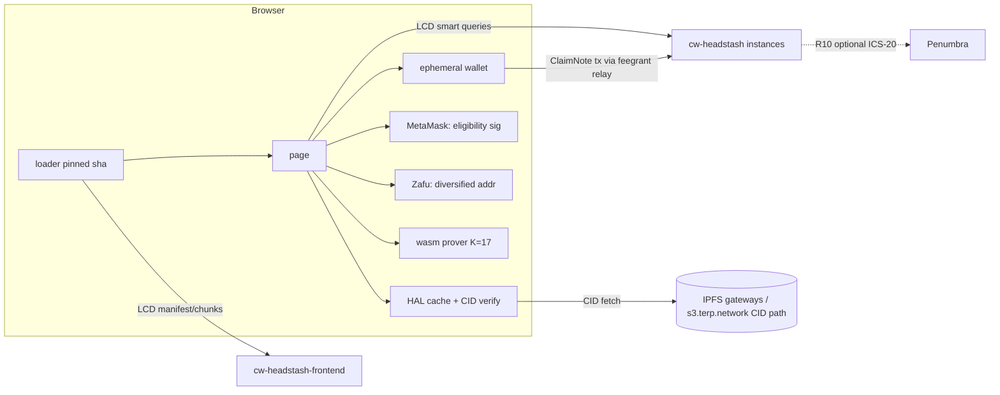
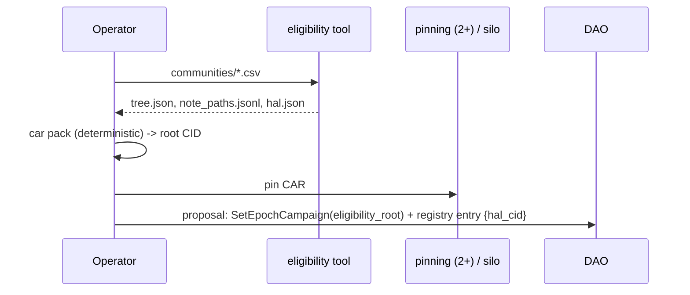
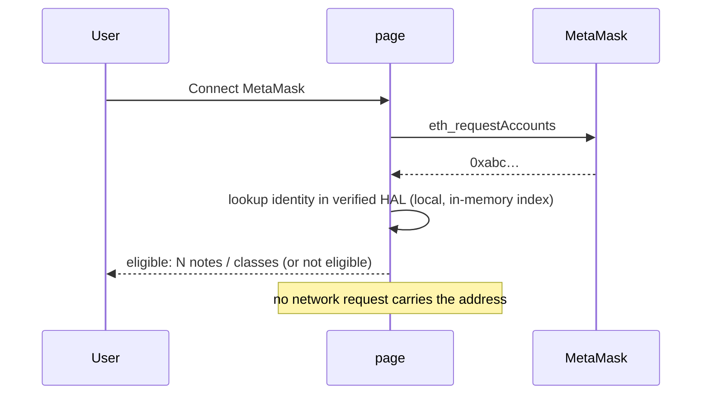
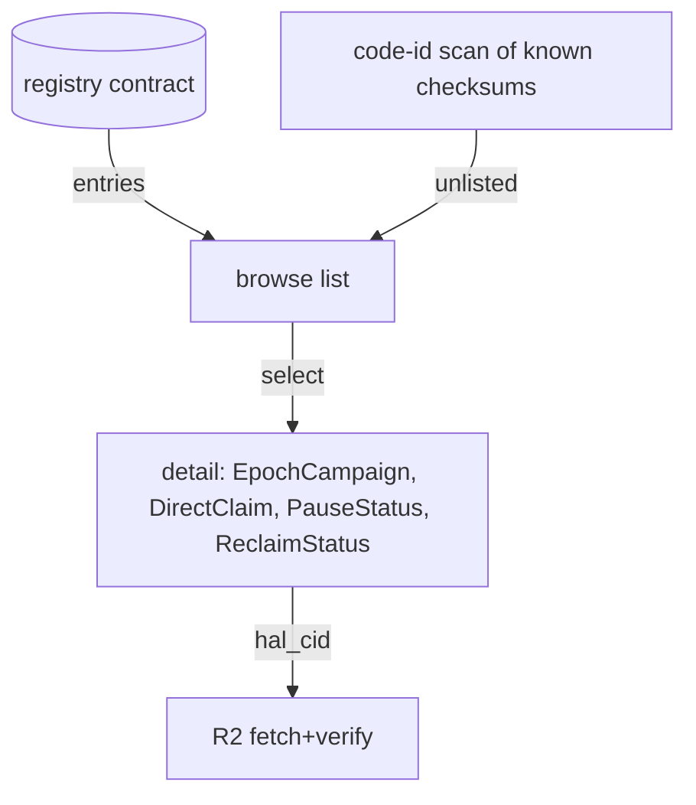

# Headstash v2 — claim page + frontend pruning spec

Status: draft for review. Branch `wip/headstash-v2` (off `e3b1e87`). The contract work for R11 is implemented here.
R1–R9 (UI) are spec only. R10 (IBC forward) is a design plus verdict; nothing is implemented.

Keywords: MUST / SHOULD / CAN as in the owner brief (pt168u). Requirement IDs R1–R11 follow the brief's order.

## 0. Actors and artifacts

| Name | What it is |
|---|---|
| **HAL** | Headstash Allocation List: the public note set (initial allocation). It is `notes/tree.json` + `notes/note_paths.jsonl` from the eligibility tool, plus a small `hal.json` index. |
| **cw-headstash** | The claim contract (one instance per headstash). It verifies `vk_id 3` proofs with `proof_instance_verify`. |
| **cw-headstash-frontend** | The on-chain page store (manifest + chunks). It is versioned and, after R11, prunable. |
| **loader** | The tiny pinned HTML that fetches the manifest and chunks from LCD, hash-checks them and boots the page (served now at `terp.network/headstash/`). |
| **page** | The claim app (JS + the membership prover wasm), stored in the frontend contract. |
| **ephemeral wallet** | A secp256k1 key generated in the browser (WebCrypto CSPRNG). It lives in memory or IndexedDB (non-extractable wrapping key) and is used for registration rewards and claims. |
| **Zafu** | The Penumbra browser wallet. It exposes diversified addresses (`addressByIndex`, one-time addresses). |



---

## R1 — The HAL file MUST be CID-accessible

**Design.**
- At campaign build time the eligibility tool output is packed as a deterministic CAR (UnixFS, CIDv1, raw leaves, sha2-256, chunker `size-1048576`, files sorted). The root CID is recorded in three places:
  1. the campaign metadata (`hal_cid`) in the headstash registry entry (R8/R9);
  2. the frontend manifest `note` field / page config;
  3. the DAO proposal text that created the campaign.
- Pin it on at least two independent pinning services, plus the existing MinIO `silo` bucket under `static/terp.network/headstash/hal/<cid>/` (served by the same nginx, so no new proxy).
- **Binding to chain.** `hal.json` contains `eligibility_root` (hex) and `depth`. The page MUST check that the tree root in the HAL equals `EpochCampaign.registration.eligibility_root` read from the contract. So the CID gives integrity of the bytes, and the on-chain root gives authenticity of the list.



## R2 — Users MUST NOT set the public note set by hand; web retrieval of the HAL

**Design.**
- The page resolves `hal_cid` from the selected headstash (R8/R9). It fetches it, in order: (a) the local cache (IndexedDB keyed by CID); (b) `https://terp.network/headstash/hal/<cid>/…` (same origin, CSP-friendly); (c) public gateways in a fixed list via `https://<gw>/ipfs/<cid>?format=car`.
- **Verification in the browser (MUST).** Fetch the CAR (trustless gateway format), verify every block hash against its CID and walk the DAG from the root CID. Use `@ipld/car` + `multiformats` (sha256 via WebCrypto). Bundle these into the page; no remote script. Never trust a gateway's `200` for plain `/ipfs/<cid>/file` responses.
- Then check the root against the chain (R1). If either check fails, the user sees a red state and claim/registration are disabled.
- An "advanced" disclosure lets users load a local HAL file. It goes through the same two checks; it never replaces the CID.

## R3 — Registration reward address SHOULD be an ephemeral in-browser wallet (CAN default to Keplr)

**Design.** The page shows a radio choice:
- `Ephemeral (recommended)`, the default. A new key per headstash per session, shown as a QR + bech32 + "export"/"sweep to…" action.
- `Keplr`. Uses `experimentalSuggestChain` + `getOfflineSignerAuto`. Where the user's Keplr supports it, a fresh derived account is used; otherwise the user is warned that the address links registration to their Keplr identity.

`reward_addr` (msg.rs:220 `RegisterNotes { reward_addr: Option<String> }`) is filled with the chosen address. The ephemeral key is generated with `crypto.getRandomValues`. It is kept in memory, and optionally persisted in IndexedDB encrypted under a non-extractable AES-GCM `CryptoKey`. The user is prompted to sweep before closing (a `beforeunload` guard while the balance is above 0).

## R4 — Eligibility check with MetaMask against the downloaded set; no server query



- Lookup is purely local: an index `identity -> [note_index…]` built from `note_paths.jsonl` after verification.
- **Privacy.**
  - The page MUST NOT send the address to the relay, LCD or any analytics. The CSP `connect-src` of the page stays limited to LCD/RPC/relay/gateways, and no request is made between connect and result.
  - Signing for registration (eth `personal_sign` of the registration challenge) happens only after an explicit "Register" click.
  - The page documents the leak that remains: registering later reveals the key on chain (by design of v1 registration). Checking eligibility does not.

## R5 — Every form step MUST have an info modal

Steps: (1) choose headstash, (2) HAL load + verify, (3) connect eligibility wallet, (4) reward address, (5) register, (6) wait for anchor / anonymity set, (7) claim destination (ephemeral / Zafu / Keplr), (8) prove, (9) submit, (10) sweep/forward.

Each step has an `(i)` button that opens an accessible `<dialog>` with three parts: *what happens*, *what is revealed on chain*, and *what can go wrong*. Modal copy lives in one `steps.json` inside the page bundle, so it is reviewable and translatable. Acceptance: a test enumerates the form steps and fails if a step has no modal entry.

## R6 — Claims MUST default to ephemeral wallet accounts

- The claim destination defaults to a **new** ephemeral key per note (not per session). This keeps notes unlinkable at the destination.
- Claims are sent from that key (`ClaimNote` pays `info.sender`, direct.rs:240/249), with fees covered by the existing feegrant relay (`CheckNoteClaim` dry-run before the grant).
- Funds are then swept by the user (to Keplr, or Zafu via R7/R10). The UI warns that sweeping several notes to one address re-links them.

## R7 — Zafu diversified addresses; a diversified address MUST NEVER be used for two claims

- Zafu (Penumbra) addresses are only reachable via IBC. So Zafu is a **sweep/forward target**, not the `info.sender` of `ClaimNote`. Under R10 (forward) the Penumbra address is bound into the proof destination.
- **Local guard.** The page asks Zafu for `addressByIndex(account, randomizer)` with a fresh randomizer per claim (or ephemeral/one-time address mode). It keeps a persistent `used_penumbra_addrs` set (IndexedDB), and also a hash of the address per headstash. It refuses reuse.
- **On-chain guard (recommended, R10 path).** The contract stores `FORWARD_USED: Map<sha256(penumbra_addr), ()>` and rejects a second claim that forwards to the same address. This catches reuse across devices and browsers.
  - The cost is one key per claim.
  - Privacy: the hash of a diversified address is unlinkable to other diversified addresses of the same wallet, and it is already revealed by the ICS-20 packet anyway.
- If R10 is not shipped, only the local guard exists, and the spec says so in the modal.

## R8 — Reusable for any existing headstash

- The page takes `?hs=<contract>` (or a registry selection). Everything is read from that contract: `EpochCampaign {}`, `DirectClaim {}`, `RegistrationTree {}`, `PauseStatus {}`, `FrontendContract {}`, `DistroConfig {}`. Denom display comes from bank metadata. The ctx is checked against `DirectClaim.expected_ctx`.
- There are no hard-coded addresses except the chain registry (chain-id, LCD/RPC list, relay URL per headstash in the registry entry).
- The HAL CID per headstash comes from the registry (R9). If there is no registry entry, the user may paste a CID (still verified against the on-chain root, R1/R2).

## R9 — Browse available headstashes and parameters

**Registry source of truth — options.**

| Option | How | Pros | Cons |
|---|---|---|---|
| A. code-id scan | LCD `/cosmwasm/wasm/v1/code/{id}/contracts` for each known cw-headstash checksum | permissionless, no new contract | finds spam/forks too; no HAL CID/relay metadata; the checksum list itself needs distribution |
| B. registry contract | small `cw-headstash-registry`: DAO-owned `Map<addr, Entry{hal_cid, relay, label, frontend, added_at}>` | curated, carries metadata, one query | a governance step per headstash; trust in the DAO |
| **C. (recommended)** | B for curated listing **plus** A shown as "unlisted (unverified)" under a toggle | best of both | two code paths |

The page displays for each headstash: label, denom + metadata, cutoff height (and an ETA), denomination table and caps (`amounts`), paid counts, `min_anonymity_set`, anchor interval, pause status, reclaim status, frontend contract, code id + checksum, admin/owner.



## R10 — IBC transfer of claimed assets to a destination after a valid claim

### Verdict

**The recipient is already a public input. A forward destination can be bound safely with NO circuit change, using a contract-only change.**

Evidence:

1. **The circuit exposes the destination as two public instance cells.**
   - `tools/headstash/circuits/halo2/src/note_membership.rs:16` documents the public inputs as "ctx, root, nullifier, dest_lo, dest_hi, amount".
   - `:167-168` load `dest_lo`/`dest_hi` as advice from `destination_lo/hi`.
   - `:190-192` constrain `[ctx, node, nullifier, dest_lo, dest_hi, amount]` to instance offsets 0..5 via `constrain_instance`.
   - The same applies in `no_ecdsa.rs:120-121, 148-150`.
   - The dest cells are not otherwise constrained (no byte/range gate). The circuit binds *whatever two canonical Pallas elements* the prover chose, and the proof is invalid for any other values.
2. **The packing is a 62-byte string.** `no_ecdsa.rs:277-291` (`pack_destination`) puts up to 62 bytes into lo (31) / hi (31). The contract mirror is `direct.rs:64` (`pack_destination`, same 62-byte limit).
3. **The contract rebuilds the instances itself.** `direct.rs:85` (`instances(ctx, root, nf, dest, amount)`) and `direct.rs:224` (`let inst = instances(...)` → `verify`). The dest is taken from **`info.sender`**: `direct.rs:240` (`check_claim(..., info.sender.as_str(), ...)`), and payout goes to the same address at `direct.rs:249` (`push_credit(res, env, strategy, info.sender.as_str(), amount)`).
4. `ctx` (`direct.rs:48-60`, `direct_ctx`) binds chain-id and contract. `nullifier` is root-independent (one spend per note).

**Answers to the brief's questions.**
- *Is the recipient a public input?* Yes: `dest_lo`, `dest_hi` (instance offsets 3–4).
- *Can H(recipient, channel, penumbra addr, memo) be bound into an existing public input?* Yes. Define the **forward destination string**
  `fwd = "hsfwd1" || base64url_nopad(sha256(DOMAIN || chain_id || contract || channel_id || receiver || memo || fallback))`
  where `DOMAIN = "terp-hs-ibc-fwd-v1\0"`, each field is length-prefixed (u16 BE), and `fallback` is a terp address for refunds. That is 6 + 43 = 49 bytes, which is ≤ 62, so it fits `pack_destination` unchanged.
  - The prover proves for `destination = fwd` (the browser prover already takes an arbitrary destination string: `browser_prove.rs:54`, `note_membership.rs:325`).
  - The contract gets a new message `ClaimNoteForward { root, nullifier, amount, proof, forward: { channel_id, receiver, memo, fallback } }`. It recomputes `fwd` from the message fields and calls the **same** `check_claim(..., &fwd, ...)`, which rebuilds the instances with `fwd`.
  - It then pays with `IbcMsg::Transfer { channel_id, to_address: receiver, amount, timeout, memo }` instead of a bank send.
  - Alternatively the hash can fill the two limbs as raw field elements. Keeping it an ASCII string keeps `pack_destination` and every existing client unchanged, so the string form is recommended.
- *Front-running / redirection?*
  - **Redirection is impossible.** Changing any of channel / receiver / memo / fallback changes `fwd`, so `dest_lo/hi` differ and `proof_instance_verify` fails. The sha256 output space makes finding a second preimage infeasible.
  - **Front-running is harmless.** Anyone who copies the tx from the mempool can only execute *the same* forward to the same receiver. The nullifier is consumed exactly once (`verify_nullifier_stateful`). The submitter is deliberately *not* in the hash, so a relayer/feegrant account can submit.
  - **Collision with a normal claim.** `ClaimNote` uses the sender's bech32 string. A bech32 address cannot equal an `hsfwd1…` string unless sha256 is broken, and `ClaimNote` verifies `dest == info.sender`, so a forward proof cannot be replayed as a plain claim either.

### Required contract-side safeguards (no circuit change)

- **Channel allowlist** (`FORWARD_CHANNELS: Map<channel_id, {counterparty_chain, enabled}>`, owner/DAO-set). A bound but dead channel would otherwise lock funds into timeouts.
- **Timeout + refund handling.** The contract is the ICS-20 sender, so on ack-error/timeout the tokens return to the contract. Implement `ibc_source_callback` (or the ICS-20 callbacks middleware, if enabled on terpd) to credit `fallback` (bound in the hash). Without callbacks, keep a `PENDING_FORWARD` record keyed by sequence and let anyone trigger `RefundForward{seq}` after timeout plus a proof of no-ack, or simplest: route refunds to `fallback` via a pull-based claim. **Open question: are IBC callbacks available on terpd?**
- **One-use Penumbra address** (R7): `FORWARD_USED: Map<sha256(receiver), ()>`.
- **Denom.** The tokenfactory denom must be transferable over ICS-20 (it is, as a native denom). The Penumbra side will see `transfer/<chan>/factory/...`. Memo length cap (e.g. 256 bytes).
- **Caps and pauses** are the same as `ClaimNote` (`check_claim` is shared, so class caps, the cutoff, the pause check and the public-path reservation all apply unchanged).
- Prefer **one IBC transfer per claim** (no batching) to avoid amount-linking. Penumbra's shielded pool provides privacy after arrival.

```mermaid
sequenceDiagram
  participant B as Browser
  participant Z as Zafu
  participant HS as cw-headstash
  participant T as ICS-20
  participant PN as Penumbra
  B->>Z: fresh diversified address A_i
  B->>B: fwd = "hsfwd1"+b64u(sha256(dom,chain,contract,chan,A_i,memo,fallback))
  B->>B: prove(destination = fwd)   (existing circuit, unchanged)
  B->>HS: ClaimNoteForward{root,nf,amount,proof,forward}
  HS->>HS: recompute fwd; check_claim(fwd) -> proof_instance_verify
  HS->>HS: nf spent; FORWARD_USED[h(A_i)]
  HS->>T: IbcMsg::Transfer(chan, A_i, amount, timeout, memo)
  T->>PN: packet -> shielded A_i
  T-->>HS: ack / timeout -> refund to fallback
```

---

## R11 — cw-headstash-frontend version pruning (IMPLEMENTED)

### Behaviour
- `instantiate` writes cw2 (`crates.io:cw-headstash-frontend`, `CARGO_PKG_VERSION` = 0.0.2).
- `migrate(MigrateMsg {})` (entry point with `MigrateInfo`):
  - with cw2 present: the contract name must match and the stored semver must be ≤ the new one (no downgrade);
  - with **no cw2** (the v1 / code-106 state): accepted only if `max_chunk`, `next_version` and `current` exist, i.e. the state looks like this contract. Any other state is refused;
  - then it writes cw2. Attributes: `from` (`v1-no-cw2` or the old version), `to`.
- `ExecuteMsg::PruneVersion { version, limit: Option<u32> }`:
  - owner only (cw-ownable);
  - refuses: the current version, an unknown version, an already pruned version, and a **pending activation target** (an `activate=true`, incomplete version greater than current). The last one can still become current by auto-activation; it becomes prunable once a newer version is made current;
  - `limit` is the number of chunk slots visited per call: default 50, clamped to [1, 250]. Gas is bounded per call (each visited slot is one read plus at most one delete);
  - first call: it marks `pruning[version] = (file, index, removed)`. Every call resumes from that cursor in manifest order;
  - when every slot has been visited: it removes `manifests[v]`, `progress[v]` and `pruning[v]`, and writes the tombstone `pruned[v] = removed`. Version numbers are never reused, because `next_version` is monotonic, so `PublishManifest` for a pruned number is refused;
  - while a version is pruning, `UploadChunk` and `SetCurrent` refuse it (no resurrection mid-prune).
- `QueryMsg::PruneStatus { version }` → `{ version, state: live|pruning|pruned|unknown, next_file, next_index, removed, remaining }`.
- **Fix**: auto-activation on the last chunk now only moves `current` forward (`version > current`). In v1, an older activate=true version that finished late would replace a newer current.
- Keep-last-N: deferred (open question). Owner tooling can loop `Versions` and prune all but N.

```mermaid
stateDiagram-v2
  [*] --> live: PublishManifest
  live --> live: UploadChunk / SetCurrent
  live --> pruning: PruneVersion (first call; not current, not pending target)
  pruning --> pruning: PruneVersion (limit slots, cursor saved)
  pruning --> pruned: last slot visited -> manifest+progress+cursor removed, tombstone
  pruned --> [*]
```



### Files
- `contracts/headstash/cw-headstash-frontend/src/lib.rs`: `PRUNING`, `PRUNED`, `CONTRACT_NAME/VERSION`, `prune`, `prune_status`, `migrate`, guards, auto-activation fix.
- `src/msg.rs`: `PruneVersion`, `MigrateMsg`, `PruneStatus`, `PruneStatusResponse`, `DEFAULT_PRUNE_LIMIT`/`MAX_PRUNE_LIMIT`.
- `src/interface.rs`: cw-orch migrate type `MigrateMsg`, `ContractWrapper::with_migrate`.
- `Cargo.toml`: `cw2`.
- Tests: `src/tests.rs` (+6 unit tests), `tests/orch_prune.rs` (cw-orch Mock / multi-test).
- e2e: `tools/headstash/e2e/run_dao.py` `fe_v2_prune` (enabled by `FE_V2_WASM`).
- Wasm: `artifacts/v2/cw_headstash_frontend.wasm` + `checksums.txt`.

---

## Security considerations (R1–R10)

- **HAL CID verification.**
  - Use trustless CAR verification only.
  - Re-check the root on chain.
  - Cap the CAR size (e.g. 64 MB) and the block count, to resist gateway DoS.
  - Cache by CID; a cached entry is never "updated".
  - The gateway list is in the page bundle (pinned by the loader manifest sha), so a compromised DNS cannot add a gateway.
- **Zafu reuse prevention.** The local set alone cannot detect reuse across devices. The on-chain `FORWARD_USED` (R10) is authoritative. The UI never offers Zafu's default (index 0) address.
- **Ephemeral keys.**
  - Generated by the CSPRNG and never sent anywhere.
  - Optional at-rest encryption with a non-extractable key; an export/sweep prompt.
  - The page runs under a strict CSP (the loader already sets `script-src` blob-only from verified chunks).
  - Losing the tab loses funds, so the sweep UX is mandatory before "done".
- **MetaMask eligibility privacy.** The lookup is local. No `eth_sign` until register. No third-party RPC calls with the address (MetaMask's own RPC still sees `eth_requestAccounts`, but not the eligibility).
- **Registry source of truth.** The curated registry is DAO-owned. The page shows both the registry entry and the on-chain facts (code checksum, admin) and flags mismatches. Unlisted code-id scan results are marked unverified.
- **IBC auto-forward.** See R10: hash-bound destination, channel allowlist, refunds to the bound fallback, one-use receiver, memo cap. Timeouts must be finite (e.g. 10 minutes of block time) so that funds are never stuck in flight.

---

## C. Security review — R11 implementation

Reviewed `lib.rs` (prune/migrate/guards) and the tests.

1. **Authorization.**
   - `PruneVersion` calls `cw_ownable::assert_owner` before any state read beyond ownership.
   - `migrate` is gated by the chain (contract admin only); in the e2e that is the DAO, and the non-admin migrate is shown to fail.
   - If ownership is renounced, pruning becomes impossible (same as SetCurrent), which is acceptable: a frozen page stays frozen.
2. **Never prune current.** `prune` checks `CURRENT == Some(version)` on every call, not just the first. While a version is pruning, `SetCurrent` refuses it and auto-activation cannot target it (uploads are refused). So current can never point to a pruning or pruned version. This is covered by the tests `never_prunes_current`, `prune_in_batches…` and the e2e `fe_v2_prune_current_refused`.
3. **Bounded work.**
   - Each call visits ≤ 250 slots (clamp, tested by `prune_limit_is_clamped`).
   - The trailing "skip empty files" loop is bounded by `files.len()`, and the manifest validation caps files (`MAX_FILES`). Zero-chunk files cost no deletes.
   - Total gas per call ≈ limit × (read + delete) + manifest load. The manifest is loaded each call; it is bounded by the existing manifest size limits.
4. **Completeness ("keys actually gone").**
   - The prune visits every `(file, index)` the manifest declares. Chunks can only exist at manifest-declared slots (`UploadChunk` checks bounds), so after completion no chunk key for the version can remain.
   - The unit test scans the raw keys plus the total storage count (−9 keys +1 tombstone). The e2e reads raw keys over LCD.
5. **Resume integrity.**
   - The cursor is stored only in contract state. Concurrent prune calls in one block are serialized by the chain.
   - The cursor never moves backwards. `removed` counts only keys that existed, so for partially uploaded versions it is less than the total (tested).
6. **Pending activation target.**
   - Refusing an incomplete `activate=true` version > current prevents racing an in-flight upload. The fix "auto-activate only forward" ensures a superseded target can never activate later, so allowing its prune afterwards is safe.
   - Residual: an owner who publishes v_{n+1} with activate=true and abandons it must make some newer version current before pruning it. This is documented.
7. **Migrate safety.**
   - The legacy path requires the three v1 items, which stops migrating an arbitrary contract's state into this code by mistake.
   - Downgrades and foreign cw2 names are refused.
   - Equal version re-migrate is allowed (idempotent), which helps redeploys.
   - The semver parse is strict `x.y.z` numeric; pre-release tags are refused (fail closed).
   - Migration does not touch existing state; v1 chunks and the manifest stay byte-identical (e2e `fe_v2_v1_state_kept_after_migrate`).
8. **Tombstones** cost one small key per pruned version, and they prevent version-number reuse, so cached loaders pinned to an old manifest sha can never be served different bytes under the same version.
9. **Loader impact.** A pinned loader that points at a pruned version gets "manifest not found" and fails closed. Operators must re-pin before pruning the version that any published loader pins (operational note in the runbook).
10. **No panics.** Arithmetic: `remaining = total - before`, where `before ≤ total` by cursor construction. Counters are u32, bounded by the manifest chunk limits.

Findings: none blocking. Recommendation: before pruning on mainnet, check every published loader pin (terp.network/headstash, s3 copies) against `Config.current`.

---

## Open questions

1. Are IBC source callbacks (or the ibc-hooks/callbacks middleware) enabled on terpd mainnet? This decides how refunds are handled for R10.
2. Registry: should a curated DAO registry contract be deployed (option C), or is code-id scanning enough?
3. Keep-last-N auto-pruning in the contract, or tooling only?
4. HAL pinning providers, and is s3.terp.network/static the canonical mirror?
5. Should the R7 on-chain `FORWARD_USED` also hash the denom (allowing the same address across different headstashes), or be global?
6. Should the mainnet migration of the frontend (code 106 → v2) be a DAO proposal rendered via cw-orch-kms like the frontend proposal (e3b1e87)?
7. Still pending from the earlier phase: DAO vote/execute CLI commands for the frontend proposal (they need the proposal id).

## R11 verification results (groot-wan, 2026-11-03)

- `HSFE_ASSET_DIR=<prover dir> nice cargo test -p cw-headstash-frontend --features interface`: lib 10 passed / 0 failed; orch_prune 1/0; orch_upload 1/0.
- Optimizer (`optimizer-arm64:0.17.0-rust1.91`, wasm-opt -Os, one-caller-inline 2000): `artifacts/v2/cw_headstash_frontend.wasm`, sha256 `88ac2bbe5af595650002bfc676e8bd90194049bb26ef660417033398f69ade77`, 381014 B, cosmwasm-check pass.
- Local e2e (`run-local.sh` HARNESS=dao FE_PROP=1 STOP_AFTER_FE=1 REST_CORS=1 + `FE_V2_WASM=artifacts/v2/cw_headstash_frontend.wasm`): **65 passed / 0 failed** (the earlier 50 plus 15 new `fe_v2_*` steps). Flow: v1 code 106 bytes (no cw2) → store v2 → non-admin migrate refused → DAO migrate (cw2 written, v1 state unchanged) → publish + upload v2 (not auto-activated) → prune of the current version refused (proposal execution_failed) → set current v2 → prune v1 limit 4 (pruning, 4/10) → upload to the pruning version refused → 2 more batches → pruned, 0/10 raw chunk keys, no manifest/progress/cursor keys, tombstone present → versions == [2] → v2 10/10 chunks hash-verified. The report is `/tmp/headstash-mvk-chain/run-1793757321/report.json` (copy in the git-ignored `tools/headstash/e2e/out/v2/`).
