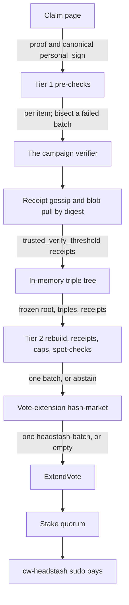
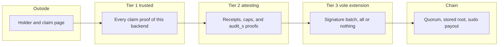

# Headstash tiers inside hash-market

The claim path is a feature of the existing hash-market process
(`crates/terp-rs/tools/hash-market`). It is not a new binary. Several
operators may run that same process with different membership. Dev binds
`127.0.0.1` only.

`tools/hash-market/docs/headstash.md` is a different feature (encrypted
notes and circuit keys). This note does not change those routes.
`ProcessHeadstash` stays in cw-headstash as a retained on-chain Halo2
variant. The epoch path does not call it.

This revision folds the approved airdrop rules from the humanity
comparison (sections 5 and 6) into the tiered trust spec. The circuits
and the contract on disk do not implement the new statement yet. Where a
row below says "today", that is the code in this tree. Where it says
"spec", that is the required change.

## Tiers

Membership and thresholds are creator parameters on cw-headstash. Sets may
overlap: one operator key may sit in more than one tier. Duties do not
collapse when a key overlaps. A process acting as the vote-extension tier
still checks signatures and does not skip that check because it also
verifies proofs.

| Tier | Who | Does | Does not |
|---|---|---|---|
| 1. Trusted set | Configured members. Ingress is any member. | Runs the campaign's one verifier off-chain (`verify_claim` or `Proof::verify`). Applies the cheap pre-checks first. Keeps an in-memory tree of accepted triples `nullifier \|\| destination \|\| amount`. Shares receipts and blobs with other members. Signs the frozen tree root. | Run the other backend. Speak for stake. Accept a public leaf index. |
| 2. Attesting set | Configured members. | Rebuilds the tree. Checks an ICS-23-style existence proof per triple. Checks every triple's receipt threshold. Enforces per-amount-class caps against the published allocation. Spot-checks `audit_s` claim proofs. Signs the reconstructed root only when all of those pass. | Verify every claim proof. Accept a batch whose sample or receipt set is incomplete. |
| 3. Vote-extension set | Validators running hash-market, reached by `x/hashmerchant` `ExtendVote`. | Checks the trusted and attesting signature batches as one batch. Serves `GET /vote-extension`. Stake quorum in the module updates the state root and sudo's cw-headstash. | Run claim proofs. Bisect a bad batch. Re-derive the tree from proof bytes. |

A later option on tier 1: one Flock/Ligerito proof that the tree contains
only triples with enough verify-receipts. The attesting set would check
that curation proof instead of sampling blobs. Not required for the first
slice. Ring-VRF, recognition sets, and BLS aggregation of member
signatures are also later.

## One prover per campaign

The creator parameter `backend` is `flock` or `halo2`. A campaign has
exactly one. Ingress rejects a proof whose backend byte disagrees with
that parameter before it verifies anything.

Halo2 is the airdrop prover. Flock is a comparison variant; candidate
gift/onramp backend (bearer link, design TBD).

The two backends stay available as two example campaigns, so a benchmark
can compare them on the same note count. Each example has its own
contract, its own `allocation_root`, and its own `ctx`. A campaign never
registers a second root for the other scheme.

The comparison also described a shared-nullifier alternative: two roots
under one set, one spent set, and byte-identical nullifiers. This spec
does not use that alternative. Cross-backend replay inside one campaign
has no path, because the second backend is refused.

## Context-scoped nullifier

`ctx` is a public 32-byte constant for the campaign. Instantiate computes
it, stores it in the creator parameters, and never updates it. The
contract, the retained verifier, and every sidecar supply those stored
bytes as a public input. A proof whose public `ctx` differs from the
stored bytes is rejected before the nullifier is inserted.

Anyone can recompute the bytes. The stored value is the one the verifier
uses. A recomputation that disagrees with the stored value is a reject.

```text
domain     = ASCII "terp/ctx/v1"                         (11 bytes)
chain_id   = UTF-8 chain id
addr       = UTF-8 bech32 of this cw-headstash contract
backend    = 1 for flock, 2 for halo2
root       = the 32-byte allocation_root

preimage   = domain
           || u16le(len(chain_id)) || chain_id
           || u16le(len(addr))     || addr
           || u8(backend)
           || root

ctx        = SHA-256(preimage)
```

`app_id` in the comparison is this contract address. `app_scope` is the
backend byte followed by `allocation_root`. A new drop is a new
instantiate, so it gets a new address or a new root and therefore a new
`ctx`.

The spent set inside this contract is keyed by the nullifier. The public
`ctx` check runs first, and the nullifier is a PRF of the note secret and
that `ctx`, so a nullifier from another campaign does not collide with
one opened under this `ctx`. A store that outlives a single contract keys
rows by `(ctx, nullifier)`.

### PRF, Flock

Today `derive` sets `nullifier = compress(rseed_message(rseed), FLAG_NULLIFIER)`
with `FLAG_NULLIFIER = 2`. `rseed_message` copies the 8 `rseed` words into
a 16-word message and leaves the other 8 words zero. The nullifier depends
only on `rseed`. There is no `ctx` input.

Spec. Keep the flag and the 16-word compress. Fill the 8 spare words with
`ctx` (`words_to_bytes` in reverse: eight little-endian `u32`s).

```text
message[0..8]  = rseed
message[8..16] = ctx as eight u32, each ctx[4i..4i+4] little-endian
nf             = compress(message, FLAG_NULLIFIER)
```

The circuit constrains `message[8..16]` to the public `ctx`. A nullifier
from the all-zero suffix is a different digest and does not verify under
this message.

### PRF, Halo2

The live nullifier is Orchard `DeriveNullifier` (ZIP 224 §4.16), gadget
`derive_nullifier`. The instance column publishes it at `NF_OLD`.

`bind_hiding_nullifier_inputs` constrains the inputs. `nk` is not a free
witness:

```text
rho = rseed_lo
psi = rseed_hi
rcm = rseed_lo + rseed_hi
nk  = Poseidon(DST_HKDF, rseed_lo, rseed_hi)
```

`DST_HKDF` is the 32-byte ASCII `Hkdf_headstash_710_terp.network\0`.
`rseed_lo` and `rseed_hi` are the little-endian `u128` halves of the
32-byte string (`rseed_halves`). Then:

```text
hash   = Poseidon(nk, rho)
scalar = hash + psi
nf     = extract_p(cm + [scalar] NullifierK)
```

That `nf` depends on the note. It does not take a campaign constant.
`claim_nullifier` in `claim_auth.rs` hashes the public leaf fields under
`terp-hs-nullifier-v1` and is not this path. The module comment above
`CLAIM_PREFIX` still mentions `esk` inside `nk`. The constraint that
synthesize runs is the `DST_HKDF` PRF above, and synthesize assigns `esk`
as zero for the note commit.

Spec. Keep `DeriveNullifier`. Bind `ctx` into the nullifier key first.
Each half is 16 bytes, so it is a canonical Pallas base (`2^128` is below
the field modulus). Raw SHA-256 output is not used as one field element.

```text
nk     = Poseidon(DST_HKDF, rseed_lo, rseed_hi)     // unchanged
ctx_lo = pallas::Base from u128le(ctx[0..16])
ctx_hi = pallas::Base from u128le(ctx[16..32])
nk_ctx = Poseidon(nk, ctx_lo, ctx_hi)               // ConstantLength<3>
hash   = Poseidon(nk_ctx, rho)
scalar = hash + psi
nf     = extract_p(cm + [scalar] NullifierK)
```

The two limbs are public inputs and must pack back to the stored `ctx`.

These two PRFs are different functions. They do not need to return the
same bytes. Each campaign runs only one of them, and `ctx` already
contains the backend byte.

## Canonical signed message

Three message formats exist around the tree. One body replaces all three.

| Format today | Where | Body |
|---|---|---|
| Halo2 claim | `circuits/halo2/src/claim_auth.rs` `claim_signing_message` | `headstash-claim-v1:` plus 64 hex characters of a 32-byte Poseidon claim digest. `attach_personal_sign` also describes the challenge as keccak of the 168-byte instance prefix. |
| Flock private claim | `circuits/claim-flock/src/statement.rs` `private_sign_message` | `headstash-private-claim-v1:` plus hex of root, nullifier, and `payout_com`. `signature_opens_leaf` runs outside the circuit. The Ligerito frontend has no secp256k1 gate yet. |
| Four-word draft | removed with the standalone ingress; not in this tree | `headstash-claim-v1:{root}:{nullifier}:{destination}:{amount}` with no `ctx`. |

Spec body, UTF-8, one line, fields separated by `:`. The four words are
the allocation root, the nullifier, the destination, and the amount.
`ctx` is the field after the prefix.

```text
headstash-claim-v1:{ctx_hex}:{root_hex}:{nullifier_hex}:{destination}:{amount}
```

- `ctx_hex`, `root_hex`, and `nullifier_hex` are 64 lowercase hex
  characters of the 32-byte values. Flock words become those bytes with
  `words_to_bytes` (each `u32` little-endian). The `{word:08x}` packing in
  `private_sign_message` is one of the formats this body replaces.
- `destination` is the bech32 string under creator parameter `bech32_hrp`.
  The 20 address bytes are the five destination words, each little-endian,
  concatenated. `accepted_root` hashes the bech32 string with a
  little-endian u16 length. It does not hash the raw 20 bytes.
- `amount` is the decimal `u64` with no leading zeros. Zero is `0`.
  Flock publishes that integer as one field word, `pack4([lo, hi, 0, 0])`.
  The leaf and the payout commitment store `lo` at message word 8 and `hi`
  at word 9. Halo2 publishes the same integer as `NoteValue`'s `u64`
  (`MAX_NOTE_VALUE` is `u64::MAX`) in the public instance. The class cap
  counts claims of one amount and stays a `u32`.

The holder signs that body with `personal_sign`. EIP-191
(`\x19Ethereum Signed Message:\n` plus the decimal length, then keccak256)
stays outside the body, as both wallets and `eip191_keccak` already apply
it. Halo2, when that circuit is rebuilt onto this body, keeps the
signature check it already runs inside the proof. Flock does not grow a
fake one. The Ligerito frontend still has no secp256k1 gate, and publishing
the five fields is not a signature check. Flock publishes `ctx`, the
allocation root, the nullifier, the destination, and the amount. Tier 1
checks `personal_sign` of this body beside the proof, with
`signature_opens_leaf`, and requires the recovered key to open the leaf.
The signature is not a public word of the Flock circuit.

The epoch verifier's public statement is `ctx`, the allocation root, the
nullifier, the destination, and the amount. The leaf index is a witness.
`CMX` is not a public word of this statement. The signature travels with
the submission and is checked before a receipt. It is not a column of the
accepted row.

## Flock leaf index is a witness

Today `Opening.index` selects the Merkle side while the circuit is built.
`verify_claim(index, proof)` rebuilds from the index. Flipping the index
changes `circuit.digest()`. The index is public to tier 1, and each claim
pays a circuit rebuild (about 0.83 s of the about 0.95 s sidecar verify
on the depth-16 bench).

Spec. The index is a witness, on the same footing as Halo2 `Circuit.pos`,
which is already a witness. `circuit.digest()` is fixed for the campaign's
depth and verifying key. `verify_claim` does not take an index argument.
Ingress rejects a submission that presents the index as a public field.
The receipt, the triple, and the chain row omit it.

Halo2 position stays a witness. No per-claim Halo2 rebuild is required for
the index.

## Confirmed: Halo2 nullifier and leaf

Read from `tools/headstash/circuits/halo2`.

The claim nullifier is `DeriveNullifier` above. It is instance `NF_OLD`.

The Merkle leaf is `poseidon_distro_leaf`:

```text
Poseidon ConstantLength<7>(
  personalization "terp-hs-distro-leaf-v1",
  epk_x, epk_y, nd, v, fdi, rseed_com
)
```

The path hash is `poseidon_distro_crh` (`terp-hs-distro-crh-v1`).
Synthesize constrains that root to instance `ANCHOR`. The circuit comment
records that the distro tree is public, unlike an Orchard Sinsemilla tree
that puts `cmx` in the leaf.

The note commitment `CMX` is a different Poseidon digest,
`poseidon_note_cmx`:

```text
Poseidon ConstantLength<9>(
  personalization "terp-hs-note-commit-v1",
  nd, v, fdi, recp, esk, rho, psi, rcm_base
)
```

Synthesize forces `esk = 0` into that commit ("note commit does not take
esk") and publishes the digest at instance `CMX`. `CMX` binds the
recipient and the nullifier inputs. The leaf binds `epk`, the allocation
words, and `rseed_com`. They are different hashes. The leaf opening does
not publish `CMX`, and `CMX` does not identify the leaf position.
`Circuit.pos` is the position witness.

`rseed_com` for the Halo2 leaf is `Poseidon(DST_RSEED, rseed_lo, rseed_hi)`.

Flock's leaf is `merkle_leaf(rseed_com, epk_x, nd, v, fdi)`: one compress
under `FLAG_LEAF`, then one under `FLAG_BIND` that absorbs the amount.
`PublicLeaf` in `tree.rs` is only `(index, rseed_com)`. That pair does not
recompute the leaf, because the leaf also absorbs the key, `nd`, `fdi`,
and the amount. The publication rule below is the list the campaign
actually freezes.

## Primitives this reuses

| Primitive | Where it lives | What this design uses it for |
|---|---|---|
| `GET /vote-extension` | `tools/hash-market/src/ve/server.rs` | One JSON body per block. The keeper calls it with no query (`keeper/vote_ext.go` `fetchSidecar`). |
| `aggregateAttestationRoot` | `x/hashmerchant/keeper/oracle.go` | SHA-256 of `source_id \|\| value \|\| height` as 8 little-endian bytes, over the sorted de-duplicated attestations. One attestation whose `source_id` is `headstash-batch` is the root the quorum stores. |
| ed25519 custody verify | `verifyOracleAttestations` | One registered `OracleSource` pubkey per `source_id`. The vote-extension tier signs the single `headstash-batch` attestation with that key after it has checked the tier batches. |
| Stake quorum `0.667` | `x/hashmerchant/types/params.go` | Unchanged. Empty extensions count in the denominator and add no root. |
| Sudo callback | `spec/06_sudo_interface.md`, `dispatchSudoCallbacks` | Delivers `chain_uid`, `algo`, `root`, and `oracle_sources` to contracts whose escrow is still paid. `chain_uid` is `headstash-claim`. |
| `ics23_proof` field | `VoteExtensionHashData` | Carries an ICS-23 existence proof of the row bytes under the accepted root so the result is attestable. The keeper does not verify that proof today (`spec/10_multi_source_oracle.md`: light-client-grade ICS-23 is not implemented). |
| BLS12-381 host API | `contracts/headstash/cw-headstash/src/wavs.rs` | `bls12_381_hash_to_g2` and `bls12_381_pairing_equality` already check a proof-of-possession per operator key. `aggregate_key` and `threshold` are stored there. That file does not yet verify a threshold signature over a headstash root. First-slice member signatures are ed25519, the algorithm the keeper already verifies. BLS aggregation of those signatures is the later compression, using this host API. |
| `accepted_root` | `contracts/headstash/cw-headstash/src/epoch.rs` | Domain `terp-headstash-accepted-v1`, the allocation root, then rows sorted by nullifier. Each row is nullifier, 32-byte denom, length-prefixed destination, amount. Sorting makes arrival order irrelevant. |
| `pending_root` | same file | Domain `terp-headstash-pending-v1` over an ordered list of digests. Order matters in the current function. Tier 1 sorts digests before hashing so gossip order cannot fork the pending root. |
| Halo2 on-chain verify | `ProcessHeadstash` | Retained. Same statement as the epoch path once the circuit is rebuilt, including public `ctx`. Not on the epoch path. |

"IBC/ICS/TAO-style" here means the IBC light-client pattern already described
in `x/hashmerchant/spec/01_concepts.md`: signatures attest a root, and an
ICS-23 proof shows a leaf under that root. No new light-client protocol.

## Data flow



The claim page sends no leaf index. The verifier is `verify_claim` when
`backend = flock` and `Proof::verify` when `backend = halo2`. The claim
page and the node both talk to hash-market. The node URL is the one
already configured as `hashmerchant.sidecar-url`.

## Trust boundaries



Full proof blobs stop at tier 1, except the `audit_s` blobs tier 2 pulls.
Tier 3 sees roots and signature batches. The chain sees one attestation
whose value is the 32-byte batch root. The row bytes stay in the batch
the sudo reads. They are not the attestation value.

## Creator parameters

Sidecars read these from cw-headstash. They are not hard-coded in
hash-market. `backend`, `ctx`, `allocation_root`, and the published
allocation list are fixed at instantiate for the life of the campaign.

| Parameter | Use |
|---|---|
| `backend` | `flock` or `halo2`. Exactly one. |
| `ctx` | The 32-byte SHA-256 above. Public input to the contract, the retained verifier, and every sidecar. |
| `cutoff_height` or `epoch_length` | The height at which the accepted tree freezes. Answered: this is the cutoff. |
| `bech32_hrp` | HRP for the destination string in the signed body. `accepted_root` hashes that string. |
| `denom_proof` | The 32-byte denom every sidecar puts in the row. It is the token strategy's proof representation, not the Flock `nd` word. |
| `payout_denom` | Bank denom sudo sends. |
| `allocation_root` | The campaign root proofs must open. Immutable. |
| `proof_len` | Exact proof byte length for this frozen verifying key. Ingress requires equality. |
| `audit_s` | How many claim proofs each attester verifies. Recommended starting value 1000. |
| `max_rows` | Largest batch whose sudo fits `SudoGasLimit`. A larger set is not attested. |
| Trusted members | ed25519 pubkeys. Optional BLS12-381 keys for the later aggregate. |
| `trusted_verify_threshold` | Distinct members who must verify a claim before its triple enters the tree. |
| `trusted_sign_threshold` | Distinct members who must sign the frozen root. |
| Attesting members | ed25519 pubkeys. |
| `attest_threshold` | Distinct attesting signatures on the reconstructed root. |

Default for each threshold is two thirds of that set, rounded up. The
creator may set another count. The stake quorum stays `0.667` and is a
different number. A key may be listed in both member sets.

The vote-extension set is the bonded validator set. It is not a second
pubkey list. The single `headstash-batch` custody key remains the
`OracleSource` registered in `x/hashmerchant`.

## How a vote is one algo

`fetchSidecar` stores one `(chain_uid, algo, root)`. This design does not
change that.

Each sidecar reads the cutoff from the contract and the current height
from the chain. Below the cutoff, `GET /vote-extension` returns algo
`headstash-pending` and does not pay. At the cutoff, it returns algo
`headstash-accepted`. Sudo on the accepted algo pays. Sudo on the pending
algo only stores the root.

A validator whose `sidecar-url` already serves another chain cannot also
serve this route: the fetch sends no `chain_uid`. Headstash validators
point `sidecar-url` at a hash-market whose only provider is this route.
Other oracle chains keep their own URL.

## Payout inside sudo

Answered: no relayer broadcasts `ApplyAcceptedBatch`.

Today `epoch::sudo` stores the root and sets `minted=0`.
`ApplyAcceptedBatch` is what pays, and it stays in the contract as a
retained variant.

The epoch path pays inside the accepted sudo:

- One attestation, `source_id = headstash-batch`.
- `value` is the 32-byte pending or accepted root. The attestation height is 1.
- The seal height selects pending versus accepted. It is `foreign_height` on the vote, not the attestation height.
- The quorum root is `aggregateAttestationRoot` of that attestation.
- Sudo recomputes `attested_root` from that 32-byte value and checks it
  against the quorum root. The row bytes are the stored batch. They are not
  `oracle_sources[0].value`. Paying those rows is the step-3 sudo change.
- A batch above `max_rows` is not signed, so it never reaches sudo.

`ApplyAcceptedBatch` is not on this path.

## Allocation set

The campaign set is a snapshot. It is immutable for the life of the
contract. Instantiate freezes `allocation_root` before claims open. There
is no later `RegisterEligibilityRoot`, no re-shard into smaller trees, and
no suspend. The anonymity set of a proof is this one tree. A new drop is
a new campaign.

The published list is what anyone needs to recompute that root, and what
tier 2 uses as the amount-class table. An attester that does not have the
list abstains. Raw `rseed` stays off the list. The nullifier cannot be
recomputed from the list.

Flock row, in index order. Leaf digest is `merkle_leaf` over these fields:

| Field | Role |
|---|---|
| `index` | Position in this frozen list. Claim traffic does not repeat it. |
| `rseed_com` | `compress(rseed_message(rseed), FLAG_RSEED)`. |
| `epk_x` | Four `u32` words, the key bytes the leaf absorbs. |
| `nd`, `fdi`, `v` | Allocation words. `v` is the amount class. |

`PublicLeaf { index, rseed_com }` is the in-memory builder type today. It
is shorter than this row. The campaign publishes the row above.

Halo2 row, in position order. Leaf digest is `poseidon_distro_leaf`:

| Field | Role |
|---|---|
| `position` | Witness on the claim path. Public only in this frozen list. |
| `epk_x`, `epk_y`, `nd`, `v`, `fdi`, `rseed_com` | The seven-field leaf preimage, tag excluded. |

`CMX` is not a column of this list.

Publishing `epk` at a known index makes every eligible key visible on the
list. A claim stays unlinkable to a row while the index stays off the
proof's public inputs, the receipt, and the chain row. A unique public
amount still names its note. That is the residual of a public payout.

## Cheap pre-checks and batch boundaries

Ingress runs these checks before the campaign verifier. A failure returns
that item and does not spend a verify:

- `backend` matches the campaign.
- Public `ctx` equals the stored `ctx`.
- Allocation root equals the stored root.
- Nullifier is absent from the spent set and from the pending set.
- Destination decodes under `bech32_hrp` and equals the destination in the
  signed body.
- Amount appears in the published allocation, and accepting it would keep
  that amount's count at or below the published count.
- Proof length equals `proof_len`.
- SHA-256 of the proof bytes has not already been accepted.

The index is not an input to this list. A public index on the submission
is a reject.

A peer verifies a blob only when the blob arrives with a valid ed25519
receipt from a configured trusted member. The receipt body is:

```text
headstash-receipt-v1:{ctx_hex}:{root_hex}:{nullifier_hex}:{destination}:{amount}:{digest_hex}
```

`digest_hex` is 64 lowercase hex characters of SHA-256 of the proof bytes.
The signed fields are the same spellings as the holder message.

Batch rules:

- User to tier 1 is per item. Submitters are untrusted. On a failed batch,
  bisect to the failing items and keep the ones that pass. One junk
  submission does not drop the honest proofs beside it. Today's verifiers
  check one proof at a time, which already isolates items. A future
  `batch_verify` at this edge uses the per-item-and-bisect rule.
- Tier 1 to tier 3 is all or nothing. The batch has one responsible
  producer, the trusted-set signature batch. One bad signature or one bad
  row rejects the whole batch. The vote extension is empty. Tier 3 does
  not attribute a signer.
- BLS aggregation, later, may bisect to name a bad signer. Not this slice.

## Tier 2 checks

A rebuild of a self-consistent tree matches the triples it was given.
That catches equivocation: two peers shown two different sets produce two
`accepted_root` values, and the member with a gap abstains. It does not
catch a trusted threshold that agrees on one forged tree. The threat
model below is written that way.

Each attester, before it signs:

1. Receipts. Every triple carries at least `trusted_verify_threshold`
   distinct valid ed25519 receipts from configured trusted members over
   the receipt body above. The signatures name the members who claimed to
   verify that blob. They are evidence. They do not by themselves prove
   the blob was honest.
2. Amount classes. For each amount `v`, the number of accepted triples
   with that amount is at most the number of published notes with that
   amount. The sum of accepted amounts is at most the sum of the published
   amounts. A forged batch that passes this check can pay at most the
   still-unclaimed balance of each class.
3. Spot-check. After the tree is frozen, each attester takes `audit_s`
   distinct triples. The sample is a function of the frozen root and the
   cutoff block hash, so the trusted set cannot rewrite the tree after
   seeing which rows will be opened. The attester pulls those blobs and
   runs the campaign verifier. A bad proof, a missing blob, or a short
   sample is an abstention.

`audit_s` of 1000 is the recommended start. If a fraction `f` of the
triples are forged, the chance a sample of size `s` hits at least one is
`1 - (1 - f)^s`:

| `f` | `s` | Chance of a hit |
|---:|---:|---:|
| 1% | 100 | about 63% |
| 1% | 1,000 | about 99.996% |
| 0.1% | 1,000 | about 63% |
| 0.1% | 3,000 | about 95% |

The October depth-16 benches put a warm Halo2 verify near 0.36 s and a
Flock verify against an already-built circuit near 0.125 s. At `s = 1000`
that is on the order of six minutes per Halo2 attester and about two
minutes per Flock attester, serial, on that M1 Pro. Those figures describe
the circuits that were measured. The `ctx` and witness-index changes need
their own timings before anyone treats them as a budget.

A forged row the sample misses can still be paid, up to the amount-class
cap. The later Ligerito curation proof is what replaces the sample.

## Q1. How the trusted set shares proofs

Digest pull on the hash-market route the members already serve.

1. The ingress member runs the pre-checks, verifies the proof, and stores
   the blob under SHA-256 of its bytes.
2. It gossips a small receipt: the receipt body above and that member's
   ed25519 signature. It does not gossip signing keys, and it does not
   gossip the leaf index.
3. A peer that lacks the blob pulls it by digest from any member who has
   it, checks the receipt, verifies it, and gossips its own receipt.
4. The triple enters the in-memory tree only after
   `trusted_verify_threshold` distinct receipts. The leaf of this tree is
   the triple. The root is `accepted_root`, sorted by nullifier.
5. At the cutoff each member freezes. A member whose blobs do not cover
   the receipt set abstains. It does not vote a partial tree. The
   spot-check in the previous section runs on that frozen tree.
6. Dev peers are other loopback ports of the same binary, or one process
   when a single operator is configured in every tier.

## Threat model

```mermaid
flowchart TD
  badproof["Forged claim proof"]
  oneliar["One trusted member signs a bad triple"]
  otherbe["Other backend on this campaign"]
  replay["Nullifier opened under another ctx"]
  indexpub["Leaf index sent in the clear"]
  inconsist["Trusted set shows two different trees"]
  withhold["Blobs or the audit sample withheld"]
  collude["Trusted threshold agrees on one forged tree"]
  miss["Spot-check misses the forged rows"]
  badsig["Bad signature in the tier-1 batch"]
  stolen["Stolen headstash-batch custody key"]
  stake["Stake at or above quorum votes a false root"]
  double["Second use of a nullifier in this campaign"]
  tamper["Destination or amount changed after the receipts"]

  badproof -->|"campaign verifier rejects"| noreceipt["No receipt"]
  oneliar -->|"below trusted_verify_threshold"| noreceipt
  otherbe -->|"backend pre-check"| noreceipt
  replay -->|"stored ctx check, and ctx inside the PRF"| noreceipt
  indexpub -->|"ingress rejects a public index"| noreceipt
  inconsist -->|"rebuilt accepted_root disagrees"| abstain["That attester abstains"]
  withhold -->|"incomplete receipt set or short sample"| abstain
  collude -->|"receipts name the signers; class caps bound the pay"| residual["A miss can still pay, up to the class cap"]
  miss --> residual
  badsig -->|"tier 3 rejects the whole batch"| empty["Empty vote extension"]
  stolen -->|"honest validators send an empty extension"| empty
  stake -->|"quorum stores the root and sudo pays"| loss["Paid from the contract balance"]
  double -->|"spent nullifier at tier 1 and in sudo"| noreceipt
  tamper -->|"row bytes change accepted_root"| empty
```



A stolen custody key does not pay by itself. Honest vote-extension
members refuse to vote a batch they did not check, and empty extensions
make quorum harder. A stolen key together with stake at or above quorum
does pay: the chain checks that one custody signature and the stake
tally, and it does not re-run claim proofs. That is the same quorum
assumption `x/hashmerchant` already has.

Consistent collusion of a trusted threshold is the case the rebuild
misses. Receipts make those signatures attributable. Amount-class caps
bound what sudo can send. The spot-check is a chance of abstention, not a
proof that every row was honest.

The ICS-23 bytes make the sudo attestable by anyone who recomputes
`accepted_root` and checks the existence proof. The keeper does not do
that check yet. The on-chain transition stays the quorum root plus the
sudo payout.

## Out of this slice

Ring-VRF and any `member_key` alias, recognition or attestation set kinds,
governance and rate-limit settlement, BLS aggregation of member signatures,
the Ligerito curation proof, and ICS-23 verification inside the keeper.
The retained `ProcessHeadstash` path stays. It picks up public `ctx` and
this signed body when its circuit is rebuilt. It is not the epoch payout.
An in-circuit secp256k1 check for Flock waits on a real gate.

## Decisions made while user offline

Safer option where a choice was open. Each one is what the code in this
branch does.

1. Flock does not check secp256k1 inside the proof. There is no such gate.
   `build` publishes the canonical fields. `sidecar.accept` recovers the
   key from `personal_sign` of the canonical body and checks it against
   the published key commitment. A proof whose body was never signed does
   not get a receipt.
2. The leaf index is a witness via a GF(2^128) select (characteristic 2).
   One gate swaps each half of a digest: `left = a + bit*(a+sibling)` and
   `right = sibling + bit*(a+sibling)`, with `bit + bit² = 0` tied to its own public zero, so the bit is 0 or 1. That zero is not the Blake3 padding zero: the padding zero is an input of earlier gates, and sharing it cycles the dataflow. The same bit wire feeds both halves
   of a level. `verify_claim` takes no index. `build` and `build_private`
   both use the select, so `circuit.digest()` does not move when the index
   flips. A public index is not an output.
3. A zero `ctx` is the old rseed-only nullifier: the second half of the
   Blake3 message is eight zero words. A nonzero `ctx` changes the
   nullifier and does not change the root. `rseed_com` still hashes
   `rseed` alone.
4. The campaign statement is the canonical five-field body. `build_private`
   still hides the key, the amount, and the destination, and it is not
   that statement. The old `headstash-private-claim-v1:` prefix is gone so
   a test cannot keep signing it as if it were current.
5. The Flock amount word stays a `u32`. The canonical decimal is
   `u64::from` of that word, which spells the same integer. The on-chain
   `u64` amount is unchanged for every value this circuit can publish.
6. The sidecar stores the campaign `ctx` and `bech32_hrp`. It rejects a
   proof whose public `ctx` differs, and a message that is not
   `canonical_claim_message` for the verified claim. Bech32 is BIP-173,
   not bech32m.
7. The select rows are an element slot. `prove_built` passes that slot's
   witness into `prove_fast_ligerito_union_circuit`. The Blake3 slot stays
   the boolean witness. `verify_built` is unchanged: the verifier already
   requires an element subproof when the circuit has an element slot.
8. `accepted_root` hashes the UTF-8 bech32 string with a little-endian u16
   length. That is what `epoch::accepted_root` hashes. The raw 20 address
   bytes are not the stored field.
9. `pending_root` sorts digests, then uses the contract preimage
   (`terp-headstash-pending-v1`, count, digest bytes). `epoch::pending_root`
   does not sort. Step 3 sudo has to sort before it hashes, or the signed
   root will not match.
10. The flock circuit does not bind a denom. Ingress requires the submitted
    32-byte denom to equal the campaign constant. The accepted row uses
    that constant. The proof is not treated as a denom check.
11. `Campaign::open` with backend `halo2` returns an error. This slice does
    not stub a halo2 verifier.
12. The state machine is the workspace member `headstash-epoch`. hash-market
    mounts it only with the non-default feature `headstash`, which also
    enables `ve`. Claim routes are `POST /ve/headstash/campaign`,
    `POST /ve/headstash/claims`, and `POST /ve/headstash/seal`.
    `/headstash/:id` stays the snap note server.
13. The campaign does not store an ed25519 secret. `accept_batch` and `seal`
    take the key as an argument. The HTTP seal has no key field. `deny_unknown_fields`
    rejects a body that carries one. Seal returns 503 until the process has
    installed the OracleSource key in memory.
14. `GET /vote-extension` for chain `headstash-claim` emits the one
    `headstash-batch` attestation from the sealed vote. `HASHMERCHANT_ATTESTATIONS`
    cannot override that chain. Other chains keep the fixture. No seal is
    HTTP 503, which terpd treats as an empty extension, rather than a body
    with zero attestations.
15. A user-facing reject does not enter the pending digest list. A bad blob
    cannot move the signed root, and a fixed proof can be submitted again.
16. The attestation value is the 32-byte pending or accepted root. Its height
    is 1 and its timestamp is 1, matching `attested_root` and
    `custody_message`. The seal height only picks the algo and is stored as
    `foreign_height`. `trusted_verify_threshold` is enforced. Receipts are
    counted before `verify_claim`. `trusted_sign_threshold` is stored and
    not enforced: the keeper checks one OracleSource signature. Amount 0 is
    rejected because the contract's `check_row` rejects it.
17. Proof bytes are bincode of the Ligerito proof, the commitment, and the
    public words. `proof_len` is that length. The digest is SHA-256 of those
    bytes. A caller cannot swap the public inputs out from under the proof.

18. Campaign parameters are an owner `SetEpochCampaign`, not new instantiate
    fields. Existing instantiate literals and JSON stay valid. A campaign
    that never sets them keeps the store-only sudo. `root_id` selects the
    eligibility root the nullifiers are spent under. Genesis is 0, and the
    allocation root must equal that registered root.
19. The owner stages rows and proof digests with `StageEpochBatch`. The
    accepted sudo pays that batch when `attested_root` of the staged
    accepted root matches the stored root and `payload.height` is at or past
    the cutoff. Pending sudo does not pay. An accepted callback below the
    cutoff does not pay. `payload.height` is the height Hashmerchant puts on
    the callback, the vote's foreign height, not attestation height 1.
    Whichever of stage and sudo happens second performs the pay.
20. The chain stores the trusted keys, `trusted_verify_threshold`, and
    `trusted_sign_threshold`. It does not check receipts or re-run
    `verify_claim`. Staging enforces the amount set, the caps, the reserved
    nullifiers, the denom, the `{hrp}1` destination prefix, and `max_rows`.
    `pending_root_sorted` sorts digests before the contract preimage.
    `epoch::pending_root` still does not sort.

21. The epoch end-to-end does not use Docker. Docker Desktop on this host
    does not start, and no image is pulled. The run uses the local `terpd`
    6.4.0 binary, chain id `headstash-epoch-e2e`, and home
    `/tmp/headstash-epoch-chain`. Every listen address is `127.0.0.1`.
    The stock server binary still has no custody-key field.
    `headstash-epoch-e2e` embeds the same router and calls `install_signer`
    in process. That key is not an environment variable and is not written
    down. The sidecar cutoff is 50 and the contract cutoff is 80, so one
    campaign can show a pending sudo, an accepted sudo below the contract
    cutoff, and an accepted sudo at the cutoff. `pending_root_sorted` is
    the preimage the stage stores. The sidecar `pending_root` sorts before
    it hashes, so the two agree. One row makes the order irrelevant; the
    e2e still hashes the sorted preimage. There is no unstage message. The
    height-80 sudo arrives while a mismatched stage is stored, so that
    sudo does not pay. The correcting `StageEpochBatch` sends the coins,
    and only because that sudo root is already stored and equals
    `attested_root` of the real rows. Quorum stays `0.667`. One validator
    meets it. Escrow is one minimum period, 1000 blocks.


22. Wasm builds in this worktree pass
    `--cfg getrandom_backend="unsupported"` for `wasm32-unknown-unknown`.
    `rand` 0.10 pulls `getrandom` 0.4, and that crate refuses this target
    unless a backend cfg is set. The unsupported backend links no host
    import. A guest call that actually asks for OS entropy returns an error.
    The epoch instantiate and sudo paths do not. `wasm_js` would import a
    browser function this chain does not provide, and a custom backend would
    be an unresolved import.


23. The epoch wasm is optimized with `wasm-opt -O1`, not `-Oz`.
    The rustc release module has 93 locals in its largest function.
    `-Oz` raises that function to 107 locals. This chain's static
    wasm check rejects a function with more than 100 locals, so the
    `-Oz` module cannot be stored. `-O1` stays at 93 and keeps bulk
    memory. `getrandom_backend="unsupported"` is unchanged.


24. The epoch end-to-end registers one ed25519 OracleSource in genesis.
    terpd 6.4.0 accepts a non-empty vote extension only when that
    extension carries a `headstash-batch` attestation, the hex root
    equals `aggregateAttestationRoot`, and the custody signature opens
    under a registered enabled source. An empty attestation list makes
    `fetchSidecar` return an empty extension, so a sealed headstash vote
    cannot skip the check. No transaction adds an oracle source. The
    32-byte seed is created in the chain home before `init` and is not
    printed. The same key signs the lane. Quorum stays `0.667`. The
    stock binary is not rebuilt.

25. A payout amount is a `u64` in both prover statements.
    The previous statement cap was 4,294,967,295 base units. Flock's
    public amount word is `pack4([lo, hi, 0, 0])`. The leaf and the
    payout commitment store `lo` at message word 8 and `hi` at word 9.
    The batch egress keeps `lo` at word 15, where a 32-bit amount
    already sat, and stores `hi` at word 14, which was zero, so an
    amount that fits in 32 bits keeps the old batch root. Halo2's
    statement amount was already `NoteValue(u64)`. The lane map is
    that amount to a `u32` class cap. `AmountCap.amount` and the
    cw-headstash payout row were already `u64`. This does not make
    the Flock signature check unlinkable.

26. Halo2 is the epoch prover. The public instance is the canonical
    body. Context is two public limbs. The nullifier key is
    Poseidon(`terp-hs-nk-v1`, Poseidon(`DST_HKDF`, rseed),
    Poseidon(`terp-hs-nk-ctx-v1`, ctx)). ECDSA runs inside the proof.
    The public challenge is the reduced EIP-191 keccak of the canonical
    body. The circuit has no keccak gadget, so the sidecar checks that
    public word by equality. `(r, s)`, the eligible point, `key_com`,
    and the note commitment are witnesses or internal cells. The payment
    address stays in the body. Its 20 bech32 bytes are right-padded with
    zeros to 32 bytes and published as the recipient Poseidon. The lane
    calls `Proof::verify` for a halo2 campaign and rejects a body that
    carries a signature or a leaf key. One campaign keeps one backend.
    Flock is a comparison variant; candidate gift/onramp backend (bearer
    link, design TBD). It still checks secp256k1 beside the proof.
    The host sidecar wire is 168 bytes: anchor, context, amount,
    nullifier, recipient, and challenge. The leaf and the note
    commitment are not on that wire. The guest module still serializes
    200 bytes. Its first 168 bytes are the older prefix, which includes
    the leaf and the note commitment. `process_headstash` hashes that
    prefix, so the retained on-chain checker is not this epoch verifier.

27. The loopback halo2 payout is one note on a dummy 32-level path.
    The circuit depth stays 32. A 32,769-note witness is suite depth
    16, and the 51,807-note witness is the real set, also suite depth
    16. Both are padded to 32 levels. The benchmark is three release
    proves of each witness, with one shared keygen. No gift-account
    code was added.
\n
28. A halo2 replay is rejected as a spent nullifier before the amount
    class cap. A second distinct note in a full class is still
    class-full. The class cap on the chain campaign stays 1.
