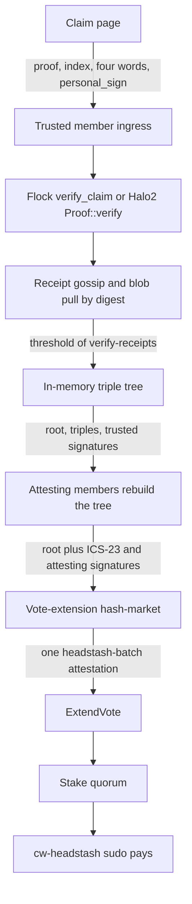
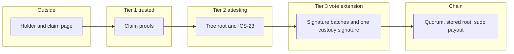

# Headstash tiers inside hash-market

The claim path is a feature of the existing hash-market process
(`crates/terp-rs/tools/hash-market`). It is not a new binary. Several
operators may run that same process with different membership. Dev binds
`127.0.0.1` only.

`tools/hash-market/docs/headstash.md` is a different feature (encrypted
notes and circuit keys). This note does not change those routes.
`ProcessHeadstash` stays in cw-headstash as a retained on-chain Halo2
variant. The epoch path does not call it.

## Tiers

Membership and thresholds are creator parameters on cw-headstash. Sets may
overlap: one operator key may sit in more than one tier. Duties do not
collapse when a key overlaps. A process acting as the vote-extension tier
still checks signatures and does not skip that check because it also
verifies proofs.

| Tier | Who | Does | Does not |
|---|---|---|---|
| 1. Trusted set | Configured members. Ingress is any member. | Runs Flock `verify_claim` and Halo2 `Proof::verify` off-chain. Keeps an in-memory tree of accepted triples `nullifier \|\| destination \|\| amount`. Shares receipts and blobs with other members. Signs the frozen tree root. | Speak for stake. |
| 2. Attesting set | Configured members. | Receives gossiped roots and triples. Rebuilds the tree in memory. Checks each triple under the root the way an IBC client checks an ICS-23 existence proof. Signs that reconstructed root. | Run claim proofs. |
| 3. Vote-extension set | Validators running hash-market, reached by `x/hashmerchant` `ExtendVote`. | Checks the trusted and attesting signature batches. Serves `GET /vote-extension`. Stake quorum in the module updates the state root and sudo's cw-headstash. | Run claim proofs. Re-derive the tree from proof bytes. |

A later option on tier 1: one Flock/Ligerito proof that the tree contains
only triples with enough verify-receipts. The attesting set would check
that curation proof instead of replaying every receipt. Not required for
the first slice.

## Primitives this reuses

| Primitive | Where it lives | What this design uses it for |
|---|---|---|
| `GET /vote-extension` | `tools/hash-market/src/ve/server.rs` | One JSON body per block. The keeper calls it with no query (`keeper/vote_ext.go` `fetchSidecar`). |
| `aggregateAttestationRoot` | `x/hashmerchant/keeper/oracle.go` | SHA-256 of `source_id \|\| value \|\| height` as 8 little-endian bytes, over the sorted de-duplicated attestations. One attestation whose `source_id` is `headstash-batch` is the root the quorum stores. |
| ed25519 custody verify | `verifyOracleAttestations` | One registered `OracleSource` pubkey per `source_id`. The vote-extension tier signs the single `headstash-batch` attestation with that key after it has checked the tier batches. |
| Stake quorum `0.667` | `x/hashmerchant/types/params.go` | Unchanged. Empty extensions count in the denominator and add no root. |
| Sudo callback | `spec/06_sudo_interface.md`, `dispatchSudoCallbacks` | Delivers `chain_uid`, `algo`, `root`, and `oracle_sources` to contracts whose escrow is still paid. `chain_uid` is `headstash-claim`. |
| `ics23_proof` field | `VoteExtensionHashData` | Carries an ICS-23 existence proof of the row bytes under the accepted root so the result is attestable. The keeper does not verify that proof today (`spec/10_multi_source_oracle.md`: light-client-grade ICS-23 is not implemented). |
| BLS12-381 host API | `contracts/cw-headstash/src/wavs.rs` | `bls12_381_hash_to_g2` and `bls12_381_pairing_equality` already check a proof-of-possession per operator key. `aggregate_key` and `threshold` are stored there. That file does not yet verify a threshold signature over a headstash root. First-slice member signatures are ed25519, the algorithm the keeper already verifies. BLS aggregation of those signatures is the later compression, using this host API. |
| `accepted_root` | `contracts/cw-headstash/src/epoch.rs` | Domain `terp-headstash-accepted-v1`, the allocation root, then rows sorted by nullifier. Each row is nullifier, 32-byte denom, length-prefixed destination, amount. Sorting makes arrival order irrelevant. |
| `pending_root` | same file | Domain `terp-headstash-pending-v1` over an ordered list of digests. Order matters in the current function. Tier 1 sorts digests before hashing so gossip order cannot fork the pending root. |
| Halo2 on-chain verify | `ProcessHeadstash` | Retained. Not on the epoch path. |

"IBC/ICS/TAO-style" here means the IBC light-client pattern already described
in `x/hashmerchant/spec/01_concepts.md`: signatures attest a root, and an
ICS-23 proof shows a leaf under that root. No new light-client protocol.

## Data flow

The claim page and the node both talk to hash-market. The node URL is the
one already configured as `hashmerchant.sidecar-url`.

## Trust boundaries

Proof bytes stop at tier 1. Tier 2 sees triples and roots. Tier 3 sees
roots and signature batches. The chain sees one attestation, the quorum
root, and the row bytes inside that attestation value so sudo can pay
without a second transaction.

## Creator parameters

Sidecars read these from cw-headstash. They are not hard-coded in
hash-market.

| Parameter | Use |
|---|---|
| `cutoff_height` or `epoch_length` | The height at which the accepted tree freezes. Answered: this is the cutoff. |
| `bech32_hrp` | Destination words in a Flock opening are 20 bytes. The string inside `accepted_root` is bech32 of those bytes under this HRP. |
| `denom_proof` | The 32-byte denom every sidecar puts in the row. It is the token strategy's proof representation, not the Flock `nd` word. |
| `payout_denom` | Bank denom sudo sends. |
| `allocation_root` | The campaign root proofs must open. |
| `max_rows` | Largest batch whose sudo fits `SudoGasLimit`. A larger set is not attested. |
| Trusted members | ed25519 pubkeys. Optional BLS12-381 keys for the later aggregate. |
| `trusted_verify_threshold` | Distinct members who must verify a claim before its triple enters the tree. |
| `trusted_sign_threshold` | Distinct members who must sign the frozen root. |
| Attesting members | ed25519 pubkeys. |
| `attest_threshold` | Distinct attesting signatures on the reconstructed root. |

Default for each threshold is two thirds of that set, rounded up. The
creator may set another count. The stake quorum stays `0.667` and is a
different number. A key may be listed in both member sets.

The vote-extension set is the bonded validator set. It is not a second
pubkey list. The single `headstash-batch` custody key remains the
`OracleSource` registered in `x/hashmerchant`.

## How a vote is one algo

`fetchSidecar` stores one `(chain_uid, algo, root)`. This design does not
change that.

Each sidecar reads the cutoff from the contract and the current height
from the chain. Below the cutoff, `GET /vote-extension` returns algo
`headstash-pending` and does not pay. At the cutoff, it returns algo
`headstash-accepted`. Sudo on the accepted algo pays. Sudo on the pending
algo only stores the root.

A validator whose `sidecar-url` already serves another chain cannot also
serve this route: the fetch sends no `chain_uid`. Headstash validators
point `sidecar-url` at a hash-market whose only provider is this route.
Other oracle chains keep their own URL.

## Payout inside sudo

Answered: no relayer broadcasts `ApplyAcceptedBatch`.

Today `epoch::sudo` stores the root and sets `minted=0`.
`ApplyAcceptedBatch` is what pays, and it stays in the contract as a
retained variant.

The epoch path pays inside the accepted sudo:

- One attestation, `source_id = headstash-batch`.
- `value` is the canonical sorted row bytes.
- `height` is the cutoff height from the contract, the same integer on
  every sidecar.
- The quorum root is `aggregateAttestationRoot` of that attestation.
- Sudo parses `oracle_sources[0].value` as those rows, recomputes the
  aggregate, checks it against the sudo root, checks the allocation root,
  rejects a known nullifier, and sends `payout_denom` of each amount.
- A batch above `max_rows` is not signed, so it never reaches sudo.

`ApplyAcceptedBatch` is not on this path.

## Q1. How the trusted set shares proofs

Proposal: digest pull on the hash-market route the members already serve.

1. The ingress member verifies the proof and stores the blob under its
   digest.
2. It gossips a small receipt: digest, allocation root, nullifier,
   destination, amount, and that member's ed25519 signature. It does not
   gossip signing keys.
3. A peer that lacks the blob pulls it by digest from any member who has
   it, verifies it, and gossips its own receipt.
4. The triple enters the in-memory tree only after
   `trusted_verify_threshold` distinct receipts. The leaf is the triple.
   The root is `accepted_root`, sorted by nullifier.
5. At the cutoff each member freezes. A member whose blobs do not cover
   the receipt set abstains. It does not vote a partial tree.
6. Dev peers are other loopback ports of the same binary, or one process
   when a single operator is configured in every tier.

## Threat model

```mermaid
flowchart TD
  badproof["Forged claim proof"]
  oneliar["One trusted member signs a bad triple"]
  collude["Trusted threshold colludes"]
  withhold["Peers withhold blobs"]
  badsig["Vote extension sees a bad signature batch"]
  stolen["Stolen headstash-batch custody key"]
  stake["Stake above quorum votes a false root"]
  double["Second use of a nullifier"]
  tamper["Destination or amount changed"]
  wrongroot["Proof opens a different allocation root"]

  badproof -->|"tier 1 verify rejects"| stop1["No receipt"]
  oneliar -->|"below trusted_verify_threshold"| stop1
  collude -->|"tier 2 rebuild mismatches"| stop2["Attesters abstain"]
  withhold -->|"incomplete set"| stop3["That member abstains"]
  badsig -->|"tier 3 rejects the batch"| stop4["Empty vote extension"]
  stolen -->|"honest validators do not vote it"| stop4
  stake -->|"quorum stores the root and sudo pays"| loss["Paid from the contract balance"]
  double -->|"tier 1 set, and sudo nullifier check"| stop5["Second pay rejected"]
  tamper -->|"different accepted_root"| stop6["Sudo aggregate mismatch"]
  wrongroot -->|"tier 1 verify, and the registered root"| stop1
```

A stolen custody key does not pay by itself. Honest vote-extension
members refuse to vote a batch they did not check, and empty extensions
make quorum harder. A stolen key together with stake at or above quorum
does pay: the chain checks that one custody signature and the stake
tally, and it does not re-run claim proofs. That is the same quorum
assumption `x/hashmerchant` already has.

The ICS-23 bytes make the sudo attestable by anyone who recomputes
`accepted_root` and checks the existence proof. The keeper does not do
that check yet. The on-chain transition stays the quorum root plus the
sudo payout.

Flock still checks `personal_sign` beside the circuit, and the leaf index
is still circuit wiring, so tier 1 must be told the index. The four-word
body is what the holder signs. The Flock circuit does not bind that string
yet. Halo2 `Proof::verify` on this path is off-chain and is the current
K=19 circuit, Merkle depth 32, not a depth-16 statement.
