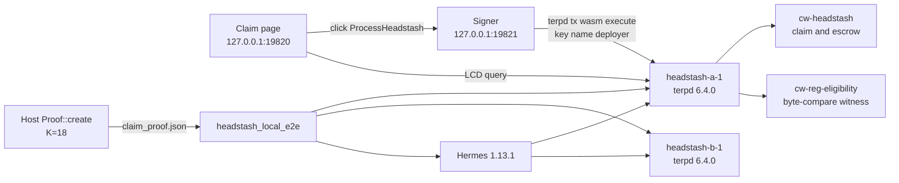
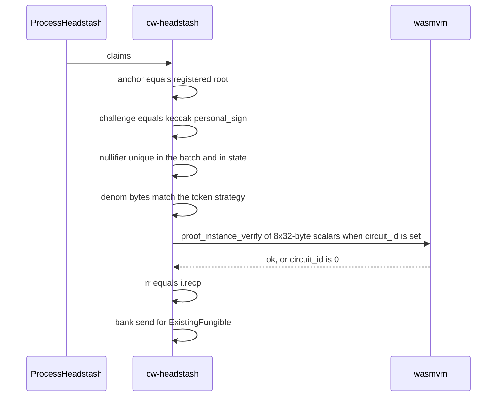

# Headstash local e2e

The harness runs on groot-wan. It starts two Terp chains from the image already on disk (`registry.terp.network/terp-core:v6.4.0`), publishes their ports on `127.0.0.1` only, deploys the claim contract and the eligibility witness, and opens a Hermes path between the chains. It does not pull images and it does not broadcast to a public network.

```sh
make headstash-e2e
```

Same entry: `crates/headstash/scripts/headstash-e2e.sh`, or `just headstash-e2e` from `crates/headstash`. `HEADSTASH_E2E_KEEP=1` (the default) leaves the chains up. `HEADSTASH_E2E_KEEP=0` tears them down. The claim page is `http://127.0.0.1:19820/` on that host.

## Access

Dev services bind `127.0.0.1` only. They are reached on groot, or from the laptop with an SSH port-forward:

```sh
ssh -N -L 19820:127.0.0.1:19820 -L 55000:127.0.0.1:55000 groot-wan
```

Development does not use the Cloudflare tunnel. Do not start or rely on `cloudflared` or nginx. The diagram below is loopback on groot. A laptop browser needs a forward for every port it calls: the claim page `19820`, the signer `19821`, and the chain LCD and RPC from `/tmp/headstash-e2e/endpoints.json`. `55000` in the example is one chain publish from a run. Use the ports that run wrote.

## Architecture



Chain ids are `headstash-a-1` and `headstash-b-1`. Bech32 prefix `terp`, denom `uterp`, gas price `0uterp`. The Penumbra module in ict-rs is a stub, so the hop is Terp to Terp.

## Claim data flow



`proof_instance_verify` receives eight 32-byte little-endian `pallas::Base` limbs (256 bytes): anchor, denom, value, recipient, nullifier, cmx, challenge low 128, challenge high 128. That is the halo2 instance. The 200-byte `Instance::to_bytes` wire is only the personal_sign prefix (`keccak256` of the first 168 bytes). The VM rejects a length that is not a multiple of 32.

A fresh contract has no `headstash-accepted` epoch root. The page query is expected to report that the epoch root is missing. That query is not a claim.

`cw-reg-eligibility` answers `verify_min_holders` by comparing proof bytes with the bytes stored at instantiate. The harness stores `[7,7,7,7]` and queries with a one-byte proof. `ok: false` is the witness check. It is not a passing claim.

## Instantiate

Genesis root is 32 bytes of `0x11`. Domain `poseidon_v1`. Circuit id `0` until `store-circuit` returns an id. Token strategy:

```json
{"existing_fungible": {"proof": "<base64 blake3(uterp) with byte 31 masked>", "raw": "uterp"}}
```

WAVS is one operator proof-of-possession from `print_wavs`. The secret is sampled in that process and is not written. The contract is instantiated with `1000000uterp` and then funded with another `5000000uterp`.

## Cases the harness submits

| Case | Expected |
| --- | --- |
| `loopback_publish` | `docker port` shows `127.0.0.1` and not `0.0.0.0` |
| `store_wasm` | both wasm files store |
| `claim_instantiate` | address returned |
| `witness_instantiate` | address returned |
| `witness_bad_proof` | query contains `"ok":false` |
| `witness_byte_compare` | `removed` — a byte match is not a claim |
| `anchor_mismatch` | error contains `does not match` |
| `bad_denom` | error contains `incorrect token denom` |
| `bad_proof` | error contains `circuit_id is 0`, `invalid headstash proof`, or the zk-api requirement |
| `double_claim` | `null:` only if the first claim's proof verifies. Otherwise `gap`, because the proof check sits inside the loop before the second nullifier is seen |
| `wrong_address` | `recipient addr not represented` only after a proof verifies. Otherwise `gap` |
| `tx_body_limit` | `config.toml` shows `67108864` for `max_body_bytes` and `max_tx_bytes` after start. This is the local chain only |
| `store_circuit` | `pass` only when a circuit id is parsed and `SetCircuitId` succeeds. A tx-size or timeout failure is `gap`. The blob is the prover's `headstash_vk.bin` when `claim_proof.json` names that path |
| `positive_claim` | `pass` only when a host `Proof::create` proof is included and the contract's balance of the proof denom drops by the proof value. The suite denom on the current file is `ibc/ATOM`. A missing prover, a denom whose `derive_nd` does not match the proof, or no circuit id is `gap`. A submitted proof that does not pay is `fail` |
| `hop_success` | chain B balance of the IBC denom increases by 1000 and chain A decreases |
| `hop_timeout` | stopped relayer: submit rejected for height/timeout, or destination balance unchanged |
| `expired_claim`, `manifold_airdrop`, `pir_gate`, `penumbra_hop` | `gap`. They are not passes |

Claim executes use `--gas 800000`, then `query tx`. `gas auto` returns an empty stdout when the contract rejects during simulation, and the wasm text is only on stderr. The harness matches the included transaction log.

Exit 0 means no case has status `fail` and the contract flow returned. A `gap` does not by itself fail the process.

## One command

`make headstash-e2e` from the terp-core root on groot-wan. The script exports `PATH` so `docker` resolves, sets `ICT_PUBLISH_HOST=127.0.0.1`, refuses `ICT_MOCK=1`, and checks that both images are already local. Reports land in `/tmp/headstash-e2e/report.json` and `endpoints.json`.

The static page loads those files, queries the epoch root and the witness, and has **Broadcast ProcessHeadstash**. That button POSTs `broadcast.json` to `http://127.0.0.1:19821/broadcast`. The signer checks that the LCD and RPC are `http://127.0.0.1:`, then `docker exec`s `terpd tx wasm execute --from deployer` with the key name. It does not read a mnemonic. `e2e/claim/broadcast.spec.cjs` launches headless Chromium, clicks Query epoch root and Broadcast ProcessHeadstash, and requires a `txhash` in the page text.

The host prover runs first, unless `claim_proof.json` is already a host-verified `Proof::create` at K=18 with its vk file on disk. In that case the script reuses the file and does not delete it.

```sh
HEADSTASH_PROVE_ONLY=1 cargo test -p terp-orch --features headstash --test export_claim_proof -- --ignored --nocapture
```

It writes `claim_proof.json` from `zk_headstash::circuit::Proof::create` after `Proof::verify`. `HEADSTASH_PROVE_ONLY=1` returns before the cw-orch Mock execute. The harness refuses a file whose `prover` is not that path or whose `host_verify` is not true. When `artifacts/cw_headstash_zkapi.wasm` exists, the script sets `HEADSTASH_WASM` to that file.

Local chain config, harness only: `config_file_overrides["config/config.toml"]` sets `rpc.max_body_bytes` and `mempool.max_tx_bytes` to 67108864. `modify_genesis` sets `consensus_params.block.max_bytes` to the same size when that genesis field exists. The known call site for the override key is the local pir chain (`re-zerve` `live-chain`).

`store-vk-param` also checks `MaxCircuitSize` (33554432) in `ValidateBasic`. A K=18 params write is 33554500 bytes. The harness sets `MAX_CIRCUIT_SIZE=67108864` on its containers. The `v6.4.0` image does not read that variable. A local image tag does. The registry image is unchanged.

`ExistingFungible` of the proof denom is the payout this suite proof can make. The current file's denom is `ibc/ATOM`. The Oct 5 wasm pays `uterp` only and cannot verify a host proof. `artifacts/cw_headstash_zkapi.wasm` is the build that calls `proof_instance_verify`. Its `NewFungible` arm mints and bank-sends in source. That arm is not the suite case, and it has not been balance-tested.
