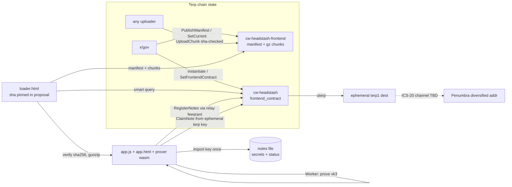
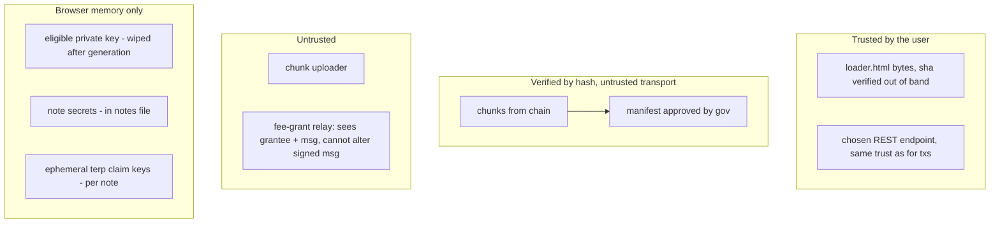

# Headstash on-chain claim frontend: spec (v1)

Status: Phase 1 spec, branch `wip/headstash-frontend` (from `wip/headstash-membership-vk` @ d378499).
The v1 claim design is locked. This document covers only how the claim web app is stored on chain, loaded, and used.

## 0. Goals

* Minimize trust and maximize transparency. The bytes a user runs come from chain state, are hash-checked against a manifest that x/gov approved, and need no CDN, IPFS, npm or remote fetches.
* Keep the byte budget small: no frameworks, gzip everything, and reuse the existing vk_id 3 browser prover wasm.
* Keep the flow to two steps: Register, then Claim. A "How this works" modal explains it.

## 1. Research

### 1.1 ERC-8244 (https://eip.tools/eip/8244), fetched 2026-10-29

ERC-8244, "Contract-Hosted Application HTML" (draft, 2026-04-30), defines one view function, `html() -> string`. It returns a complete, self-contained HTML dapp from contract state, which a wallet or explorer fetches with one `eth_call` and renders.
* Style: one self-contained document with inline JS that implements its own primitives (keccak, ABI). Any external resource has to be integrity-pinned (SRI or content-addressed). The origin contract address is embedded as a JS constant at write time.
* Rendering rules: a sandboxed iframe with a default-deny CSP, no inherited cookies or storage, and no ambient network access. The host shows the origin contract and chain id outside the frame.
* Storage and batches: the ERC does not prescribe storage. The reference implementation concatenates SSTORE2-style data chunks. For documents too large for one call, a paginated helper (e.g. `htmlChunkAt(i)`) is explicitly allowed. The "Mutable HTML" section recommends immutable pointers and renounced setters.
* Our mapping: CosmWasm smart queries take the place of `eth_call`. `Manifest{}` plus `Chunk{}` is the paginated helper. Published versions are immutable, and only the "current" pointer is gov-controlled.

### 1.2 Inventory of existing assets (measured on groot-wan, 2026-10-29)

| asset | path | raw B | gzip -9 B | brotli -q11 B |
|---|---|---:|---:|---:|
| vk3 prover glue | `websites/dao-dao-ui/apps/dapp/public/headstash-prover/membership/zk_headstash.js` | 10,923 | 2,770 | 2,462 |
| vk3 prover wasm | `.../membership/zk_headstash_bg.wasm` (sha256 51681559…88847) | 2,006,266 | 664,363 | 472,288 |
| worker (pinned-hash loader) | `.../membership/worker.js` | 3,043 | 1,238 | 1,063 |
| legacy K19 wasm (not used) | `.../headstash-prover/zk_headstash_bg.wasm` | 4,828,224 | n/a | n/a |
| lab claim page | `tools/headstash/e2e/claim/index.html` | 4,415 | n/a | n/a |
| Next.js page | `apps/dapp/pages/headstash.tsx` → `@dao-dao/stateful HeadstashClaimPage` | n/a | n/a | n/a |

* The prover is built by `tools/headstash/scripts/build-browser-prover.sh` (wasm-pack `--target web`, `--features browser`) from `tools/headstash/circuits/halo2/src/browser_prove.rs`. It exports `membership_key_com_hex` and `prove_note_witness_browser` (vk_id 3, 17 siblings). `tools/headstash/e2e/bench_wasm_prove.mjs` times it.
* Native browsers have only gzip DecompressionStream, not brotli, so brotli is shown for comparison only. The on-chain encoding is gzip.
* The params are not shipped: `prove_note_witness_browser` does keygen in-wasm at K=11, as the existing worker does.

### 1.3 Note backup / key handling (user decision 2026-10-29)

The repo has no threshold-encryption design, and the user confirmed there is none. Threshold and Shamir are **out of scope** and are not in the code. (The only prior mention is an "AES-GCM backup in IndexedDB" in `docs/public/headstash-architecture.md`.)
The design that replaces it: **key-import once, then pre-generate everything.** See §6.

### 1.4 Penumbra

* `@penumbra-zone/wasm` (npm) exposes key and address utilities, including ephemeral-address generation (penumbra PR #2973). It is a bundler-oriented package, several MB, with ~100 MB proving keys in `@penumbra-zone/keys` for building transactions. **Not vendored.** It is too heavy for chain storage and has not been verified here.
* Diversified addresses: one IVK gives 2^128 unlinkable addresses (address index → AES diversifier). Only Zafu/Prax, which hold the full viewing key, can produce one for the user's long-term wallet.
* Prax (now Zafu) injects a provider record under `window[Symbol.for('penumbra')]`. This is believed correct but **UNVERIFIED** here.
* The Terp (morocco-1) ↔ Penumbra (penumbra-1) IBC channel is **UNKNOWN**. Neither the repo nor public sources (chaintools explorer, Prax registry) document a channel. The repo docs (`CLAIM-WORKFLOW.md`, `DEPLOY-READINESS.md`) say "ict-rs dry-run before live channel; no Penumbra channel test on this branch".
* So the bridge step ships as **guidance plus a pasted-address check only**. The page validates a `penumbra1…` bech32m address and shows the exact ICS-20 parameters to use once the channel exists. It does **not** build a MsgTransfer. The STUB is in this spec only (§7).

## 2. Contract: `cw-headstash-frontend`

Path: `contracts/headstash/cw-headstash-frontend` (same workspace and style as cw-headstash: cw-ownable, cw-storage-plus, cw_serde).

### State
* `OWNER` (cw-ownable): on mainnet, x/gov. Its only power is to publish a manifest and to point `current` at a complete version.
* `MANIFESTS: Map<u32, Manifest>`: immutable once published.
* chunk bytes: raw `storage.set(b"c" ++ ver_be ++ file_be16 ++ idx_be32, data)`. They are raw, not JSON, so there is no 33 % base64 bloat in state.
* `PROGRESS: Map<u32, u32>`: count of uploaded chunks. `CURRENT: Item<Option<u32>>`.

### Manifest
```
Manifest { version: u32, entry: String, files: Vec<FileEntry>, note: Option<String>, activate: bool }
FileEntry { path, content_type, encoding: "gzip"|"identity", size /*raw*/, sha256 /*raw, hex32*/,
            stored_size, chunks: Vec<HexBinary /*sha256 of each stored chunk*/> }
```
Limits: ≤ 16 files, ≤ 512 chunks per file, path ≤ 64 ASCII chars `[a-z0-9._/-]`, and each chunk ≤ `max_chunk_bytes` (instantiate parameter, hard cap 128 KiB = wasmvm storage value limit 131072 B; measured: a 256 KiB chunk fails on chain with Value too big).

### Execute
* `PublishManifest { manifest }`: owner only. `version` must equal `next_version` (monotonic, gap-free), so published versions are never overwritten.
* `UploadChunk { version, file, index, data }`: **permissionless**. Accepted only if `sha256(data) == manifest.files[file].chunks[index]` and the chunk is not stored yet. Because uploads are content-addressed, the uploader is untrusted and needs no gov role. When the last chunk lands, the version is **sealed** (complete). If `activate` is set, `current` moves to it automatically. Gov therefore needs exactly one proposal per release.
* `SetCurrent { version }`: owner only. The version must be complete. This allows a rollback to an older complete version.
* `UpdateOwnership(..)`: cw-ownable two-step. Renouncing freezes `current` forever, the "renounce setters" option from ERC-8244.

### Query
`Config{}`, `Manifest{version?}` (default current), `Chunk{version, file, index} -> Binary`, `Status{version} -> {uploaded,total,complete}`, `Versions{start_after,limit}`.

There is no `html()` single call. The loader (§4) is the ERC-8244 "paginated client".

## 3. cw-headstash config: `frontend_contract`

* New `Item<Option<Addr>>` `FRONTEND_CONTRACT`, stored separately like `EXTERNAL_ASSET_REGISTRY`. The existing config structs are untouched, so state stays backward compatible.
* `InstantiateMsg.frontend_contract: Option<String>` with `#[serde(default)]`. It is validated with `addr_validate`. Old instantiate JSON still parses.
* `ExecuteMsg::SetFrontendContract { addr: Option<String> }`: owner only (x/gov on mainnet), the same pattern as `SetExternalAssetRegistry`.
* `QueryMsg::FrontendContract {} -> Option<Addr>`.
* Migration: no state migration is needed, because an absent item reads as `None`. **This changes the cw-headstash wasm hash.** Production `artifacts/cw_headstash.wasm` (sha 43a8e5d8…) and `tools/headstash/deploy/rendered-mainnet/*` are **not regenerated**. The mainnet render (13-store-wasm, 14-instantiate-proposal with `frontend_contract`) must be redone later.
* Mainnet order: store + instantiate the frontend (gov admin), PublishManifest (gov), uploads (anyone), then instantiate cw-headstash with `frontend_contract`. Alternatively, call `SetFrontendContract` later.

## 4. Loading the page

```
loader.html (~3–4 KB, NOT on chain; its sha256 is published in the gov proposal + repo; user saves it or uses CLI)
  1. config: REST url, chain_id, headstash contract (constants baked at render; ERC-8244 "origin contract")
  2. GET smart(headstash, {frontend_contract:{}})  -> frontend addr
  3. GET smart(frontend, {manifest:{}})            -> manifest (+ optional pinned manifest sha in loader)
  4. for each chunk: GET smart(frontend,{chunk:{...}}) ; sha256 == manifest.chunks[i] else abort
  5. concat, DecompressionStream('gzip'), sha256(raw) == file.sha256 else abort
  6. body.innerHTML = app.html ; import(blob:app.js).start({files, manifest, cfg})
```
* The CLI path (cw-orch helper `fetch`) writes the same verified files to disk for offline use.
* CSP in the loader: `default-src 'none'; script-src 'unsafe-inline' blob: 'wasm-unsafe-eval'; worker-src blob:; style-src 'unsafe-inline'; connect-src <REST> <RELAY>; img-src data:`. The CSP stays on the document, so the app inherits it. Network access is limited to the chain REST and the fee-grant relay.

## 5. Byte, gas and fee budget

Mainnet: block max_gas 50,000,000, max_bytes 16,777,216, min fee 0.05 uthiol/gas.
* Upload txs are **permissionless and content-addressed**, so any hot key can send them. **Zigner (64 KiB amino sign doc) does not apply to chunk uploads.** Only `PublishManifest` goes through gov. Its body (~16 files, 1.3 k chunk hashes at 32 KiB, or ~200 at 128 KiB) is 3–15 KB, which fits the existing gov-session authz pattern (`tools/headstash/gov-session`, MsgExec SubmitProposal) and is well under 64 KiB.
* Measured numbers are in `frontend-onchain-bench.json`, summarized in §9 (Phase 2).

## 6. Notes file (replaces threshold backup)

**Flow:** the user imports their eligible secp256k1 private key **once** (paste hex). The page then:
1. derives the EVM address and loads that identity's eligibility rows (bundled per campaign or pasted `note_paths` JSON);
2. for **every** eligible note across every campaign, derives `secret_i = HKDF-SHA256(ikm=priv, salt="terp-hs-note-secret-v1", info=ctx‖identity‖u32le(note_index)) (64 B) mod p_pallas`, then computes `key_com_i` (wasm `membership_key_com_hex`) and `nullifier_i = Poseidon(nf_tag, secret_i, ctx)` (wasm `note_nullifier_hex`, a small new export over the existing `claim_nullifier`);
3. signs the registration (EIP-191 `headstash-register-notes-v3:{ctx}:{list_hash}:{n}:{reward_addr}`) with the key in memory;
4. **wipes the key** and writes the notes file. Secrets are deterministic, so the same key always regenerates the same file.

**Decision: the file stores only derived per-note secrets, never the private key.** Reasons: a leaked file exposes unclaimed note value (and nullifier linkability) but never the eligible wallet's other funds, and the key can always regenerate the file.

Format `headstash-notes.v1.json` (optionally wrapped as `{"v":1,"enc":"pbkdf2-aesgcm", salt, iv, ct}`, PBKDF2-SHA256 600k plus AES-256-GCM via WebCrypto, so there is no Argon2 dependency):
```json
{"v":1,"chain_id":"morocco-1","contract":"terp1…","identity":"<evm hex>","created":1730200000,
 "notes":[{"c":"<ctx hex>","i":0,"cls":3,"amt":"10000000","s":"<secret hex>","k":"<key_com hex>","n":"<nullifier hex>",
           "st":"new|registered|submitted|spent","tx":"<hash?>","dest":"terp1…?"}],
 "sha256":"<hex sha256 of canonical JSON of the object without the sha256 field>"}
```
* Status is tracked locally. The page never queries the nullifier set. A claim tx's result (code 0, or a "nullifier spent" error) moves `st`. Re-import checks `sha256` first.
* The file is "process all notes at once": one registration (≤32 notes per chunk tx, as the contract requires) and then a claim loop over every `registered` note.

## 7. Post-claim Penumbra (STUB, spec only)

* Long-term: install Zafu (or Prax), copy a fresh **diversified** address (one per note, so per-note destinations stay unlinkable), then ICS-20 `uterp` Terp→Penumbra on channel `<TBD>`.
* Ephemeral: an in-browser Penumbra spend key via `@penumbra-zone/wasm` (generateSpendKey → address index i). Its lifecycle: created in memory, the seed shown once, never persisted unencrypted, and swept into Zafu later. **Not built.** It is too large for chain storage and unverified.
* The page shows a detection hint (`window[Symbol.for('penumbra')]` present → "Zafu/Prax detected"), validates a pasted `penumbra1` address (bech32m), and prints the transfer parameters. It sends nothing.
* OPEN: the channel id, whether to vendor a Penumbra wasm on chain, and memo/timeout policy.

## 8. Diagrams





## 9. Security review

* **Integrity:** chunk sha256 is checked against the manifest, and the full-file sha256 is checked after gunzip. The manifest is gov-published and immutable per version. The loader is the trust root (small enough to audit), and can optionally pin the manifest sha. A malicious RPC can withhold data or lie about the manifest. Mitigations: pin the manifest sha in the loader, or cross-check two RPCs.
* **CSP and no remote fetches:** default-src none, and connect-src only REST + relay. No eval except `wasm-unsafe-eval`. Workers come from blob URLs only. No third-party fonts or images.
* **Key handling:** the eligible key is pasted, held in a JS variable, used for derivation and the one EIP-191 signature, then overwritten. It is never stored or sent. The notes file holds secrets (sensitive: anyone holding it can claim unclaimed notes). Optional passphrase encryption is offered. Per-note ephemeral claim keys are random, used for one ClaimNote, and are not saved (dest funds then move to Penumbra). OPEN: should ephemeral dest keys also be saved in the file, so funds left on the dest can be recovered? Proposed: yes, as `dk`.
* **Phishing:** the loader shows the contract addresses + chain id + manifest version and sha before running the app.
* **Penumbra ephemeral key:** not implemented (§7). If built: in memory, shown once, and the user must sweep it.
* **Relay:** it is fee-grant only. It cannot change signed fields (the reward_addr is covered by the v3 signature, and the dest is bound in the proof).
* **Mutable UI:** gov can move `current`. Renouncing ownership freezes it. The loader can pin a version.

## 10. Phase 2 measurements (local chain v6.4.0, 2026-10-29)

Raw data: . Payload: the real prover bundle (zk_headstash.js 10923 B, gzipped 2754 B; zk_headstash_bg.wasm 2006266 B, gzipped 664342 B; worker.js 3043 B, gzipped 1228 B), for 668324 B gzipped in total. Each size was run on a fresh instantiate. Uploads came from a non-owner account. Every chunk was downloaded over REST and its sha256 checked against the manifest. After gunzip, each file was checked against its raw sha256.

| chunk | upload txs | upload gas | max gas/tx | total gas (incl. publish) | fee @0.025 uterp | wall s | blocks | verify s |
|---|---|---|---|---|---|---|---|---|
| 16 KiB | 43 | 35.18M | 0.85M | 35.46M | 886623 | 58.8 | 57 | 0.21 |
| 32 KiB | 23 | 32.23M | 1.56M | 32.46M | 811398 | 32.1 | 31 | 0.12 |
| 64 KiB | 13 | 30.82M | 2.98M | 31.02M | 775443 | 18.4 | 17 | 0.10 |
| 96 KiB | 9 | 30.27M | 4.41M | 30.45M | 761353 | 12.8 | 12 | 0.07 |
| 128 KiB | 8 | 30.13M | 5.83M | 30.31M | 757859 | 11.4 | 11 | 0.07 |

Every size passed all three checks: verified, stranger-publish rejected, and tampered-chunk rejected. Instantiating with a 256 KiB max_chunk_bytes is also rejected. Storing the code (357352 B) costs 2.56M gas. Gas comes to about 45 gas/B and barely depends on chunk size, so most of the cost is per-byte storage. **Recommendation: 128 KiB.** It needs the fewest txs, and its 5.8M gas per tx is well under the mainnet block max of 50M.

Builds:  (optimizer-arm64 0.17.0-rust1.91, , BUILD_RC checked). The cw-headstash wasm is now sha256  (1131133 B); it was . The hash changed for two reasons. First, the new  config field, query and msg. Second, the extra wasm-opt flag . Without that flag, one-caller inlining produced a 74369-byte function, and arm64 singlepass rejects any function over ~69 KB with ImpossibleRelocation. The largest function is now 60591 B. **The mainnet render () must be redone**; this change did not regenerate it. cw_headstash_frontend.wasm sha256 is .
