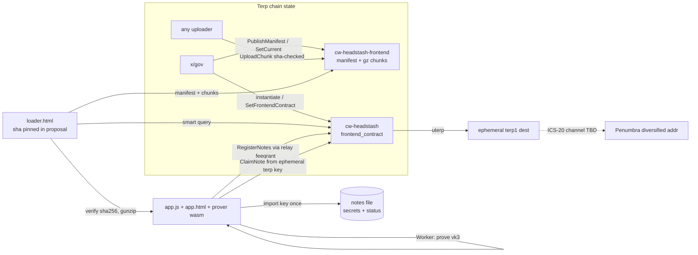
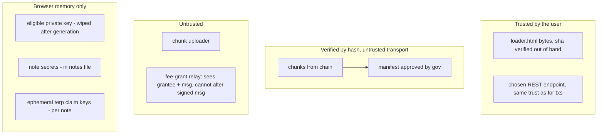

# Headstash on-chain claim frontend: spec (v1)

Status: Phase 1 spec, branch `wip/headstash-frontend` (from `wip/headstash-membership-vk` @ d378499).
The v1 claim design is locked. This document covers only how the claim web app is stored on chain, loaded, and used.

## 0. Goals

* Minimize trust and maximize transparency. The bytes a user runs come from chain state, are hash-checked against a manifest that x/gov approved, and need no CDN, IPFS, npm or remote fetches.
* Keep the byte budget small: no frameworks, gzip everything, and reuse the existing vk_id 3 browser prover wasm.
* Keep the flow to two steps: Register, then Claim. A "How this works" modal explains it.

## 1. Research

### 1.1 ERC-8244 (https://eip.tools/eip/8244), fetched 2026-10-29

ERC-8244, "Contract-Hosted Application HTML" (draft, 2026-04-30), defines one view function, `html() -> string`. It returns a complete, self-contained HTML dapp from contract state, which a wallet or explorer fetches with one `eth_call` and renders.
* Style: one self-contained document with inline JS that implements its own primitives (keccak, ABI). Any external resource has to be integrity-pinned (SRI or content-addressed). The origin contract address is embedded as a JS constant at write time.
* Rendering rules: a sandboxed iframe with a default-deny CSP, no inherited cookies or storage, and no ambient network access. The host shows the origin contract and chain id outside the frame.
* Storage and batches: the ERC does not prescribe storage. The reference implementation concatenates SSTORE2-style data chunks. For documents too large for one call, a paginated helper (e.g. `htmlChunkAt(i)`) is explicitly allowed. The "Mutable HTML" section recommends immutable pointers and renounced setters.
* Our mapping: CosmWasm smart queries take the place of `eth_call`. `Manifest{}` plus `Chunk{}` is the paginated helper. Published versions are immutable, and only the "current" pointer is gov-controlled.

### 1.2 Inventory of existing assets (measured on groot-wan, 2026-10-29)

| asset | path | raw B | gzip -9 B | brotli -q11 B |
|---|---|---:|---:|---:|
| vk3 prover glue | `websites/dao-dao-ui/apps/dapp/public/headstash-prover/membership/zk_headstash.js` | 10,923 | 2,770 | 2,462 |
| vk3 prover wasm | `.../membership/zk_headstash_bg.wasm` (sha256 51681559…88847) | 2,006,266 | 664,363 | 472,288 |
| worker (pinned-hash loader) | `.../membership/worker.js` | 3,043 | 1,238 | 1,063 |
| legacy K19 wasm (not used) | `.../headstash-prover/zk_headstash_bg.wasm` | 4,828,224 | n/a | n/a |
| lab claim page | `tools/headstash/e2e/claim/index.html` | 4,415 | n/a | n/a |
| Next.js page | `apps/dapp/pages/headstash.tsx` → `@dao-dao/stateful HeadstashClaimPage` | n/a | n/a | n/a |

* The prover is built by `tools/headstash/scripts/build-browser-prover.sh` (wasm-pack `--target web`, `--features browser`) from `tools/headstash/circuits/halo2/src/browser_prove.rs`. It exports `membership_key_com_hex` and `prove_note_witness_browser` (vk_id 3, 17 siblings). `tools/headstash/e2e/bench_wasm_prove.mjs` times it.
* Native browsers have only gzip DecompressionStream, not brotli, so brotli is shown for comparison only. The on-chain encoding is gzip.
* The params are not shipped: `prove_note_witness_browser` does keygen in-wasm at K=11, as the existing worker does.

### 1.3 Note backup / key handling (user decision 2026-10-29)

The repo has no threshold-encryption design, and the user confirmed there is none. Threshold and Shamir are **out of scope** and are not in the code. (The only prior mention is an "AES-GCM backup in IndexedDB" in `docs/public/headstash-architecture.md`.)
The design that replaces it: **key-import once, then pre-generate everything.** See §6.

### 1.4 Penumbra

* `@penumbra-zone/wasm` (npm) exposes key and address utilities, including ephemeral-address generation (penumbra PR #2973). It is a bundler-oriented package, several MB, with ~100 MB proving keys in `@penumbra-zone/keys` for building transactions. **Not vendored.** It is too heavy for chain storage and has not been verified here.
* Diversified addresses: one IVK gives 2^128 unlinkable addresses (address index → AES diversifier). Only Zafu/Prax, which hold the full viewing key, can produce one for the user's long-term wallet.
* Prax (now Zafu) injects a provider record under `window[Symbol.for('penumbra')]`. This is believed correct but **UNVERIFIED** here.
* The Terp (morocco-1) ↔ Penumbra (penumbra-1) IBC channel is **UNKNOWN**. Neither the repo nor public sources (chaintools explorer, Prax registry) document a channel. The repo docs (`CLAIM-WORKFLOW.md`, `DEPLOY-READINESS.md`) say "ict-rs dry-run before live channel; no Penumbra channel test on this branch".
* So the bridge step ships as **guidance plus a pasted-address check only**. The page validates a `penumbra1…` bech32m address and shows the exact ICS-20 parameters to use once the channel exists. It does **not** build a MsgTransfer. The STUB is in this spec only (§7).

## 2. Contract: `cw-headstash-frontend`

Path: `contracts/headstash/cw-headstash-frontend` (same workspace and style as cw-headstash: cw-ownable, cw-storage-plus, cw_serde).

### State
* `OWNER` (cw-ownable): on mainnet, x/gov. Its only power is to publish a manifest and to point `current` at a complete version.
* `MANIFESTS: Map<u32, Manifest>`: immutable once published.
* chunk bytes: raw `storage.set(b"c" ++ ver_be ++ file_be16 ++ idx_be32, data)`. They are raw, not JSON, so there is no 33 % base64 bloat in state.
* `PROGRESS: Map<u32, u32>`: count of uploaded chunks. `CURRENT: Item<Option<u32>>`.

### Manifest
```
Manifest { version: u32, entry: String, files: Vec<FileEntry>, note: Option<String>, activate: bool }
FileEntry { path, content_type, encoding: "gzip"|"identity", size /*raw*/, sha256 /*raw, hex32*/,
            stored_size, chunks: Vec<HexBinary /*sha256 of each stored chunk*/> }
```
Limits: ≤ 16 files, ≤ 512 chunks per file, path ≤ 64 ASCII chars `[a-z0-9._/-]`, and each chunk ≤ `max_chunk_bytes` (instantiate parameter, hard cap 128 KiB = wasmvm storage value limit 131072 B; measured: a 256 KiB chunk fails on chain with Value too big).

### Execute
* `PublishManifest { manifest }`: owner only. `version` must equal `next_version` (monotonic, gap-free), so published versions are never overwritten.
* `UploadChunk { version, file, index, data }`: **permissionless**. Accepted only if `sha256(data) == manifest.files[file].chunks[index]` and the chunk is not stored yet. Because uploads are content-addressed, the uploader is untrusted and needs no gov role. When the last chunk lands, the version is **sealed** (complete). If `activate` is set, `current` moves to it automatically. Gov therefore needs exactly one proposal per release.
* `SetCurrent { version }`: owner only. The version must be complete. This allows a rollback to an older complete version.
* `UpdateOwnership(..)`: cw-ownable two-step. Renouncing freezes `current` forever, the "renounce setters" option from ERC-8244.

### Query
`Config{}`, `Manifest{version?}` (default current), `Chunk{version, file, index} -> Binary`, `Status{version} -> {uploaded,total,complete}`, `Versions{start_after,limit}`.

There is no `html()` single call. The loader (§4) is the ERC-8244 "paginated client".

## 3. cw-headstash config: `frontend_contract`

* New `Item<Option<Addr>>` `FRONTEND_CONTRACT`, stored separately like `EXTERNAL_ASSET_REGISTRY`. The existing config structs are untouched, so state stays backward compatible.
* `InstantiateMsg.frontend_contract: Option<String>` with `#[serde(default)]`. It is validated with `addr_validate`. Old instantiate JSON still parses.
* `ExecuteMsg::SetFrontendContract { addr: Option<String> }`: owner only (x/gov on mainnet), the same pattern as `SetExternalAssetRegistry`.
* `QueryMsg::FrontendContract {} -> Option<Addr>`.
* Migration: no state migration is needed, because an absent item reads as `None`. **This changes the cw-headstash wasm hash.** Production `artifacts/cw_headstash.wasm` (sha 43a8e5d8…) and `tools/headstash/deploy/rendered-mainnet/*` are **not regenerated**. The mainnet render (13-store-wasm, 14-instantiate-proposal with `frontend_contract`) must be redone later.
* Mainnet order: store + instantiate the frontend (gov admin), PublishManifest (gov), uploads (anyone), then instantiate cw-headstash with `frontend_contract`. Alternatively, call `SetFrontendContract` later.

## 4. Loading the page

```
loader.html (~3–4 KB, NOT on chain; its sha256 is published in the gov proposal + repo; user saves it or uses CLI)
  1. config: REST url, chain_id, headstash contract (constants baked at render; ERC-8244 "origin contract")
  2. GET smart(headstash, {frontend_contract:{}})  -> frontend addr
  3. GET smart(frontend, {manifest:{}})            -> manifest (+ optional pinned manifest sha in loader)
  4. for each chunk: GET smart(frontend,{chunk:{...}}) ; sha256 == manifest.chunks[i] else abort
  5. concat, DecompressionStream('gzip'), sha256(raw) == file.sha256 else abort
  6. body.innerHTML = app.html ; import(blob:app.js).start({files, manifest, cfg})
```
* The CLI path (cw-orch helper `fetch`) writes the same verified files to disk for offline use.
* CSP in the loader: `default-src 'none'; script-src 'unsafe-inline' blob: 'wasm-unsafe-eval'; worker-src blob:; style-src 'unsafe-inline'; connect-src <REST> <RELAY>; img-src data:`. The CSP stays on the document, so the app inherits it. Network access is limited to the chain REST and the fee-grant relay.

## 5. Byte, gas and fee budget

Mainnet: block max_gas 50,000,000, max_bytes 16,777,216, min fee 0.05 uthiol/gas.
* Upload txs are **permissionless and content-addressed**, so any hot key can send them. **Zigner (64 KiB amino sign doc) does not apply to chunk uploads.** Only `PublishManifest` goes through gov. Its body (~16 files, 1.3 k chunk hashes at 32 KiB, or ~200 at 128 KiB) is 3–15 KB, which fits the existing gov-session authz pattern (`tools/headstash/gov-session`, MsgExec SubmitProposal) and is well under 64 KiB.
* Measured numbers are in `frontend-onchain-bench.json`, summarized in §9 (Phase 2).

## 6. Notes file (replaces threshold backup)

**Flow:** the user imports their eligible secp256k1 private key **once** (paste hex). The page then:
1. derives the EVM address and loads that identity's eligibility rows (bundled per campaign or pasted `note_paths` JSON);
2. for **every** eligible note across every campaign, derives `secret_i = HKDF-SHA256(ikm=priv, salt="terp-hs-note-secret-v1", info=ctx‖identity‖u32le(note_index)) (64 B) mod p_pallas`, then computes `key_com_i` (wasm `membership_key_com_hex`) and `nullifier_i = Poseidon(nf_tag, secret_i, ctx)` (wasm `note_nullifier_hex`, a small new export over the existing `claim_nullifier`);
3. signs the registration (EIP-191 `headstash-register-notes-v3:{ctx}:{list_hash}:{n}:{reward_addr}`) with the key in memory;
4. **wipes the key** and writes the notes file. Secrets are deterministic, so the same key always regenerates the same file.

**Decision: the file stores only derived per-note secrets, never the private key.** Reasons: a leaked file exposes unclaimed note value (and nullifier linkability) but never the eligible wallet's other funds, and the key can always regenerate the file.

Format `headstash-notes.v1.json` (optionally wrapped as `{"v":1,"enc":"pbkdf2-aesgcm", salt, iv, ct}`, PBKDF2-SHA256 600k plus AES-256-GCM via WebCrypto, so there is no Argon2 dependency):
```json
{"v":1,"chain_id":"morocco-1","contract":"terp1…","identity":"<evm hex>","created":1730200000,
 "notes":[{"c":"<ctx hex>","i":0,"cls":3,"amt":"10000000","s":"<secret hex>","k":"<key_com hex>","n":"<nullifier hex>",
           "st":"new|registered|submitted|spent","tx":"<hash?>","dest":"terp1…?"}],
 "sha256":"<hex sha256 of canonical JSON of the object without the sha256 field>"}
```
* Status is tracked locally. The page never queries the nullifier set. A claim tx's result (code 0, or a "nullifier spent" error) moves `st`. Re-import checks `sha256` first.
* The file is "process all notes at once": one registration (≤32 notes per chunk tx, as the contract requires) and then a claim loop over every `registered` note.

## 7. Post-claim Penumbra (STUB, spec only)

* Long-term: install Zafu (or Prax), copy a fresh **diversified** address (one per note, so per-note destinations stay unlinkable), then ICS-20 `uterp` Terp→Penumbra on channel `<TBD>`.
* Ephemeral: an in-browser Penumbra spend key via `@penumbra-zone/wasm` (generateSpendKey → address index i). Its lifecycle: created in memory, the seed shown once, never persisted unencrypted, and swept into Zafu later. **Not built.** It is too large for chain storage and unverified.
* The page shows a detection hint (`window[Symbol.for('penumbra')]` present → "Zafu/Prax detected"), validates a pasted `penumbra1` address (bech32m), and prints the transfer parameters. It sends nothing.
* OPEN: the channel id, whether to vendor a Penumbra wasm on chain, and memo/timeout policy.

## 8. Diagrams





## 9. Security review

* **Integrity:** chunk sha256 is checked against the manifest, and the full-file sha256 is checked after gunzip. The manifest is gov-published and immutable per version. The loader is the trust root (small enough to audit), and can optionally pin the manifest sha. A malicious RPC can withhold data or lie about the manifest. Mitigations: pin the manifest sha in the loader, or cross-check two RPCs.
* **CSP and no remote fetches:** default-src none, and connect-src only REST + relay. No eval except `wasm-unsafe-eval`. Workers come from blob URLs only. No third-party fonts or images.
* **Key handling:** the eligible key is pasted, held in a JS variable, used for derivation and the one EIP-191 signature, then overwritten. It is never stored or sent. The notes file holds secrets (sensitive: anyone holding it can claim unclaimed notes). Optional passphrase encryption is offered. Per-note ephemeral claim keys are random, used for one ClaimNote, and are not saved (dest funds then move to Penumbra). OPEN: should ephemeral dest keys also be saved in the file, so funds left on the dest can be recovered? Proposed: yes, as `dk`.
* **Phishing:** the loader shows the contract addresses + chain id + manifest version and sha before running the app.
* **Penumbra ephemeral key:** not implemented (§7). If built: in memory, shown once, and the user must sweep it.
* **Relay:** it is fee-grant only. It cannot change signed fields (the reward_addr is covered by the v3 signature, and the dest is bound in the proof).
* **Mutable UI:** gov can move `current`. Renouncing ownership freezes it. The loader can pin a version.

## 10. Phase 2 measurements (local chain v6.4.0, 2026-10-29)

Raw data: . Payload: the real prover bundle (zk_headstash.js 10923 B, gzipped 2754 B; zk_headstash_bg.wasm 2006266 B, gzipped 664342 B; worker.js 3043 B, gzipped 1228 B), for 668324 B gzipped in total. Each size was run on a fresh instantiate. Uploads came from a non-owner account. Every chunk was downloaded over REST and its sha256 checked against the manifest. After gunzip, each file was checked against its raw sha256.

| chunk | upload txs | upload gas | max gas/tx | total gas (incl. publish) | fee @0.025 uterp | wall s | blocks | verify s |
|---|---|---|---|---|---|---|---|---|
| 16 KiB | 43 | 35.18M | 0.85M | 35.46M | 886623 | 58.8 | 57 | 0.21 |
| 32 KiB | 23 | 32.23M | 1.56M | 32.46M | 811398 | 32.1 | 31 | 0.12 |
| 64 KiB | 13 | 30.82M | 2.98M | 31.02M | 775443 | 18.4 | 17 | 0.10 |
| 96 KiB | 9 | 30.27M | 4.41M | 30.45M | 761353 | 12.8 | 12 | 0.07 |
| 128 KiB | 8 | 30.13M | 5.83M | 30.31M | 757859 | 11.4 | 11 | 0.07 |

Every size passed all three checks: verified, stranger-publish rejected, and tampered-chunk rejected. Instantiating with a 256 KiB max_chunk_bytes is also rejected. Storing the code (357352 B) costs 2.56M gas. Gas comes to about 45 gas/B and barely depends on chunk size, so most of the cost is per-byte storage. **Recommendation: 128 KiB.** It needs the fewest txs, and its 5.8M gas per tx is well under the mainnet block max of 50M.

Builds: `tools/headstash/scripts/opt-fe.sh` (optimizer-arm64 0.17.0-rust1.91, `--ignore-rust-version`, BUILD_RC checked). The cw-headstash wasm is now sha256 `1305e4345352785282a59627c5f57abc0ce96126e32c2f5ad5a86e5abd6888f5` (1131133 B); it was `43a8e5d88a3af34dc09bd63f85f88a1b2b0a008a4b68ef45a83ed434894149a9`. The hash changed for two reasons. First, the new `frontend_contract` config field, query and msg. Second, the extra wasm-opt flag `--one-caller-inline-max-function-size=2000`. Without that flag, one-caller inlining produced a 74369-byte function, and arm64 singlepass rejects any function over ~69 KB with ImpossibleRelocation. The largest function is now 60591 B. **The mainnet render (`deploy/rendered-mainnet`) must be redone**; this change did not regenerate it. cw_headstash_frontend.wasm sha256 is `fe096bf119e8e0b150fa32fff405f46b53917fe9a219ecfeda112cb3fe66c2a1` (357352 B).

## 11. Phase 3: claim page (results, 2026-10-29)

Files: `tools/headstash/frontend/{loader.html, app.html, app.js, crypto.js}`. The prover is `zk_headstash.js` + `zk_headstash_bg.wasm`, built from `circuits/halo2` (zakura-halo fork, `browser` feature, `browser_prove.rs`) with wasm-bindgen 0.2.127. There is no framework, no CDN, and no eval. CSP: `script-src 'unsafe-inline' blob: 'wasm-unsafe-eval'`, connect-src limited to REST and the relay.

| file | raw B | gzip -9 B |
|---|---|---|
| loader.html (served, not on chain) | 3015 | 1542 |
| app.html | 5023 | 2247 |
| app.js | 14638 | 5354 |
| crypto.js | 10640 | 4326 |
| zk_headstash.js | 12918 | 3065 |
| zk_headstash_bg.wasm, unoptimized (wasm-bindgen output) | 3618817 | 700207 |
| zk_headstash_bg.wasm, binaryen `wasm-opt -Oz` (shipped) | 1807402 | 647049 |
| zk_headstash_bg.wasm, binaryen `wasm-opt -Os` (compared) | 1841545 | 648373 |

On chain: 5 files, 10 chunks at 128 KiB, about 715 KB stored.

Notes file (no threshold or Shamir): a versioned JSON `headstash-notes.v1.json` with a sha256 over canonical JSON. Passphrase encryption is optional (PBKDF2-SHA256 600k + AES-GCM). The key is used once, at generation, and then wiped. The file holds only derived note secrets, key_coms, nullifiers, eligibility paths, the registration signature and a per-note status (new, registered, submitted, spent). The page never queries the nullifier set.

Headless e2e (`e2e/browser_e2e.py` + `browser_e2e.mjs`, Playwright 1.49 / chromium-1148, local chain `headstash-mvk-e2e`, cw_headstash 1305e434…):
- PASS: page loaded from on-chain chunks (manifest v1, per-chunk + raw sha256 checked; load 206 ms).
- PASS: notes file checksum ok; test key not present in file; key field cleared.
- PASS: page registered all 43 EVM notes (2 fee-granted chunks of 32 + 11, fresh wallet each).
- PASS: anchor accepted; fresh browser session re-imported the file.
- PARTIAL: claimed 5/43 notes through the page (5 proofs + fee-granted claim txs, balances exact, 10008 TERP). The other 38 failed `insufficient funds`. The test identity is owed 200008 TERP, but the run_direct campaign is funded with only 10030 TERP, and the local chain's whole liquid supply is below 200008 TERP. A later top-up + retry run hit the 600-block claim window (`window`). The default is now CUT_AHEAD=7200 for browser runs.
- PASS: replay from the pre-claim file minted nothing (balances unchanged).
- PASS: Penumbra stub rejects an invalid address; the "How this works" modal opens.
- Browser proof time: 43 proofs, 3214–3282 ms each (headless chromium, groot-wan), k=11, proof 2752 B, wasm memory peak about 28 MB.
- Prover optimization: groot-wan's system wasm-opt is broken, so use the binaryen npm package (wasm-opt version 132): `npx wasm-opt -Oz --enable-bulk-memory --enable-nontrapping-float-to-int --enable-sign-ext --enable-mutable-globals --enable-reference-types --enable-multivalue zk_headstash_bg.wasm -o out.wasm` (about 42 s). -Oz gives −50.1% raw and −7.6% gz; -Os is slightly larger, so ship -Oz (sha256 prefix 3d371778287164cf). On chain the frontend goes from 10 to 9 chunks of 128 KiB.
- Full browser e2e on a fresh chain (RESET=1 bootstrap with OWNER_UTERP raised and REST_CORS=1; campaign funded to the owed 200011.5 TERP; CUT_AHEAD=7200). Each run: 29/29 PASS; 43/43 registered; 43/43 claimed with exact balances (200008 TERP); 43/43 old-file replays refused (spent nullifier); no extra mint.
  - Unoptimized prover: prove 3211/3224/3305 ms (min/median/max), claim phase 262.3 s, page load 216 ms.
  - -Oz prover: prove 3200/3215/3340 ms, claim phase 265.0 s, page load 212 ms. Proof time is unchanged within noise; the gain is download size.

### 11.x Reproducible prover build (`scripts/build-browser-prover.sh`)
`tools/headstash/scripts/build-browser-prover.sh [DEST|-]` is the one way to produce the page's prover (`zk_headstash.js` + `zk_headstash_bg.wasm`):
1. `cargo build --release --lib --target wasm32-unknown-unknown -p zk-headstash --no-default-features --features browser` with `--cfg getrandom_backend="wasm_js"`. Cargo resolves into a scratch copy of `tools/headstash/Cargo.lock` (`resolver.lockfile-path`), so the committed lock is never rewritten; the resolved lock's sha256 is printed.
2. `wasm-bindgen --target web --out-name zk_headstash`. The CLI version must equal the `wasm-bindgen` crate in the resolved lock (checked; currently 0.2.122). Override with `WASM_BINDGEN=`.
3. binaryen **wasm-opt 132** from npm, pinned in `scripts/wasm-opt/package-lock.json` (`binaryen@132.0.0`, integrity `sha512-4Usg7yEvwO3FMso3Oov6qkOOHSod1IEv+boKkh77kTljM+eNBouqCTbqWswGzbG+vDNO/b/v2C4gfEh1WgB9Lg==`; `npm ci` refuses a mismatch, the script also checks `--version`). Flags: `-Oz --enable-bulk-memory --enable-nontrapping-float-to-int --enable-sign-ext --enable-mutable-globals --enable-reference-types --enable-multivalue`.
4. Prints raw and `gzip -9n` sizes and sha256 for both files.

Reproducibility check (groot-wan, 2026-10-29, rustc 1.98.0-nightly 61d7280f3, resolved lock 852dac3e…): two builds from empty target dirs gave byte-identical output.

| file | raw B | raw sha256 | gzip B | gzip sha256 |
|---|---|---|---|---|
| zk_headstash_bg.wasm before wasm-opt | 3613365 | e72078d7d76fef12212c3429fe8adcb0828e6c8cd02e4ecd1e835a14336b1862 | 697105 | 284f6809… |
| **zk_headstash_bg.wasm (-Oz)** | **1801693** | **2774af96737a634bf979ff21389144bd94119f48213128213e9df1bfe21c5f18** | 642593 | a9b1bb2321bda1f320fbeffbc2ca36e84f441a2f4b28bc6abb6a1d731ad5e89f |
| zk_headstash.js | 12777 | 7993da8952cb3a28c69627f3118de051f8a90253c716a1f571475654db8d6564 | 3005 | dfd6812d… |

This differs from the earlier -Oz prover above (3d371778…, 1807402 B) because that one came from a flattened scratch workspace with wasm-bindgen 0.2.127; the repo workspace resolves wasm-bindgen 0.2.122. The repo-built 2774af96… prover is the one used by the gov-session dry run (§12).

## Appendix W. WAVS operator set: optional, disabled for this drop

**Spec.**
- `InstantiateMsg.wavs` becomes `Option<WavsProofOfOwnership>` (`#[serde(default)]`). `HeadstashCfg.w` becomes `Option<WavsOperatorSet>` (`#[serde(default)]`, so older stored configs that hold a set still decode as `Some`).
- `wavs: None` disables WAVS. Nothing is stored, and no PoP or threshold check runs. With `Some(set)`, instantiate keeps the existing validation (`verify()`: n ≥ 1, `poos.len() == total_operators`, 1 ≤ threshold ≤ n, plus a BLS12-381 PoP pairing check per key) and rejects invalid sets.
- Every reader of WAVS state goes through `wavs_operator_set()`, which returns `Err("wavs disabled")` when `w` is None (fail closed). There is no ExecuteMsg that sets, rotates or enables WAVS, and none is added. `migrate` is a no-op. The only way to enable WAVS later is for the wasm admin (x/gov) to migrate to new code that does so.
- `QueryMsg::WavsStatus {}` returns `{enabled, operator_set}`.
- The smart-account authenticator impl (`TerpAccountTrait for CwHeadstash`: on_auth_added/removed/request/track/confirm) is removed. It was never reachable: the `sudo` entry point only decodes `HashMerchantSudoMsg`, which is the sole real sudo user (x/hashmerchant anchor seals). The `WAVS_OPERATORS` map is removed with it.
- The mainnet render uses `"wavs": null`. There is no WAVS placeholder and no throwaway set.

**Security note.**
- A WAVS operator set is an extra trust root: whoever holds the aggregate key could authenticate as the contract's set. Leaving it disabled removes that root. Claims depend only on the ZK proof, the registration anchor and the nullifier set.
- Removing the authenticator impl also removes `on_auth_removed`, which cleared HEADSTASH_CFG, NULLIFIERS and the eligibility roots. Future wiring could otherwise have made that a state wipe that permits double claims.
- On chain, attaching the contract as a `CosmwasmAuthenticatorV1` stays refused, because the sudo entry point rejects `on_authenticator_added`. The dry run checks this.
- Disabling is permanent for this code. Only x/gov, as wasm admin, can change it, by migrating to new code.

## Appendix R: Emergency reclaim, burn at cutoff, and contracts-first deploy (2026-10-30)

**Rule.** Before the airdrop ends, governance can *reclaim* the escrow to the community pool. After it ends, the leftovers can only be *burned*. The two windows are disjoint and use the same boundary that claims use:

| block height `h` | claims | `EmergencyReclaim {}` | `SweepUnclaimed {}` (burn) |
|---|---|---|---|
| no campaign set (Phase A) | refused (no campaign) | allowed (gov) | refused ("epoch campaign is not set") |
| `h <= cutoff_height` (44,444,444) | open | allowed (gov) | refused ("campaign has not ended") |
| `h > cutoff_height` | refused ("window") | refused ("campaign has ended: only the burn sweep…") | allowed (owner = gov), burns (vk3 default, `burn_unclaimed: true` in the render) |
| after a reclaim | refused | refused | refused |

**`ExecuteMsg::EmergencyReclaim {}`** (new, `src/reclaim.rs`)
- Auth: the sender must be the cw-ownable owner AND the x/wasm admin of this contract (read live with a `ContractInfo` query). On mainnet both are the x/gov module account (`terp10d07y265gmmuvt4z0w9aw880jnsr700jag6fuq`), so only a passed proposal can run it. If either one is moved, the other still blocks a single key. Having no admin at all refuses.
- Destination: the community pool, through `CosmosMsg::Distribution(DistributionMsg::FundCommunityPool)`. terpd v6.4.0 x/wasm (`keeper/handler_plugin_encoders.go`) encodes this as `/cosmos.distribution.v1beta1.MsgFundCommunityPool`, with depositor = the contract. SDK v0.55 x/distribution moves the coins from the contract account into the distribution module and credits `FeePool.CommunityPool`. That is where the funding came from (`MsgCommunityPoolSpend`). The message takes no recipient, so the destination cannot be changed per call. This needs the cosmwasm-std `staking` feature (capability `staking`, which is built in on terpd).
- Amount: the contract's full bank balance of each configured token-strategy denom (uterp on mainnet), queried at execution time. That is exactly what is left after any claims. A zero balance sends nothing but still enters the terminal state.
- Terminal state: `RECLAIMED = {height, amounts}` is written. From then on `execute` and `sudo` refuse everything at the entry point ("headstash reclaimed by governance: claims and registration are halted"). That covers claims, registration, anchors, batches, sweep, owner ops and a second reclaim. The `CheckNoteClaim` and `CheckRegisterNotes` dry-run queries refuse the same way. `QueryMsg::ReclaimStatus {}` returns the record. The state cannot be undone except by a gov migration to new code.
- `SweepUnclaimed` is unchanged: owner only, `h > cutoff`, and it burns.

**Funds-path audit (who can move escrow).**
- x/gov (owner + admin) can: reclaim (pre-cutoff), sweep/burn (post-cutoff), migrate, and the owner-only config ops listed below.
- Owner-only ops: Mint/Burn (tokenfactory; the mainnet strategy is ExistingFungible uterp, so they are inapplicable), SetCircuitId, RegisterEligibilityRoot, bridge cfg/reflection/asset/frontend, SetDenomTable, AssignPublicNotes, StageEpochBatch, SetEpochCampaign, BindNoteCircuit, SweepUnclaimed, UpdateOwnership (two-step; renounce is refused).
- No owner key: the owner is gov from instantiate, so no EOA can run any of the above.
- Relayer / anyone: ClaimNote pays only `amount` to the sender, after a valid halo2 proof against a sealed anchor, an unspent nullifier, a per-denomination cap and `h <= cutoff`. It needs a bound circuit (gov). AcceptAnchor and registration move no funds. ProcessHeadstash needs a gov-set circuit_id (0 is refused). ApplyPublicBatch and ApplyAcceptedBatch pay only rows staged by the owner (gov). BridgeMintNote and EgressBurn need the gov-set bridge cfg (not set in the mainnet render).
- WAVS: disabled (`wavs: null`, Appendix W). There is no authenticator, and sudo only takes HashMerchantSudoMsg anchor seals, which move no funds.
- Frontend contract: holds only page bytes. It has no bank messages. Uploads are permissionless but content-addressed, and the owner (gov) is the only one who can publish or switch manifests.
- Result: before the cutoff only gov can move the escrow other than by a valid claim, and it can only send it to the community pool. After the cutoff only gov can, and it can only burn.

**Security note.**
- Reclaim is a gov kill switch. A malicious or captured governance majority could end the airdrop early. That is the same trust gov already has as wasm admin (it could migrate). The reclaim adds nothing beyond that, and it fixes the destination to the community pool instead of an arbitrary address.
- Reclaim and burn can never both apply: reclaim needs `h <= cutoff` and burn needs `h > cutoff`. Burning early is impossible, and so is reclaiming after the end.
- Requiring both owner and admin closes the gap where ownership (two-step) or admin (MsgUpdateAdmin by gov) is moved by itself.
- A claim and a reclaim in the same block are ordered by the chain. Either the claim pays first and the reclaim takes the remainder, or the reclaim halts and the claim is refused. Funds are never double spent.

**Contracts-first deploy (Phase A / Phase B).** Instantiate needs no circuit: `circuit_id: None`, and direct claims stay refused ("direct claims are not enabled") until `BindNoteCircuit`, which is owner (gov) only, set-once and checks ctx + vk_hash. So no contract change is needed for binding later.
- Phase A (now, no circuit):
  1. The session grant (proposer → eph).
  2. The eph stores both wasms. Code upload is `Everybody` on chain, and each store sets `instantiate_permission AnyOfAddresses[gov]`.
  3. One small proposal A: CommunityPoolSpend 1 uterp → gov; Instantiate2 frontend (owner/admin gov) + publish_manifest; Instantiate2 cw-headstash (owner/admin gov, funds 1 uterp, which is the ExistingFungible minimum).
  4. Revoke the session.
  5. Upload the frontend chunks (throwaway key, terp1fx feegrant), which seals the manifest.
  After A both contracts exist at their predicted addresses and can be funded. Reclaim already works.
- Phase B (circuit ready):
  1. A new session grant.
  2. The circuit store proposal (eph, >64 KiB). Circuit upload is `Nobody`, so gov is required.
  3. Deposit top-up.
  4. Revoke.
  5. Proposal B: set_epoch_campaign, bind_note_circuit, CommunityPoolSpend (funding − 1) uterp directly to the contract.
  6. The claimer feegrant.
- Why proposal A is needed: gov-only instantiate permission plus owner = gov for publish_manifest. The frontend InstantiateMsg takes no manifest. The only proposal-free alternative is to add the proposer key to the instantiate permission and make it the frontend owner until gov accepts ownership, which is itself a proposal. That puts a single key in control of the page and changes both Instantiate2 addresses (creator ≠ gov). Not adopted.

## Appendix P: Pauser, a fast halt and resume of claims (2026-10-30)

**Goal.** A DAO address can halt and resume claiming right away, without waiting for a governance vote. Halting is separate from claiming, and the pauser gets no power over funds.

**Config.**
- `InstantiateMsg.pauser: Option<String>` (`#[serde(default)]`). `None` means no pauser; only gov can pause.
- Stored as `PAUSER: Item<Addr>` (absent = none) and `PAUSED: Item<PauseRecord{height, by}>` (absent = live), in `src/pause.rs`. The config is separate from `HeadstashCfg`, so the existing storage layout is unchanged.
- `ExecuteMsg::UpdatePauser { pauser: Option<String> }`: owner (gov) only. It sets, rotates or clears the pauser. Clearing it does not resume a paused contract.
- `QueryMsg::PauseStatus {}` returns `{ pauser, paused, paused_at_height, paused_by }`.

**Pause and resume.**
- `ExecuteMsg::Pause {}` / `ExecuteMsg::Resume {}`: the sender must be the pauser or the owner (gov). Anyone else gets "unauthorized: only the pauser or the owner can pause/resume".
- They are not idempotent and give clear errors instead: pausing while paused returns "already paused", and resuming while live returns "not paused".
- Events: `action=pause` or `action=resume`, `by=<sender>`, `height=<h>`.

**While paused, these are refused with "headstash claims are paused"** (checked at the entry point, before any handler):
- Claims and payouts: `ClaimNote`, `ProcessHeadstash`, `BridgeMintNote`, `ApplyAcceptedBatch` and `ApplyPublicBatch`.
- Registration: `RegisterHeadstash`, `RegisterHeadstashSol` and `RegisterNotes`.
- `sudo` (HashMerchant anchor seals; they move no funds, but they are halted too so a halt stops everything outside gov).
- The dry-run queries `CheckNoteClaim` and `CheckRegisterNotes`. The claim page relies on these, so it shows the pause before anyone signs.

**Still allowed while paused:**
- Gov: `EmergencyReclaim` (before the cutoff), `SweepUnclaimed` (burn, after the cutoff), `UpdatePauser`, `Resume` and all owner config ops.
- `AcceptAnchor`, which is permissionless and only rolls the registration-tree anchor. It moves no funds and registers nobody.

**Precedence.** The reclaimed terminal state wins. `reclaim::ensure_live` runs first in `execute`, so after a reclaim `Pause`, `Resume` and `UpdatePauser` are refused as well. A paused contract can still be reclaimed or swept by gov.

**Cutoff.** Pausing does not move `cutoff_height` (44,444,444). A pause that lasts until the cutoff ends the claim window, and after that the leftovers can only be burned. Gov can mitigate this by resuming (gov can always resume, even if the pauser is gone or compromised), by rotating or clearing the pauser, or by reclaiming to the community pool before the cutoff.

**Security review.**
- *Power of the pauser:* it can only write and delete `PAUSED`. It has no bank message, no config write and no recipient field, and it isn't checked in any funds path, so it cannot claim, receive, move, reclaim or sweep anything, or change the pauser, the owner, the circuit, the campaign or the frontend.
- *Worst case for a compromised pauser key:* a denial of service, where it keeps claims paused or toggles them. Gov ends this with `UpdatePauser { pauser: None }` plus `Resume` in one proposal. A pauser cannot block gov: owner calls skip the pause gate except for the listed claim and registration paths, and gov itself never claims.
- *Front-running:* a pause in the same block as a claim is ordered by the chain. Either the claim pays first, or it is refused with nothing spent (the nullifier is not consumed and the fee grant is unchanged). The grant service refuses while `CheckNoteClaim` errors.
- *Validation:* the address is checked with `addr_validate` at instantiate and in `UpdatePauser`. Empty strings are refused.
- *Migration and upgrade:* there are no new storage keys in `HeadstashCfg`. An older contract without `PAUSER` reads as no pauser and live.
- *Gas:* one extra `may_load` per gated entry.
