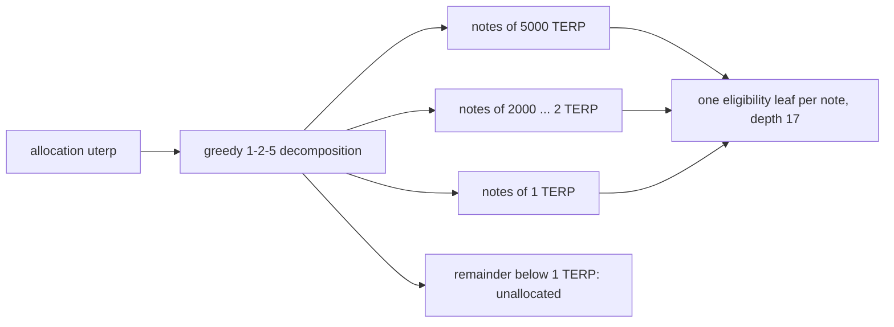
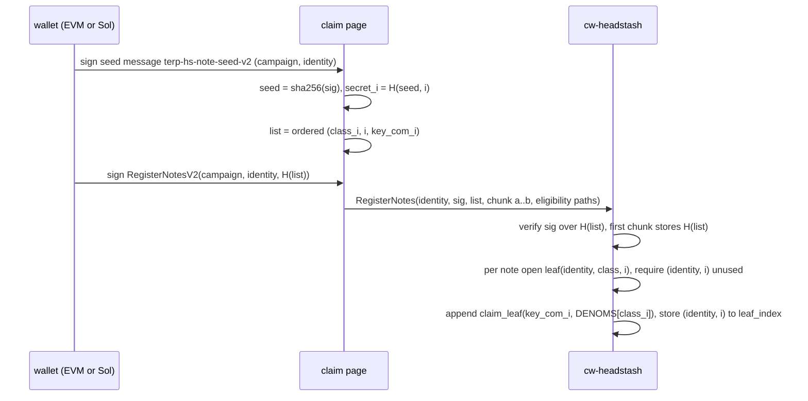
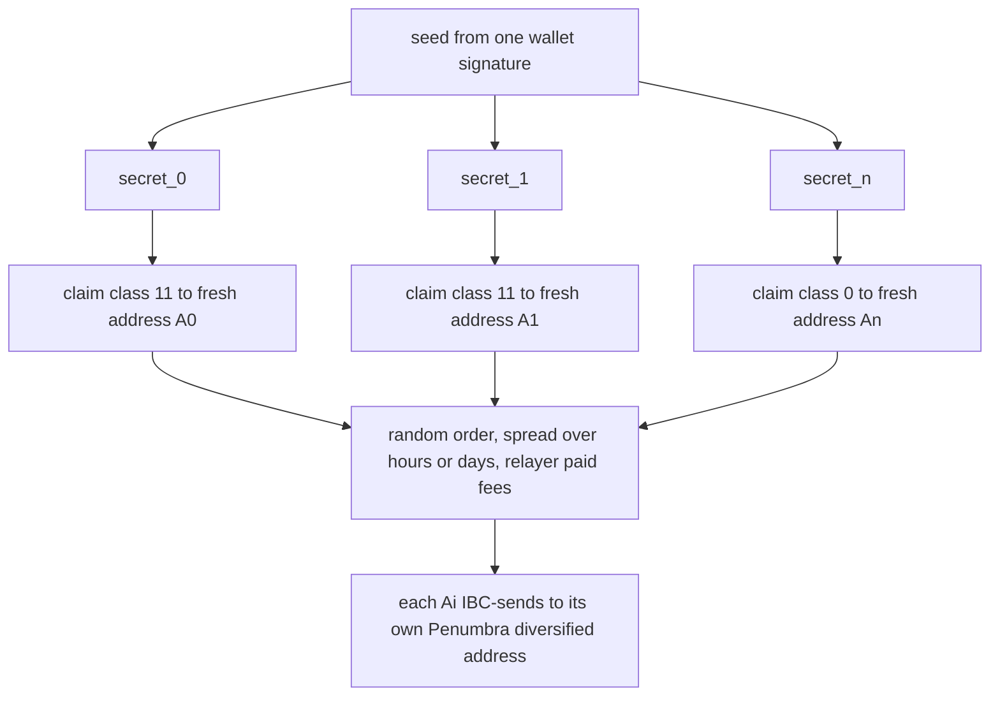

# Headstash fixed-denomination claim notes (spec rev 5)

Status: phase 1 (circuit, tree builder, spec). Contract, sidecar and claim page are phase 2.
Supersedes the "one leaf per identity" model of `headstash-registration-spec.md` rev 4 for
new campaigns. vk_id 2 stays registered for the existing campaign; it must not be used
for a new deployment (see security addendum N1 in `security-review-2026-10-26.md`).

## 1. Why

Rev 4 puts one `(identity, amount)` leaf per eligible identity. 1,563 of 17,791 identities
have an amount nobody else has, so the public `amount` input of a claim names the claimant.
Rev 5 splits every allocation into fixed-value notes. A claim reveals only a denomination
class, and every class has at least 5,081 notes from at least 2,859 holders.



## 2. Denominations

Twelve classes, `denom_class u8` = index:

| class | 0 | 1 | 2 | 3 | 4 | 5 | 6 | 7 | 8 | 9 | 10 | 11 |
|---|---|---|---|---|---|---|---|---|---|---|---|---|
| TERP | 1 | 2 | 5 | 10 | 20 | 50 | 100 | 200 | 500 | 1000 | 2000 | 5000 |

Decomposition is greedy from the largest class (`epoch/src/denominations.rs::decompose`).
Notes of one identity are numbered `note_index = 0..n`, largest class first.
`MAX_NOTES_PER_IDENTITY = 256`; the largest holder needs 177.

**Remainder.** The sub-1-TERP part of each allocation is not a note. It stays in the
contract as unallocated (same treatment as excluded rows) and is reported per identity in
`notes.jsonl` (`remainder`). Production total: 9,632,607,378 uterp (about 9,632.6 TERP, 0.014%).
Adding 0.5/0.2/0.1 classes would cut it to 881,407,378 uterp but needs 131,903 notes,
more than the 2^17 = 131,072 leaves of a depth-17 tree, and raises unique class vectors
from 895 to 1,376. Decision: 1 TERP minimum. Open: a later transparent remainder claim.

## 3. Eligibility leaf (sha256 tree, checked at registration)

```
leaf = sha256("terp-hs-note-elig-v2" || identity_tag || identity || denom_class u8 || note_index u16_le)
node = sha256("terp-hs-note-node-v2" || left || right)
identity_tag = 0x01 (EVM, 20-byte address) | 0x02 (Solana, 32-byte pubkey)
depth 17, empty leaf = 32 zero bytes, leaves sorted by identity bytes, an identity's notes contiguous
```

The amount is not in the leaf: it is `DENOMS[denom_class]` from the contract denom table.
Test vector prefix `76925bb0` (`leaves_are_domain_separated`).

Production root (2026-10-26 build, `DENOMS=1 eligibility/budget.sh`):
`c6ffae12fc3e5aa7f40a4f5b45e141b18362bdb06a798cc5c234ab5b5105a3b0`.

## 4. Claim leaf and circuit (vk_id 3)

```
key_com    = Poseidon("terp-hs-keycom-v1", secret)                (unchanged)
claim_leaf = Poseidon("terp-hs-note-leaf-v2", key_com, amount)    (new tag)
nullifier  = Poseidon("terp-hs-nullifier-v1", secret, ctx)        (unchanged)
public     = [ctx, root, nullifier, dest_lo, dest_hi, amount]     (layout unchanged)
```

Claim tree depth 17 (contract `DEPTH` 16 to 17). Every Poseidon tag and every Merkle layer
constant is fixed with `constrain_constant` (fix for N1). `prove_note` refuses non-class
amounts; the contract must also check `amount` is in `DENOMS` before verifying.

| | vk_id 2 (rev 4) | vk_id 3 (rev 5) |
|---|---|---|
| depth | 16 | 17 |
| K | 11 | 11 (measured minimal, `note_k_is_minimal`) |
| public inputs | 6 | 6 |
| proof bytes | 2752 | 2752 |
| vk blob bytes | 135,023 | 135,023 |
| vk hash | 94d43261...ed11 | 34d11437d957554f4008377dece5fac0f047e0e9cc012d15b3d09448a6cc5398 |
| native prove / verify | | 0.094 s / 0.004 s (groot-wan, release, keygen excluded) |
| pk bytes | 1,245,877 | 1,245,877 |
| canonical body | headstash-claim-v1:... | headstash-note-claim-v2:... |

## 5. Registration v2



* One signature per identity, over `H(list) = sha256("terp-hs-note-list-v2" || campaign ||
  identity_tag || identity || n u16_le || (class u8 || index u16_le || key_com 32)*)`.
  The list must be exactly the identity's notes 0..n in order (the contract checks n
  against the eligibility path of the last note, or takes n from a per-identity count leaf).
* Storage: `NOTE_REG: Map<(identity_bytes, u16), u32>` (leaf index) and
  `NOTE_LIST: Map<identity_bytes, [u8; 32]>` (signed list hash). Re-registering a note or
  a different list for the same identity is an error.
* Duplicate `key_com` is rejected inside a list and globally (`KEYCOMS` set).
* Batching: each chunk carries the full list (35 bytes per note, 6.2 KB at n = 177) so the
  hash is recomputed, plus eligibility paths only for its slice. Proposed 32 notes per message.
* Gas (estimate, measure in phase 2): rev 4 measured 398,371 to 403,982 gas for one
  registration (signature, depth-15 sha path, one Poseidon append). Each note adds a
  depth-17 sha path, a depth-17 Poseidon frontier append and two writes; budget 150k to
  250k per note, so p50 (5 notes) is about 1.0 to 1.4M gas and the max (177) about 6 chunks.

## 6. Claims

One claim per note, each a separate transaction with its own nullifier and destination.



* **Short-lived wallets.** `dest_i = terp1(secp256k1 key H("terp-hs-dest-v2", seed, i))`.
  The page recreates them from the same wallet signature; nothing new to back up.
* **Timing.** Random order across classes, random delay (minutes to days) between notes,
  never two notes of one identity in one block, fees via relayer or fee-grant so no
  destination is funded from a linked account.
* **Penumbra bridge.** Each short-lived wallet sends to a distinct Penumbra diversified
  address of the same spend key; notes recombine only inside the shielded pool. Sending all
  notes in one block, or to one transparent address, undoes the split.

## 7. Anonymity sets (production tree)

| TERP | notes | holders |
|---|---|---|
| 1 | 6,491 | 6,491 |
| 2 | 12,569 | 8,762 |
| 5 | 10,150 | 10,150 |
| 10 | 6,940 | 6,940 |
| 20 | 6,387 | 5,613 |
| 50 | 6,219 | 6,219 |
| 100 | 5,081 | 5,081 |
| 200 | 15,363 | 10,917 |
| 500 | 8,031 | 8,031 |
| 1000 | 7,978 | 7,978 |
| 2000 | 5,956 | 5,009 |
| 5000 | 7,676 | 2,859 |

98,841 notes, 17,791 identities, mean 5.56, p50 5, p99 13, max 177, none with zero notes.
A single claim hides among at least 5,081 claims of its class. If an observer can group
all claims of one identity, the class vector is unique for 895 identities and the note
count alone for 15; the section 6 hygiene is what prevents grouping.

## 8. Migration

* New campaign: new eligibility root (above), new claim tree (depth 17), vk_id 3.
* vk_id 2 and the depth-16 state stay for the existing campaign; the rev-4 circuit code is
  unchanged and its vk hash 94d43261...ed11 still holds.
* Builder: `DENOMS=1 eligibility/budget.sh` (or `--denominations --total <uterp>`) writes
  `<out>/notes/{tree.json, notes.jsonl, note_paths.jsonl, summary.json}` next to the rev-4
  outputs and asserts `notes + remainder + dust + unallocated == 67,000,000,000,000`
  (66,456,669,000,000 + 9,632,607,378 + 5,863 + 533,698,386,759).

## 9. Open decisions

1. Remainder: unallocated (current) or a transparent remainder claim.
2. Notes per registration message (32 proposed) once gas is measured.
3. How the contract learns n per identity (last-note path vs. a count leaf).
4. Fee model for short-lived destinations (fee-grant vs. relayer).

## 10. Browser prover (build 2026-10-26, zakura from local crates/zakura-common)

`scripts/build-browser-prover.sh -` (exports `prove_membership_witness_browser` and
`prove_note_witness_browser`):

* `zk_headstash.js` 10,923 bytes, sha256 `37a98d349275cb4a2c6e93f7278c4fc0c26c4120766d8f49add45448b0f8a964`
* `zk_headstash_bg.wasm` 2,006,266 bytes, sha256 `51681559143fcdb411e00515a745bf880e13c23a77ed28f13a7640b71acbe1c8`
* Parity: wasm proof (node, `initSync`, 3.35 s incl. keygen) verifies against the native vk_id 3
  (`browser_note_proof_matches_native_vk`).
