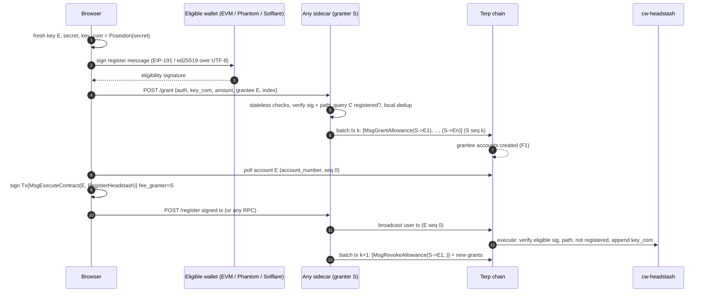

# Headstash registration spec (rev 4): submit to any sidecar (direct batched path)

Status: IMPLEMENTED on `wip/headstash-membership-vk` (local commits, not deployed). History: rev 1 (`e4520b1`),
rev 2 (`144d87d`), rev 3 (`51d30fe`, fee grants to fresh wallets). Rev 4 (2026-10-26) makes the direct sidecar
path primary (resolves D1 below) and keeps fee grants only as an optional self-submit path (section A).
Circuit, vk and public-input layout unchanged; only the eligibility (pre-registration) layer changed.

> Rev 5 (fixed-denomination notes, depth 17, vk_id 3) is specified in
> [`headstash-denominations-spec.md`](headstash-denominations-spec.md). Rev 4 stays valid for the existing campaign only.

## R4.1 Primary flow: any sidecar relays RegisterHeadstash directly

1. The holder signs the registration message with the eligible key (EVM personal_sign, or Phantom/Solflare
   `signMessage` for Solana). The claim destination is a separate Terp address and must not equal the registering
   address (the page warns).
2. The page POSTs it to any sidecar in its configured list (falls back to the next on network error, 429 or 5xx) and
   polls `GET /register/status/{id}` on the sidecar that accepted it.
3. The sidecar checks cheapest-first: 4 KiB body cap, JSON/format, `ctx == campaign ctx`, per-IP and per-identity
   rate limits, native signature verify (secp256k1 recover; ed25519 strict), eligibility path vs its local tree
   whose root and depth must equal the on-chain campaign at startup, cached `Registered{identity}` query, dedupe by identity,
   max queue length.
4. A single broadcaster flushes every N seconds (default 6) or at max batch (default 25) as ONE tx with several
   `RegisterHeadstash` / `RegisterHeadstashSol` msgs from the sidecar's own account. Sequence is kept locally and
   refreshed from chain on mismatch. The batch is simulated first; a failing msg (node reports `message index: i`)
   is dropped with its phrase (e.g. `already registered`) and the rest retried; failed delivery requeues up to 2x.
5. The contract re-verifies everything, so a sidecar cannot forge or alter a registration; it can only refuse or
   delay. Liveness: any sidecar, or the holder submitting the same msg themselves (any funded account; the
   sender is irrelevant to the contract).

No fee grants and no fresh wallets. Each sidecar pays its own gas; the registration is a few hundred k gas per msg.
Cross-sidecar duplicates cost at most one failed simulate, never a fee (the Registered query plus simulation drop it).

Operations: the binary is `headstash-register-relay` (hash-market). It binds 127.0.0.1 only behind the one nginx
(X-Real-IP trusted only from loopback). The operator key is a keyring reference (`HEADSTASH_RELAY_FROM`,
`HEADSTASH_RELAY_HOME`, `HEADSTASH_KEYRING_BACKEND`) passed to `terpd tx sign --offline`; the process never reads key material.
Chain access is the node REST API (`HEADSTASH_REST`, loopback by default). Required: `HEADSTASH_CONTRACT`,
`HEADSTASH_ELIGIBILITY` (tree.json from `headstash-eligibility`).

HTTP:
- `POST /register` takes `{kind:"evm"|"sol", ctx_hex, key_com_hex, amount:"<decimal>", signature_hex, pubkey_hex?}`.
  Lowercase hex. EVM sig is 65 bytes (v 27/28 or 0/1). Sol pubkey is 32 bytes and sig is 64 bytes.
  It returns `202 {id,status:"queued"}`, `200 {status:"registered"}`, `400 {error}`, `429` or `503`.
- `GET /register/status/{id}` returns `queued | submitted{txhash} | registered{txhash,height} | failed{error}`.
  The id is `hex(sha256(identity))[..16 bytes]`.

## R4.2 Encodings (normative, supersedes section 7 leaves)

- ctx: the campaign's 32-byte Pallas field ctx (`epoch_campaign.ctx`), shared by both kinds.
- EVM message: `headstash-register-v1:{ctx_hex}:{key_com_hex}:{amount}` (EIP-191). Unchanged.
- Solana message: `headstash-register-sol-v1:{ctx_hex}:{key_com_hex}:{amount}`, raw UTF-8, ed25519
  (`deps.api.ed25519_verify`; non-canonical S rejected).
- EVM leaf: `sha256("terp-hs-elig-leaf-v1" || addr20 || amount_le8)` (48-byte preimage, unchanged, so the published EVM
  root form stays valid. This resolves D3 as "EVM untagged + Solana tagged").
- Solana leaf: `sha256("terp-hs-elig-leaf-v1" || 0x02 || pubkey32 || amount_le8)`. The 61-byte preimage can never
  equal a 48-byte EVM preimage.
- Node: `sha256("terp-hs-elig-node-v1" || left || right)`; padding leaf = 32 zero bytes; depth <= 16.
- Vectors: sol_leaf(pubkey=0x01*32, 15) = `e224308c...3af711`; evm_leaf(0x7e5f45...395bdf, 15) = `45dd29df...4412ed`.
- Identity / one-registration key: EVM `hex(addr)` and Solana `"sol:" + hex(pubkey)`, both in the shared ADDRESSES map.
- Contract msgs: `RegisterHeadstash{key_com,amount,signature,eligibility_index,eligibility_path}`,
  `RegisterHeadstashSol{key_com,amount,pubkey,signature,eligibility_index,eligibility_path}`, and the
  `Registered{identity} -> bool` query.
- Snapshot: Solana entries are accepted as base64(utf8(base58)) or plain base58 (stoned-ape-club is plain base58).
  Each must decode to exactly 32 bytes on the curve; duplicates are summed. Built by `headstash-eligibility`
  (headstash-epoch).

## R4.3 Remaining decisions
- D2 (batch size/cadence): defaults 25 / 6 s, env-tunable.
- D5 reimbursement: still open (sidecars self-fund in rev 4).
- Allocation policy for fractional token snapshots (chronic-token) before the production root is built.

---

# Section A (optional): self-submit via fee grant (rev 3 text, retained)

The following is the rev 3 design. It is no longer the primary path. Use it only if a holder wants to submit
their own tx from a fresh wallet without funds. Section numbers below are rev 3's.

Status: DRAFT, design only. History: rev 1 (`e4520b1`) and rev 2 (`144d87d`) in
`smart-account-registration-spec.md` (now a pointer). Rev 3 (2026-10-26) follows the Terp Network decision to
prefer fee grants to fresh wallets over the smart-account registrar. No code, no chain txs. Circuit and locked vk_hash unchanged.

## 0. Verified code facts

| # | Fact | Where |
|---|---|---|
| F1 | `MsgGrantAllowance` **creates the grantee account** if it does not exist (unless blocked addr) | cosmos-sdk v0.55.0 `x/feegrant/keeper/keeper.go:75, 81-89` |
| F2 | Every signer account must exist for sig verification | sdk `x/auth/ante/sigverify.go:651-656` |
| F3 | SIGN_MODE_DIRECT sign data includes the signer's **account_number**, read from state | sdk `x/auth/ante/sigverify.go:383, 393` |
| F4 | With a fee granter, fees are taken from the granter (must exist) via `UseGrantedFees` | sdk `x/auth/ante/fee.go:128`; `x/feegrant/keeper/keeper.go:233-239` |
| F5 | `AllowedMsgAllowance` filters by msg **type URL only** | sdk `x/feegrant/filtered_fee.go:72-75` |
| F6 | Revocation exists (granter-only `MsgRevokeAllowance`) | sdk `x/feegrant/keeper/keeper.go:159` |
| F7 | Feegrant keeper is wired into the app and the classic ante deduct decorator | terp-core `app/keepers/keepers.go:148, 245-246`; `app/abci/ante.go:68`; `app/app.go:444` |
| F8 | A tx without a selected authenticator uses the classic path (pubkey set, sig verify, sequence increment) | `app/abci/ante.go:70-77, 97-101` |
| F9 | cw-headstash verifies the eligible signature itself; anyone may relay | `contracts/headstash/cw-headstash/src/msg.rs:150-157`; `src/registration.rs:195-238, 327-361` |
| F10 | Existing relay already accepts registrations over HTTP and submits `RegisterHeadstash` | `tools/hash-market/src/bin/headstash-register-relay.rs:162, 214, 248, 289, 411` |

Consequence of F1+F2+F3: **the user cannot sign the registration tx before the grant lands**, because the fresh
account's account_number does not exist yet. So grant and registration cannot be in one tx or reliably in one
block. The flow is two-phase.

**No chain change is required** (F1, F4, F5, F6, F7 are stock SDK; F8 is the classic path; F9 needs only contract changes).

## 1. Chosen flow

Phase A (grant): browser makes fresh Terp key `E`, gets the eligibility signature from the eligible wallet
over the register message (which already commits to `key_com`), and POSTs `{auth, key_com, amount, grantee=E,
eligibility_index}` to any sidecar. Sidecar verifies natively (sig, path to root, not registered on chain, not
already granted by this sidecar), queues it, and broadcasts **one sidecar tx per batch** carrying N
`MsgGrantAllowance{granter=S, grantee=E_i}` msgs (sidecar's own sequence, no clash).

Phase B (register): browser polls until `E` exists (account_number known, sequence 0), signs
`Tx{MsgExecuteContract(sender=E, cw-headstash, RegisterHeadstash{key_com, amount, auth, eligibility_index, eligibility_path})}`
with `fee_granter=S`, and deposits it to the same sidecar (or broadcasts it to any RPC itself; it is fully signed).
`E`'s pubkey is set on this first tx by the classic ante (F8). Sidecar forwards deposited txs as they come (each is
its own tx with E's own sequence; sidecar does not re-sign), then in the next batch sends `MsgRevokeAllowance` for
grants whose registration landed or whose expiry is near.



Ordering: the grant always lands at least one block before the registration (phase B waits for it). Latency ~2 blocks.

Simplification to note: since cw-headstash already verifies ownership itself (F9), a sidecar could instead put
the user's `RegisterHeadstash` msgs directly into its own batched tx (sender = S, the existing relay F10), with one
tx per batch, no fresh wallet and no grant. That is strictly fewer steps. The grant flow is chosen because the
user signs and owns their own registration tx, and the sidecar only pays (decision D1).

## 2. Grant scoping and misuse

Allowance per grantee:
```
AllowedMsgAllowance{ allowed_messages: ["/cosmwasm.wasm.v1.MsgExecuteContract"],
  allowance: BasicAllowance{ spend_limit: [ceil(1.5 * registration_fee) uterp], expiration: now + 30 min } }
```
- It cannot pin the contract (F5). A grantee can spend it on any wasm execute. Bounded loss: one spend_limit per
  grant. With per-sidecar dedup, one grant per eligible address per sidecar; worst case eligible_count x sidecars x spend_limit.
- Single use in practice: spend_limit covers one registration only; BasicAllowance is removed when exhausted (keeper.go:233-239).
- Revocation: yes, granter-only (F6). Sidecar revokes in the next batch after the registration event, or for
  stale grants. Expiry makes revocation a cleanup, not a safety need.
- Re-grant: sidecar refuses a second grant to the same eligible address while one is live or after registration.

## 3. Cross-sidecar duplication

One eligible address can ask every sidecar for a grant. Mitigations:
1. Each sidecar queries cw-headstash `registered(eligible_id)` before granting (cheap, required).
2. Local dedup per sidecar.
3. Shared grant set via vote extensions or gossip: not worth it. Waste is bounded (eligible_count x sidecars x
   spend_limit, e.g. 2,000 x 5 x 0.05 TERP = 500 TERP worst case), expires in 30 min, and can only be used for
   MsgExecuteContract fees. Optional cheap improvement: sidecars read each other's grants on chain
   (`feegrant` query by grantee) before granting, which needs no new protocol.

## 4. Funding and incentives

- Each sidecar operator funds its own granter account `S` (separate from validator and attestor keys).
- Campaign reimbursement: the headstash campaign (or community pool) reimburses sidecars per **successful**
  registration they granted (provable on chain: grant from S to E, then RegisterHeadstash from E with fee_granter=S).
  Paid by a periodic claim, reusing the attestor-registry operator list (`docs/public/attestor-registry-spec.md`)
  so only registered infra runners are reimbursed.
- Top-up: alert at < N x spend_limit; operators top up S; reimbursement covers fees plus a small margin.

## 5. Censorship resistance and liveness

- Any validator or infra runner can run a sidecar; the front end lists several and rotates on refusal.
- If every sidecar refuses: the user funds `E` (or any wallet) themselves and submits phase B directly with no
  fee_granter; cw-headstash accepts it because ownership is verified on chain (F9). Registration never depends on sidecars.
- Sidecars only affect who pays, never validity.

## 6. Privacy

Registration links the eligible address to `E` and `key_com` (acceptable: registration is linkable by design).
`E` must never be the claim destination and must not be reused. UX: label it "registration wallet, single use",
keep it in session storage only, discard after registration, and have the claim screen reject a destination equal to any registration wallet.
Claims stay on the batched claim ingress; a sidecar that saw a grant request should not also see the claim from the same IP/session (recommend a different sidecar or delay).

## 7. Message formats (rev 3; leaves superseded by R4.2)

- EVM: EIP-191 over `headstash-register-v1:{ctx}:{key_com}:{amount}`.
- Solana: `ed25519_verify` over UTF-8 bytes of `headstash-register-sol-v1:{ctx_hex}:{key_com_hex}:{amount_decimal}`;
  `signMessage(new TextEncoder().encode(M))`; base58 is only the pubkey/signature encoding. The old claim contract
  (old headstash-patch repo) is deleted and unrecoverable; this format is defined fresh.
- Snapshot: entries are `base64(utf8(base58))`; decode base64 -> base58 string -> 32 bytes exactly; drop off-curve keys.
- Leaves: `keccak256(0x02||pubkey32||amount_be64)` Solana, `keccak256(0x01||addr20||amount_be64)` EVM (or EVM untagged if root published, D3).
- Wire: `auth: {secp256k1_eip191:{signature}} | {ed25519:{pubkey, signature}}`.
- Should the grantee be bound? Optional: extend the message with `:{grantee}` so a sidecar can prove it granted to the address the eligible key chose. Not needed for safety (the leaf is key_com); costs a message change (D4).

## 8. Security review

1. **Sidecar API DoS**: stateless pre-checks first (sizes, lengths, prefix, amount range, index bound), then one
   signature verify, then path; reject before any chain query. Rate limits per eligible id (1 live request) and per
   IP (e.g. 10/min); max body 4 KiB; max batch size (e.g. 100 grants per tx, below block gas); queue cap with 503.
2. **Replay across ctx/chain**: ctx binds chain_id, contract and round; cw-headstash rejects other ctx. A grant
   request replayed to another sidecar is the duplication case (section 3). A signed phase-B tx cannot be replayed (E sequence).
3. **Malleability**: secp256k1 low-s, v in {0,1,27,28}; ed25519 host verify rejects non-canonical s. Sidecar dedup keys
   on eligible id, never on signature bytes.
4. **One per address**: enforced on chain by cw-headstash `REGISTERED` (registration.rs:234); grants are only a fee concern.
5. **Malicious sidecar**: cannot forge registration (contract verifies eligible sig); cannot change key_com (signed);
   can censor (user tries another or self-funds); can front-run by broadcasting the same signed tx (harmless, same leaf);
   can log IP and link to eligible address (already linkable). It could refuse to forward phase B: browser also broadcasts directly.
6. **Fee griefing of sidecars**: only verified, unregistered eligible ids get grants; waste bounded per section 2-3.
7. **Sidecar key custody**: granter key separate from validator/attestor keys, holds only the grant budget. On groot-wan
   dev the operator key is used through the existing keyring and never read or exported by tooling. Production: HSM/KMS or a
   dedicated low-balance hot key with periodic top-up.
8. **Grant scope creep**: type-URL-only scope (F5) accepted; tight spend_limit and expiry are the real bound.
9. **Contract**: unchanged ownership logic; adds ed25519 and tags. The contract ignores the tx sender, so E, S or anyone may submit.

## 9. Alternatives

### 9.1 Feegrant as an authenticator on the fresh wallet (user alternative, more complex)
E adds a smart-account authenticator (MessageFilter pinned to cw-headstash + CosmWasm check of eligibility) and the
grant is scoped through it. Gains contract pinning. Costs: E still needs a fee source and an account to add the
authenticator (an extra tx), CosmWasm auth must fit `MaximumUnauthenticatedGas` 120k (`x/smart-account/types/params.go:12`),
and fees are taken before execution (`x/smart-account/ante/ante.go:192-215`). Deferred.

### 9.2 Smart-account registrar (rev 2, deferred)
One shared registrar R paying fees. Findings: fees taken from first signer after its authenticator approves and kept even if
execution fails (`ante.go:110-118, 192-215`); Track writes survive execution failure; `SequenceMatch` hard-coded (`ante.go:171`),
so a shared R clashes on sequence and needs unordered-tx wiring (absent) or sharding; 120k auth gas limit; R must be keyless.

### 9.3 Sidecar signature accumulation + vote-extension ingress (rejected, rev 2)
Extra validator bandwidth and complexity on a critical surface.

## 10. Effort (no chain upgrade)

| Component | Work | Effort |
|---|---|---|
| Sidecar (`headstash-register-relay.rs` / hash-market-server) | `/grant` endpoint with native checks, grant batcher, `/register` forwarder, revoke sweeper, rate limits, metrics | 4-5 d |
| cw-headstash | ed25519 path, `auth` enum, tagged leaves / eligible id, `registered` query if absent | 3-4 d |
| Eligibility tooling | SAC decode, off-curve filter, rebuild root | 2 d |
| Front end | fresh wallet, Phantom/Solflare signing, grant request, poll, sign phase B, sidecar rotation, single-use UX | 4-5 d |
| Ops / reimbursement | granter funding, alerts, reimbursement claim via attestor registry | 2-3 d |
| Tests | e2e grant then register, duplication, expiry, revoke, self-funded fallback | 2-3 d |
Total: ~2.5-3.5 weeks; chain: none.

## 11. Decisions / open questions
- D1: grant flow (user signs own tx) vs sidecar relaying RegisterHeadstash directly (fewer steps, same trust).
- D2: spend_limit and expiry values; batch size and cadence.
- D3: EVM eligibility root published already (EVM untagged + Solana tagged) or full re-root.
- D4: bind grantee in the signed message?
- D5: reimbursement source and rule (per successful registration via attestor registry?).
- D6: accept bounded cross-sidecar waste (recommended) vs on-chain pre-check of existing grants vs gossip.

## R5. Direct on-chain claim (vk_id 3, zk-api build)
Reuses the registration epochs and anchors of `registration.rs` unchanged (no new epoch or anchor
machinery, no auto-snapshot). `ClaimNote {root, nullifier, amount, proof}`:
1. amount is a campaign denomination and `DIRECT_CLASS_PAID[class] < class.cap`;
2. the public-reserved check;
3. root must be an accepted anchor (`anchor_known`); otherwise "root is not an accepted anchor";
4. nullifier unused;
5. `proof_instance_verify(zk_id, proof, [ctx, root, nullifier, dest_lo, dest_hi, amount])` with the
   zk_id pinned by `bind_note_circuit` (hash-checked, single bind), dest = info.sender;
6. record the nullifier, pay `amount` to the sender. Window = campaign cutoff; `sweep_unclaimed` after.
The nullifier is root-independent, so a note proven against any accepted anchor spends once.
Fee grants: the relay dry-runs the claim with the contract queries, then grants
`AllowedMsgAllowance{MsgExecuteContract}` over `BasicAllowance{spend_limit = one claim fee, short
expiry}` to the fresh wallet; dedupe by nullifier; rate limited; no IP logging.
