# Headstash architecture and privacy flows

Public overview of the approved Headstash design. Rendered on the dao-dao-ui
landing page `/headstash-overview` (`HeadstashArchitectureDiagram.tsx`). Sources:
`contracts/headstash/cw-headstash/src/registration.rs`, `tools/hash-market/src/ve/`,
`tools/headstash/epoch/src/lane.rs`, `x/hashmerchant/keeper/vote_ext.go` (terp-core),
`tools/headstash/docs/circuit/DEPLOY-REVIEW.md`, `REGISTRATION-TREE.md`.

```mermaid
flowchart LR
  subgraph Browser["User browser (private)"]
    S["secret\nAES-GCM backup in IndexedDB"]
    KC["key_com = Poseidon(secret)"]
    P["Web Worker wasm\nK=11 zakura Halo2 membership proof\nnullifier = Poseidon(secret, ctx)\nbinds destination + u64 amount"]
  end
  W["Eligible EVM wallet\npersonal_sign\nheadstash-register-v1:{ctx}:{key_com}:{amount}"]
  R["Relayer (anyone)\nRegisterHeadstash"]
  C["cw-headstash\nsecp256k1 recover vs eligibility root\none registration per address, unique key_com\nappend to depth-16 Poseidon tree (frontier on-chain)"]
  A["Epoch anchors (AcceptAnchor, permissionless)\nroot history; accepted only if\nleaf_count >= min_anonymity_set"]
  N["Single nginx\norigin allowlist\npublic: POST /ve/headstash/claims\ncampaign/seal: operator-signed"]
  SC["Sidecar ingress\nhash-market-server on 127.0.0.1:9090\nnative verify via vk registry (vk_id 2 = K=11)\nbatch per epoch"]
  V["Validators\nx/hashmerchant vote extensions\nabstain on invalid custody signature\nquorum 0.667"]
  PAY["cw-headstash settle\nvk_hash locked at campaign creation\nnullifier spent once"]
  D["Destination terp1...\npublic uterp"]
  PN["Penumbra shielded address\nICS-20 via Zafu\npenumbra.fi/portfolio"]

  S --> KC --> W --> R --> C --> A
  A -- "accepted root + registration_path" --> P
  S --> P
  P -- "proof, nullifier, root, destination, amount" --> N --> SC --> V --> PAY --> D
  D -. optional IBC .-> PN
```

## Public vs private

| Step | Public | Private |
|---|---|---|
| Register | EVM address, key_com, amount, signature, leaf | secret |
| Epoch anchor | root, leaf_count, anchor history | which leaf is yours |
| Prove | nothing until submit | secret, leaf index, Merkle path |
| Claim (nginx -> sidecar) | proof, nullifier, accepted root, destination, amount | link destination <-> registering address |
| Payout | destination gets public uterp, nullifier spent | registering address not referenced |
| Penumbra (optional) | IBC transfer out of destination | shielded balance |

Notes
- Amount is public in both the registration and the claim, so the effective anonymity set is the registered leaves with the same amount under the accepted root.
- Proofs are sound without trusting the sidecar, so anyone can run ingress; only payout needs validator quorum.
- Dev only: loopback LCD answers `Access-Control-Allow-Origin: *`; production uses the one nginx allowlist.
