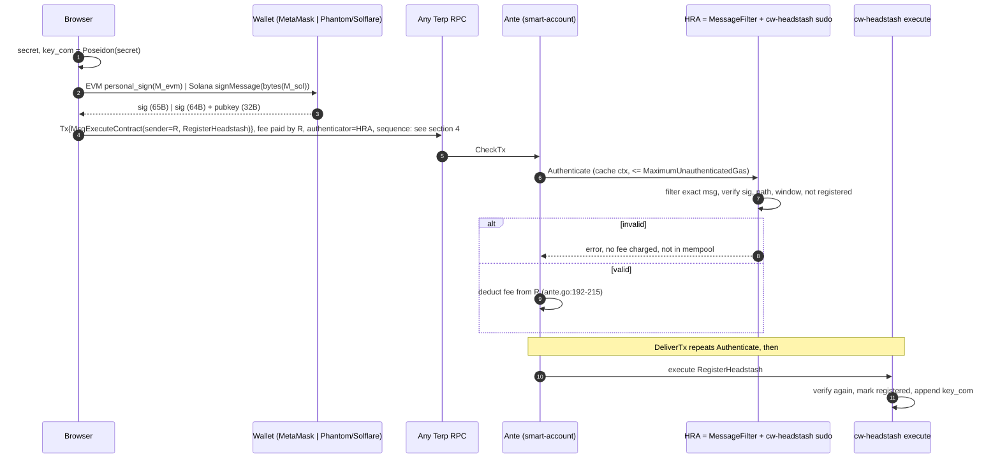

# Headstash registration through a shared registrar smart account (design spec, rev 2)

Status: DRAFT, design only. Rev 1 2026-10-26 (commit e4520b1). Rev 2 2026-10-26 applies Terp Network review decisions:
no chain zero-fee lane; the registrar smart account pays fees; Solana via in-contract `ed25519_verify`;
feegrant vs unordered analysis; sidecar batching recorded as a rejected alternative; expanded security review.
No code, no chain txs. Circuit and locked vk_hash unchanged.

## 0. Code facts this design relies on

| Fact | Where |
|---|---|
| Fee payer is the first signer of msg[0]; manual fee payer not supported | `x/smart-account/ante/ante.go:63-66, 110-118` |
| Authenticators run first under a small gas meter (`MaximumUnauthenticatedGas`, default 120_000) | `ante/ante.go:76-83`, `x/smart-account/types/params.go:12` |
| Fees are deducted **only after** the fee payer's authenticator returns ok, then the store is written so the fee persists even if a later message fails authentication | `ante/ante.go:185-215` |
| Authenticate runs in a discarded cache ctx; Track runs after all msgs authenticate, and its writes are **not** reverted if message execution later fails | `ante/ante.go:185-187, 218-240`; `authenticator/iface.go` (Track doc) |
| Sequence must equal account sequence (`SequenceMatch`) in ante; sequence then incremented | `ante/ante.go:171`, `authenticator/replay_protection.go`, `app/abci/ante.go:85` |
| No unordered-tx wiring anywhere in `app/` or `x/smart-account` (grep `unordered`: no hits) | `app/abci/ante.go:68-104` |
| Without a selected authenticator the tx goes through the classic sig path (key signature) | `app/abci/ante.go:70-77, 97-101` (CircuitBreakerDecorator) |
| `AddAuthenticator`/`RemoveAuthenticator` are signed by the account itself; only `SetActiveState` (circuit breaker) has a governor/controllers | `x/smart-account/keeper/msg_server.go:29, 67, 92-108` |
| Feegrant is honored by the deduct decorator (`FeeGranter`) | `ante/ante.go:117`, `types/expected_keepers.go:14` |
| cw-headstash: EVM message l.327, EIP-191 + secp256k1 recover l.335-361, leaf l.404 (20B only), "already registered" l.234 | `contracts/headstash/cw-headstash/src/registration.rs` |
| Ed25519 CosmWasm authenticator exists but signs Cosmos tx bytes (`sign_mode_direct`), not a wallet message | `contracts/smart-accounts/terp-ed25519/src/lib.rs:10-14, 177-190` |

Contradictions with the review assumptions:
1. "Fees paid by the registrar" is correct (first-signer deduction, `ante.go:110-118, 192-215`), but a tx that
   **passes the authenticator and then fails in contract execution still pays** (fee written at `ante.go:203-209`
   before execution). So the authenticator must replicate every contract precondition, or the registrar can be drained (section 3).
2. Track writes survive execution failure (`iface.go` Track doc). Recording "registered" in Track would lock an
   address out if execution fails. Source of truth must be cw-headstash state (section 2.3).
3. 120_000 unauthenticated gas (`params.go:12`) is probably too small for a CosmWasm sudo that does a secp256k1 or
   ed25519 verify plus a 16-32 level keccak path; exceeding it fails with OutOfGas (`ante.go:86-95`). Must be benchmarked; options in OQ3.
4. Feegrant `AllowedMsgAllowance` scopes by message **type URL** only. It can allow `MsgExecuteContract` but cannot pin the cw-headstash address.
5. Option (b) (feegrant to an ephemeral key) does not escape the registrar's sequence: the grant itself is a tx from some granter (section 4).

## 1. Design summary

One shared **registrar account R** pays all registration fees. R carries one authenticator, the
Headstash Registration Authenticator (HRA):

```
AllOf(
  MessageFilter{"@type":"/cosmwasm.wasm.v1.MsgExecuteContract","sender":R,
                "contract":<cw-headstash>,"funds":[],"msg":{"register_headstash":{}}},
  CosmwasmAuthenticator{contract: <cw-headstash or headstash-auth>, params: {}}
)
```

The CosmWasm leg is **signing-aware**: its sudo `authenticate` receives the `RegisterHeadstash` msg and the
tx signature slot, and runs the same pure function cw-headstash uses at execute:
`verify_registration(ctx, msg) -> Result<EligibleId>` (EVM: EIP-191 secp256k1 recover; Solana: `deps.api.ed25519_verify`),
then eligibility path, window open, tree not full, not already registered. Preferred: put the sudo entry point in
**cw-headstash itself**, so there is one code path and one state (no drift between authenticator and contract).

The user's browser builds the tx with `sender = R`, fee from R, selected authenticator = HRA id, and broadcasts to any
public RPC. No relayer, no sidecar. cw-headstash re-runs `verify_registration` in execute (ownership never skipped).

## 2. Data flow



### 2.3 State
- `REGISTERED[eligible_id]` lives in cw-headstash and is written only by successful execute.
- HRA Track: no-op (or a per-block counter only, see 3.3). Two txs for the same address in one block: the
  first execute writes REGISTERED; the second tx's DeliverTx ante re-runs Authenticate against updated state and
  fails **before** fee deduction. In CheckTx both may enter the mempool; the duplicate is evicted on recheck.

## 3. Fees, funding and drain analysis

### 3.1 Who pays
R pays every registration (first signer). R must stay funded. Rough cost: gas ~300-500k at min gas price per
registration, times eligible holders (thousands). Fund R with a fixed budget sized for the eligible count plus 20%.

### 3.2 Who can make R pay
Only a tx where HRA Authenticate returns ok (fees are deducted after it, `ante.go:192-198`). HRA returns ok only
for an unused, valid eligible signature over the current ctx. Therefore the maximum number of paid txs equals the
number of eligible, unregistered entries, plus the residual cases below:
1. **Pass-auth, fail-execute**: anything the contract checks that HRA does not (window closes between blocks, tree
   full, gas limit too low, contract migrated). Mitigation: HRA and execute share one function and one state; HRA
   rejects `gas_limit` above a cap and below a floor (so an attacker cannot set too little gas to make execution fail
   after fee); HRA rejects any fee above a cap (attacker cannot burn R by setting a huge fee) and any non-native fee denom.
2. **Same-block duplicates**: only the first executes; the rest fail at DeliverTx ante before fee (2.3). Cost: CheckTx work only.
3. **Front-running** a user's own tx: same signed key_com, so it only registers the user; R pays once.
4. **Fee size attack**: the attacker builds the tx, so the attacker chooses fee and gas. HRA must pin
   `fee == expected` (params: max_fee, max_gas), otherwise one valid signature could spend R's whole balance.
5. **Track/state desync**: avoided by keeping state in the contract.
Bound: R loses at most (eligible_count x max_fee) plus rare race cases. No unbounded griefing.

### 3.3 Top-up and monitoring
- Alert when R balance < 2 days of expected volume or < N x max_fee; alert on paid-but-failed executes (event
  `headstash.register` missing for a tx where R paid).
- Top-up by multisig/DAO send to R (anyone can send to R; harmless).
- Optional HRA per-block counter in Track (reset per height) capping registrations per block, e.g. 50.

## 4. Sequence handling: shared R clashes

All users sign txs for the same account R. With `SequenceMatch` (`ante.go:171`) two browsers that read sequence s
both build txs with s; one fails with sequence mismatch (no fee charged since sequence check happens in
`GenerateAuthenticationRequest` before deduction, but the user must retry). Under load this is a retry storm.

### (a) Unordered transactions on R
- SDK v0.55 supports `unordered=true` + `timeout_timestamp`, replay-protected by tx hash. Needs wiring: the
  unordered decorator/manager in `app/abci/ante.go`, and smart-account must pass a replay mode that skips
  `SequenceMatch` for unordered txs (`ante.go:171` currently hard-codes it) and skip sequence increment.
- Pros: one tx per user, no trusted party, no new grants, concurrency unlimited. Byte replays blocked by the hash
  store; semantic replays blocked by REGISTERED.
- Cons: chain upgrade (small, contained in ante); unordered applies to any account once enabled, so gate it:
  allow unordered only when the selected authenticator is a CosmWasm authenticator whose params opt in, or enable chain-wide per SDK default.

### (b) One-time feegrant to a browser ephemeral key
Flow: browser makes ephemeral Terp key E; E gets `AllowedMsgAllowance{[MsgExecuteContract], BasicAllowance{spend_limit, expiration}}`;
E sends RegisterHeadstash with `fee_granter`.
- Chicken-and-egg: the grant is itself a tx (`MsgGrantAllowance`) whose granter must sign and pay.
  - Granter = R via HRA: still one tx per user from R, so the **same sequence clash** moves to the grant tx. Nothing gained.
  - Granter = cw-headstash contract (CosmosMsg::Any `MsgGrantAllowance`, granter = contract) triggered by a verified
    eligibility signature: someone must still submit that execute tx and pay for it: a relayer (centralized) or R (clash again).
  - Granter = a relayer/faucet: reintroduces the trusted, centralized party the user wants removed.
- Two txs per user instead of one; the grant leaks the ephemeral key to the eligible address (fine, registration is linkable anyway).
- Scope is weaker: allowance cannot pin the contract address (type URL only), so E could spend its allowance on any wasm execute.
- Verdict: (b) does not solve the sequence problem without a relayer.

### (c) Sharded registrars (no chain change)
R_1..R_k (e.g. k = 32) each with the same HRA. Browser picks a random shard, reads its sequence, retries on another
shard on mismatch. Clash probability per attempt ~ concurrent users / k. Fees: fund k accounts. Admin surface x k.

### Recommendation
**(a) unordered on R** as the target: one tx, no trusted party, smallest attack surface. Ship **(c)** first if the
upgrade cannot land before the registration window, since it needs no chain change. Do not use (b).

## 5. Solana

The old claim contract (old version of the terpnetwork headstash-patch repo) is deleted and unrecoverable. Its
method was ed25519 offline signatures; this spec defines the format fresh, verified in-contract with `deps.api.ed25519_verify`.

Exact signed bytes: Phantom/Solflare `signMessage(Uint8Array)` signs raw bytes. Base58 is only the encoding of pubkeys and signatures.
```
M_sol   = UTF-8 bytes of "headstash-register-sol-v1:" + ctx_hex + ":" + key_com_hex + ":" + amount_decimal
ctx_hex = lowercase hex of the 32-byte registration ctx (binds chain_id, cw-headstash address, round)
key_com_hex = lowercase hex of the 32-byte key_com, amount_decimal = base-10 u64, no padding
```
Browser: `wallet.signMessage(new TextEncoder().encode(M_sol))` -> 64-byte signature; pubkey from `wallet.publicKey.toBytes()`.
Wire (in RegisterHeadstash and therefore visible to HRA): `auth: {ed25519: {pubkey: Binary(32), signature: Binary(64)}}`;
EVM stays `auth: {secp256k1_eip191: {signature: Binary(65)}}`. Contract checks lengths, then `ed25519_verify(M_sol, sig, pubkey)`.
No Solana off-chain-message envelope, no prehash.

Snapshot mapping: entries store `base64(utf8(base58_address))` (git `fdb575c` `scripts/solana-utils.js`). Tooling:
base64-decode -> ASCII base58 string -> base58-decode (Bitcoin alphabet) -> must be exactly 32 bytes (reject otherwise; also
reject off-curve? no: Solana PDAs are off-curve and cannot sign, so drop off-curve keys at snapshot build and report them).
Leaf: `keccak256(0x02 || pubkey32 || amount_be64)`; EVM leaf `keccak256(0x01 || addr20 || amount_be64)`.
If the existing EVM root is already published untagged, keep EVM untagged and tag only Solana (length differs, no collision; OQ1).
Eligible id for REGISTERED: `0x01||addr20` or `0x02||pubkey32`.

## 6. Considered alternative: sidecar accumulation + vote-extension ingress (not the plan)

Sidecars collect registration signatures, reject invalid ones, batch verified ones, and validators confirm batches via vote extensions.
- Pros: no per-user tx; second confirmation by validator quorum; fees amortized; spam filtered off-chain.
- Cons: extra bandwidth on every validator, VE size limits, liveness coupled to sidecars, more code on a critical surface,
  sidecar becomes an ingress users depend on, censorship by sidecar operators, harder audit.
- Decision: rejected in favour of the direct path (section 1, sequence per section 4).

## 7. Security review (critical surface)

1. **Replay across ctx/chain**: ctx binds chain_id, contract address and round; signatures for testnet, a fork, another
   instance or a past round fail. Within chain: REGISTERED blocks semantic replay; unordered hash store (a) or sequence (c) blocks byte replay.
2. **Domain separation**: EVM inside EIP-191 with prefix `headstash-register-v1:`; Solana raw with `headstash-register-sol-v1:`.
   A Solana `signMessage` payload starting with ASCII `h` cannot parse as a Solana tx (Phantom also refuses tx-shaped messages);
   not a Cosmos SignDoc; not EIP-712. Leaf tags separate address spaces. Do not reuse the same message for claims.
3. **Malleability**: secp256k1 require low-s and v in {0,1,27,28}; identity = recovered address. ed25519 host verify
   (ed25519-zebra) rejects non-canonical s; identity = pubkey. Never key state by signature bytes or tx hash.
4. **One per address**: REGISTERED in contract; checked in HRA and execute; duplicates in one block fail at DeliverTx ante before fee.
5. **Griefing / drain**: section 3.2; pin fee, gas floor/ceiling, denom; per-block cap; all contract preconditions in HRA.
6. **Ownership**: checked twice by the same function; execute never trusts "ante already checked".
7. **Authenticator scope**: MessageFilter pins type, sender R, contract, empty funds, `register_headstash` only; one message
   per tx (reject multi-msg so a valid registration cannot carry a second message paid by R); no memo-carried data trusted.
   Cosmwasm leg rejects unknown fields in its params.
8. **Registrar key and admin control**: R must not have a usable private key, or the holder can bypass HRA via the
   classic path (`app/abci/ante.go:97-101`) and spend R's funds or call `RemoveAuthenticator`/`AddAuthenticator`
   (`msg_server.go:29, 67`). Options: (i) R created at upgrade as a module-derived address with HRA installed by the upgrade
   handler (no key exists); (ii) R a cw3/DAO multisig contract account. Recommend (i). cw-headstash wasm admin can migrate
   the sudo logic: admin must be the DAO/gov with a timelock; vk_hash lock unaffected. Circuit breaker
   (`msg_server.go:92-108`) can disable all authenticators chain-wide: registration then halts (fails closed); document it.
9. **Gas**: the HRA must fit `MaximumUnauthenticatedGas` or authenticate always fails (`ante.go:86-95`); benchmark.
10. **Privacy**: registration is linkable by design. Claims stay on the batched ingress; a direct claim through R would link
    timing/IP and shrink the anonymity set, so out of scope.

## 8. Changes per component and effort (revised, no chain fee lane)

| Component | Change | Effort |
|---|---|---|
| cw-headstash | shared `verify_registration`; ed25519 path; `auth` enum; tagged eligible id/leaf; sudo `authenticate` entry (no-op track/confirm); fee/gas pin params | 4-6 d |
| Chain | (c) none. (a) unordered wiring in `app/abci/ante.go` + replay mode at `ante.go:171`; create R and install HRA in upgrade handler | (c) 0; (a) 4-6 d |
| Ops | fund R, monitoring, alerts | 1-2 d |
| Eligibility tooling | decode SAC entries, off-curve check, rebuild root | 2 d |
| Front end | Phantom/Solflare signMessage, tx with sender R + selected authenticator, shard/unordered logic, multi-RPC | 4-5 d |
| Benchmarks/tests | HRA gas vs 120k, drain tests, duplicate-in-block test | 2-3 d |
Total: ~2.5-3 weeks (was 3-4).

## 9. vk_hash impact
None. Registration is outside the circuit; only the eligibility root and contract registration code change.

## 10. Open questions
- OQ1: is the EVM eligibility root already published (untagged EVM + tagged Solana, or full re-root)?
- OQ2: sequence: ship (c) sharded registrars now and (a) unordered later, or wait for (a)?
- OQ3: HRA gas: raise `MaximumUnauthenticatedGas` by param change, use a native Go leg, or trim the path check?
- OQ4: R creation: module-derived at upgrade (recommended) vs DAO multisig account.
- OQ5: fee/gas caps and per-block cap values; R funding budget and who tops up.
- OQ6: sudo authenticator inside cw-headstash (recommended) vs separate headstash-auth contract.
