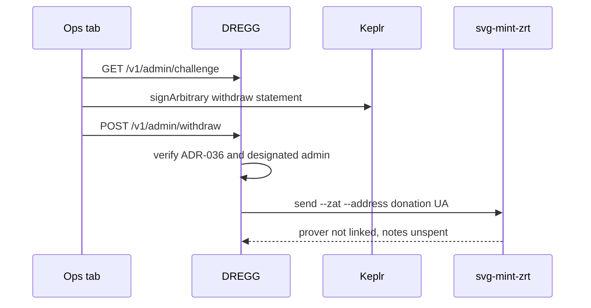

# Ops collect

Desk: [permissionless.money/ops](https://permissionless.money/ops).

1. Sign in with Keplr (ADR-036) to read admin state.
2. Withdraw asks Keplr to sign once more.

The signed bytes are:

```
permissionless.money withdraw <zat> zat to <donation-ua> <challenge>
```

A login signature cannot spend. There is no destination field. A foreign `to` is 400.

The fed then runs `svg-mint-zrt send --zat … --address <donation-ua>`. On this build that command checks the donation UA and exits because the Ironwood prover is not linked. Notes are not marked spent. Nothing is broadcast. The house does not have `svg-mint-zrt` installed and does not have `~/.terp/svg-mint-zrt`.

Session refund is a different route. It changes phase to refunded and does not move ZEC.


