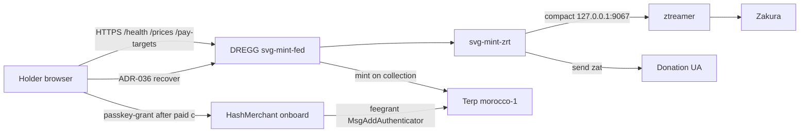

# Architecture

Permissionless SVG mint is a **desk**: a holder pays ZEC or native THIOL, DREGG entitles, CosmWasm mints an SVG NFT on Terp `morocco-1`. HashMerchant never buys the NFT. The house Zcash stack never answers the browser.

## Actors

| Actor | Does | Must not be |
|---|---|---|
| Holder | Keplr `terp1` or passkey-bound device | Admin |
| DREGG (`svg-mint-fed`) | Checkout, watch, entitle, mint | Feegrant granter, deposit UA |
| HashMerchant onboard | One-time `MsgAddAuthenticator` feegrant after paid `c` | Minter |
| svg-mint-zrt | House ZEC seed, note ledger, recover policy | Public zec.rocks. This build does not scan or broadcast. |
| ztreamer | CompactTxStreamer (`GetLightdInfo.vendor = Ztreamer`) | ECC lightwalletd |
| Zakura | Zcash full node, loopback RPC | Browser JSON-RPC |
| Admin | ADR-036 recover to the donation UA | Deposit wallet |

## Runtime graph

## Trust waist

- A note is this checkout when its address is the diversified UA, or its memo is the payment id. Empty memos still count when the address matches.
- Unmined is receipt. The page says "Payment received. Minting after the next block." The mint runs only after that note is mined.
- Unpaid checkouts show a countdown (`pending_ttl_secs`, default 10 minutes). The clock stops once the note is seen. It does not reset on refresh.
- The desk shows one sentence per step. It does not dump `/health` JSON at the holder.
- ZIP-321 memo is a blinded Pedersen commitment (`memo_hex` starts `6431`), never a `terp1`.
- `checkout_ready` is the Pay gate. `/v1/prices` ok is not Pay.
- House ZEC tip may hide `zec_uri` without closing native THIOL.
- Compact server is house ztreamer on loopback. Never zec.rocks. Never zcash.rotko.net.
- Recover is a **fresh** ADR-036 over amount + donation UA + challenge. A login signature cannot spend.

## Source trees

Workspace: `~/abstract/svg-mint` (this documentation, the `dregg` library, `svg-mint-fed`, `svg-mint-zrt`). `terp-core/crates/dregg/svg-mint` is a leftover snapshot.

Pinned runtimes (git submodules of the product crate, see [Runtimes](/engines/runtimes)):

- Zakura — `zakura-core/zakura` tag `v1.6.0`
- ztreamer — house CompactTxStreamer (vendor Ztreamer)
