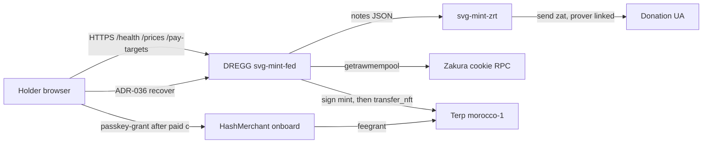

# Architecture

Permissionless SVG mint is a desk. A holder pays native THIOL, or ZEC once a spendable house wallet exists. DREGG entitles. CosmWasm mints an SVG NFT on Terp `morocco-1`. HashMerchant never buys the NFT. The house Zcash stack never answers the browser.

## Actors

| Actor | Does | Must not be |
|---|---|---|
| Holder | Keplr `terp1` or passkey-bound device | Admin |
| DREGG (`svg-mint-fed`) | Checkout, watch, entitle, sign the mint, `transfer_nft` to the pay-target | Feegrant granter, ZEC deposit wallet, collection admin |
| HashMerchant onboard | One-time passkey feegrant after a paid `c` | Minter, and not a thread inside the fed |
| svg-mint-zrt | One house ZEC seed and one note ledger | A new seed on every start. Scan and prover are not linked. |
| Zakura | House Zcash full node. Cookie JSON-RPC for tip and mempool. | Browser JSON-RPC |
| Compact server | Intended: ztreamer. Live on `:9067`: ECC lightwalletd. | zec.rocks, rotko, or a second archive node |
| Admin | ADR-036 recover to the donation UA | Deposit wallet |

## What the ZEC tick does

Every 12 seconds the fed runs two ZEC observers:

1. `svg-mint-zrt notes`. A matched unmined note is a receipt (`mempool`). A matched mined note is the mint. The fed trusts the `mined` flag in that JSON. It does not ask lightwalletd.
2. House cookie `getrawmempool`, then up to eight verbose `getrawtransaction` calls. Shielded txids are stored as `house_mempool_shielded`. They are not matched to a checkout.

`zcli` and zcashd `z_listreceivedbyaddress` are not on this tick. ETH, Base, and BTC watcher threads stay in the process and return immediately while `ETH_RPC`, `BASE_RPC`, and `BTC_RPC` are unset.

Session refund (`POST /v1/admin/checkout`, action `refund`) changes the session phase. It does not move ZEC. On-chain claim is `POST /v1/admin/withdraw`: ADR-036, then `svg-mint-zrt send` to the donation UA only. That send fail-closes while the prover is unlinked.

## Runtime graph

## Keys that must survive a restart

| File | Mode | Restart |
|---|---|---|
| `~/.terp/svg-mint-fed.sk` | `0600`, 32 raw bytes | Loaded. Created once if missing. Never replaced by a shorter file. |
| `~/.terp/dregg-svg-runtime.sk` | `0600`, 32 raw secp256k1 bytes | Mint signer. Public address `terp1z4zc83jvff6w5d6dap23nl75ah9f5s828na3z8`. Created once. A short file is not replaced. |
| `~/.terp/svg-mint-fed-cell.json` | mint cell | Default store. Not `/tmp`. |
| `~/.terp/dregg-hd.seed` | BTC/ETH diversifier | Not a ZEC spend key. |
| `~/.terp/svg-mint-zrt/spend.seed` | `0600` | Absent on the house. `init` is the only creator. Do not init to recover old notes. |

`SVG_MINT_FED_SK_HEX` is optional. If it is set and the file exists, they must match or the process exits. The public operator key is logged. The secret is not.

## Trust waist

- `checkout_ready` is the Pay gate. `/v1/prices` ok is not Pay.
- Pay stays closed while the runtime minter's `uthiol` balance is unknown or below the gas reserve (default `50` THIOL, `DREGG_MINTER_GAS_RESERVE`). The mint message does not attach the NFT price. One mint and its `transfer_nft` are two transactions, about `0.08` THIOL of gas at `800_000` gas and `0.05uthiol`.
- `DREGG_COLLECTIONS`, or `~/.terp/dregg-svg-collections` when that env is empty, is the configured set. Pay stays closed with `collections_unset` while it is empty. The legacy id `svg` is not a pay target.
- A configured address is admitted only when LCD simulate accepts an empty-funds `update_extension` mint from `terp1z4zc83jvff6w5d6dap23nl75ah9f5s828na3z8`, including that collection's whitelist `alloc` and `proof_hashes`. A contract reject is `collection_rejected` and is not broadcast. The fed does not send `add_minter`. Code 98 is the collection code. Code 71, code 72, and the claim that code 83 is the new collection code are retired.
- `/v1/prices` quotes the fractal only. The active ZEC tier follows on-chain `num_tokens`. Logos are not served.
- A mempool txid is not a mint. A note counts only after `svg-mint-zrt` matches the address or the ZIP-321 memo and marks it mined.
- ZIP-321 memo is a blinded Pedersen commitment (`memo_hex` starts `6431`), never a `terp1`.
- House tip drift may hide `zec_uri` without closing native THIOL.
- Recover is a fresh ADR-036 over amount, donation UA, and challenge.

## Source trees

Canonical edits: groot-wan `~/abstract/terp-core/crates/terp-rs/tools/svg-mint`. Live systemd on groot2 starts binaries from `~/abstract/svg-mint`. These pages live in `docs/vocs/pages` and are copied into permissionless-docs at compile time. Do not publish the Vocs site from this tree unless asked.
