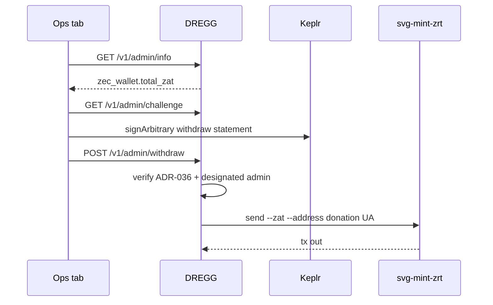

# Ops collect

Unlinked desk: [permissionless.money/ops](https://permissionless.money/ops).

1. Sign in with Keplr (ADR-036) to **read** `zec_wallet.total_zat`.
2. Confirm the house total matches what you expect.
3. Enter zatoshis. **Withdraw ZEC** asks Keplr to sign **once more**.

The signed bytes are:

```
permissionless.money withdraw <zat> zat to <donation-ua> <challenge>
```

That signature binds amount + donation UA + a one-time challenge. A login signature cannot spend. Token and zid can read info; they cannot move funds. There is no dest field — foreign `to` is 400.

Send is `svg-mint-zrt send --zat … --address <donation-ua>` against house ztreamer.


